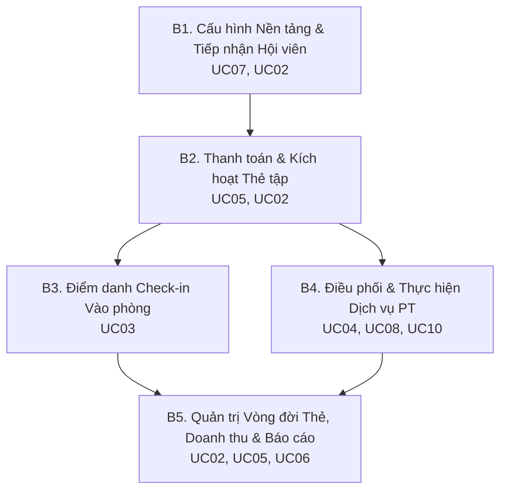

# TÀI LIỆU YÊU CẦU SẢN PHẨM (PRD) & PRODUCT BACKLOG
# HỆ THỐNG QUẢN LÝ PHÒNG TẬP THỂ THAO (GYM MANAGEMENT SYSTEM)

  

---

# PHẦN I: TỔNG QUAN HỆ THỐNG & LUỒNG NGHIỆP VỤ VẬN HÀNH

## 1. Giới thiệu & Bối cảnh Nghiệp vụ

Hệ thống Quản lý Phòng tập Thể thao vận hành dựa trên sự phối hợp chặt chẽ giữa ba nhóm tác nhân chính:
* **Hội viên (Member):** Khách hàng sử dụng dịch vụ tập luyện, tra cứu gói tập, chủ động đặt/đổi/hủy lịch hẹn với huấn luyện viên (PT), theo dõi tiến độ thể hình (InBody) và đánh giá chất lượng dịch vụ.
* **Huấn luyện viên cá nhân (Personal Trainer - PT):** Nhân sự chuyên môn trực tiếp giảng dạy; chủ động đăng ký khung giờ làm việc rảnh, theo dõi lịch dạy tuần, quản lý học viên phụ trách, cập nhật chỉ số thể chất và xác nhận hoàn tất ca tập.
* **Nhân viên vận hành & Quản trị viên (Admin / Lễ tân / Thu ngân):** Tiếp nhận khách hàng, phát hành thẻ tập, thu ngân và xuất hóa đơn, kiểm soát ra/vào phòng tập (Check-in), phân công PT, cấu hình danh mục gói tập và theo dõi báo cáo doanh thu tài chính.

Hệ thống được thiết kế theo **kiến trúc 3 lớp (3-Tier Architecture)**:
1. **Presentation Layer:** Ứng dụng Desktop (WinUI 3) dành cho Admin/Lễ tân/Thu ngân và Ứng dụng Web/Mobile (Blazor Server) dành cho Hội viên và PT.
2. **Business Logic Layer (Core):** Đảm nhiệm toàn bộ quy tắc nghiệp vụ, tính toán ngày hết hạn, kiểm tra xung đột lịch dạy, quy tắc hoàn hủy và quản lý trạng thái.
3. **Data Access Layer (Infrastructure):** Quản lý lưu trữ CSDL (SQL Server qua EF Core), giao dịch ACID (Unit of Work) và tích hợp cổng thanh toán VietQR, camera quét mã QR.

---

## 2. Ma trận Phân quyền Tác nhân (Actor Matrix - 10 Phân hệ)

| STT | Mã Phân Hệ | Tên Phân Hệ Nghiệp Vụ | Hội viên (Member) | Huấn luyện viên (PT) | Quản trị viên (Admin / Staff) |
| :---: | :---: | :--- | :---: | :---: | :---: |
| 1.0 | **UC01** | Đăng nhập và Xác thực | x | x | x |
| 2.0 | **UC02** | Quản lý hội viên và gói tập | | | x |
| 3.0 | **UC03** | Thực hiện check-in điểm danh | | | x |
| 4.0 | **UC04** | Quản lý PT & ca dạy | | | x |
| 5.0 | **UC05** | Quản lý thanh toán & hóa đơn | | | x |
| 6.0 | **UC06** | Quản lý báo cáo & thống kê | | | x |
| 7.0 | **UC07** | Quản lý tài khoản & Danh mục gói tập | | | x |
| 8.0 | **UC08** | Quản lý lịch dạy & Học viên | | x | |
| 9.0 | **UC09** | Quản lý thông tin cá nhân & Gói tập | x | | |
| 10.0 | **UC10** | Đặt lịch tập với PT & Đánh giá | x | | |

---

## 3. Quy trình Nghiệp vụ Vận hành Cốt lõi (B1 → B5)

1. **B1: Cấu hình Nền tảng & Tiếp nhận Hội viên (UC07, UC02):** Super Admin thiết lập danh mục gói tập và tài khoản nhân sự. Khi có khách hàng, Lễ tân tiếp nhận thông tin và tạo hồ sơ hội viên mới.
2. **B2: Thanh toán & Kích hoạt Gói dịch vụ (UC05, UC02):** Lập hóa đơn, thu tiền (Tiền mặt, VietQR, POS). Hệ thống chuyển hóa đơn sang `PAID`, kích hoạt thẻ tập `ACTIVE`, tạo mã QR định danh và gửi thông báo điện tử.
3. **B3: Tuyến Điểm danh Check-in Thường nhật (UC03):** Lễ tân quét mã QR hoặc nhập SĐT. Hệ thống kiểm tra điều kiện (trạng thái `ACTIVE`, còn hạn, còn buổi, đúng khung giờ), ghi nhận lượt check-in và trừ buổi tập theo lượt.
4. **B4: Điều phối & Giảng dạy Dịch vụ PT (UC04, UC08, UC10):** Admin gán cố định PT phụ trách cho hội viên. PT đăng ký lịch rảnh theo tuần. Hội viên chọn ca trống của PT để đặt lịch (hoặc đổi/hủy ca). Sau buổi tập, PT cập nhật chỉ số InBody và xác nhận hoàn tất; Hội viên gửi đánh giá chất lượng (1–5 sao).
5. **B5: Quản trị Vòng đời Thẻ, Tài chính & Báo cáo (UC02, UC05, UC06):** Xử lý ngoại lệ (gia hạn, nâng cấp, bảo lưu `FROZEN`, hủy đăng ký gói hoặc khóa thẻ); xử lý hoàn tiền hóa đơn theo quy định; trích xuất báo cáo doanh thu tài chính và hiệu suất hoạt động phòng tập.

---

# PHẦN II: PRODUCT BACKLOG & BẢNG ĐẶC TẢ CHI TIẾT USER STORIES (37 USE CASES)

---

## THEME 1: XÁC THỰC, PHÂN QUYỀN & CẤU HÌNH HỆ THỐNG

### Epic 01: Xác thực & Điều hướng Phân quyền (Tương ứng UC01)

#### ● User Story 01.1: Đăng nhập hệ thống theo vai trò người dùng (Tương ứng UC01)
* **Mô tả:** Là người dùng hệ thống (Admin, PT, Member), tôi cần đăng nhập bằng Tên đăng nhập/Email và Mật khẩu để hệ thống xác thực danh tính và tự động điều hướng tôi đến đúng không gian làm việc.
* **Độ ưu tiên:** `Must have` | **Story Point:** `5`
* **Tiêu chí chấp nhận (AC):**
  * Nhập Tên đăng nhập/Email và Mật khẩu, nhấn "Đăng nhập", thời gian phản hồi < 1 giây.
  * Nếu hợp lệ: Cấp JWT Token chứa claims vai trò (role), điều hướng Admin vào Dashboard quản trị, PT vào giao diện Lịch dạy, Member vào Cổng hội viên.
  * Nếu sai mật khẩu: Thông báo *"Tên đăng nhập hoặc mật khẩu không chính xác"*, giữ nguyên tên đăng nhập và xóa trống ô mật khẩu.
  * Nếu tài khoản bị khóa: Báo lỗi *"Tài khoản đã bị khóa"*, từ chối đăng nhập.
* **Danh sách task triển khai 3 lớp:**
  * *(Presentation):* Thiết kế màn hình đăng nhập chuẩn Responsive trên Desktop và Web, lưu trữ session token.
  * *(Business Logic):* Viết hàm `LoginAsync` trong `IAuthService`, xác thực mã băm BCrypt, sinh JWT Token.
  * *(Data Access):* Truy vấn bảng `USERS`, kiểm tra trạng thái `status == 'ACTIVE'`, ghi nhận vào `LOGIN_AUDIT_LOG`.

---

### Epic 02: Quản lý Tài khoản & Danh mục Gói tập (Tương ứng UC07)

#### ● User Story 07.1: Tạo mới tài khoản và phân quyền nhân sự (Tương ứng UC 7.1.1)
* **Mô tả:** Là Super Admin, tôi cần tạo mới tài khoản nhân viên và gán vai trò quyền hạn tương ứng để phân công công việc.
* **Độ ưu tiên:** `Must have` | **Story Point:** `5`
* **Tiêu chí chấp nhận (AC):**
  * Nhập thông tin: Họ tên, Email, SĐT, Tên đăng nhập, Mật khẩu ban đầu và chọn vai trò (Admin, Lễ tân, Thu ngân, PT).
  * Kiểm tra trùng lặp: Nếu Email hoặc Tên đăng nhập đã tồn tại, báo lỗi chi tiết bên dưới trường dữ liệu vi phạm.
  * Lưu thành công: Cấp tài khoản mới trạng thái `ACTIVE` vào CSDL.
* **Danh sách task triển khai 3 lớp:**
  * *(Presentation):* Màn hình danh sách nhân sự kèm Form Modal tạo tài khoản.
  * *(Business Logic):* Validate định dạng dữ liệu, băm mật khẩu, gán Role claims trong `ISystemSettingService`.
  * *(Data Access):* Insert bảng `USERS` và bảng liên kết `USER_ROLES`.

#### ● User Story 07.2: Cập nhật thông tin tài khoản và điều chỉnh phân quyền (Tương ứng UC 7.1.2)
* **Mô tả:** Là Super Admin, tôi cần cập nhật thông tin và điều chỉnh lại vai trò/quyền hạn truy cập của nhân viên.
* **Độ ưu tiên:** `Must have` | **Story Point:** `3`
* **Tiêu chí chấp nhận (AC):**
  * Cho phép chỉnh sửa thông tin cá nhân và thay đổi vai trò nhân sự.
  * Ràng buộc an toàn: Ngăn chặn Super Admin tự tước quyền Quản trị của chính tài khoản đang đăng nhập; hiển thị cảnh báo *"Không thể tự thay đổi quyền của tài khoản hiện tại"*.
* **Danh sách task triển khai 3 lớp:**
  * *(Presentation):* Giao diện chỉnh sửa quyền tài khoản có kiểm tra tài khoản phiên hiện tại.
  * *(Business Logic):* Kiểm tra logic ID đang đăng nhập khác ID cần sửa quyền quản trị.
  * *(Data Access):* Update bảng `USERS` và `USER_ROLES`.

#### ● User Story 07.3: Khóa hoặc Mở khóa tài khoản nhân viên (Tương ứng UC 7.1.3)
* **Mô tả:** Là Super Admin, tôi cần khóa quyền truy cập của tài khoản vi phạm hoặc mở khóa khi nhân sự làm việc lại.
* **Độ ưu tiên:** `Must have` | **Story Point:** `3`
* **Tiêu chí chấp nhận (AC):**
  * Cho phép bấm "Khóa" hoặc "Mở khóa" kèm hộp thoại xác nhận.
  * Ràng buộc an toàn: Ngăn chặn Quản trị viên tự khóa tài khoản của chính mình; thông báo *"Không thể tự khóa tài khoản đang đăng nhập"*.
  * Tài khoản bị khóa lập tức bị từ chối khi thực hiện các yêu cầu API tiếp theo.
* **Danh sách task triển khai 3 lớp:**
  * *(Presentation):* Switch toggle hoặc nút hành động Khóa/Mở khóa có cảnh báo xác nhận.
  * *(Business Logic):* Xử lý chuyển đổi cờ `Status` (`ACTIVE` / `LOCKED`) và vô hiệu hóa JWT Token tương ứng.
  * *(Data Access):* Cập nhật cột `status` trong bảng `USERS`, ghi vết vào `AUDIT_LOGS`.

#### ● User Story 07.4: Thêm mới gói tập vào danh mục kinh doanh (Tương ứng UC 7.2.1)
* **Mô tả:** Là Super Admin, tôi cần tạo mới gói tập vào hệ thống để bắt đầu mở bán cho khách hàng.
* **Độ ưu tiên:** `Must have` | **Story Point:** `5`
* **Tiêu chí chấp nhận (AC):**
  * Nhập: Tên gói, Đơn giá (>0), Thời hạn (ngày/tháng), Số buổi tập, Số ngày bảo lưu tối đa, Khung giờ tập và Mô tả quyền lợi.
  * Kiểm tra trùng lặp: Tên gói tập không được trùng với gói đang kinh doanh.
* **Danh sách task triển khai 3 lớp:**
  * *(Presentation):* Biểu mẫu tạo gói tập có kiểm tra trường số dương và bắt buộc.
  * *(Business Logic):* Hàm `SavePackageAsync` trong `ISystemSettingService`, kiểm tra nghiệp vụ và định dạng.
  * *(Data Access):* Insert bảng `PACKAGES` với `is_active = true`.

#### ● User Story 07.5: Chỉnh sửa thông tin gói tập (Tương ứng UC 7.2.2)
* **Mô tả:** Là Super Admin, tôi cần chỉnh sửa thông số giá bán, thời hạn hoặc quyền lợi của gói tập hiện có.
* **Độ ưu tiên:** `Must have` | **Story Point:** `3`
* **Tiêu chí chấp nhận (AC):**
  * Cho phép cập nhật tên gói, đơn giá, thời hạn, quyền lợi.
  * Các thẻ tập đã bán trước đó vẫn giữ nguyên quyền lợi và thời hạn đã cam kết; thông tin mới áp dụng cho các lượt đăng ký/gia hạn về sau.
* **Danh sách task triển khai 3 lớp:**
  * *(Presentation):* Form cập nhật gói tập hiển thị thông tin hiện tại.
  * *(Business Logic):* Xử lý cập nhật thông số và đồng bộ danh mục.
  * *(Data Access):* Update bản ghi trong bảng `PACKAGES`.

#### ● User Story 07.6: Xóa hoặc Chuyển trạng thái ngừng kinh doanh gói tập (Tương ứng UC 7.2.3)
* **Mô tả:** Là Super Admin, tôi cần xóa gói tập khỏi hệ thống hoặc ngừng kinh doanh khi không còn áp dụng.
* **Độ ưu tiên:** `Must have` | **Story Point:** `3`
* **Tiêu chí chấp nhận (AC):**
  * Nếu gói tập chưa từng có hội viên đăng ký: Cho phép xóa hoàn toàn khỏi CSDL.
  * Nếu gói tập đã có hội viên đăng ký hoặc phát sinh hóa đơn: Từ chối xóa vật lý, hiển thị thông báo lỗi và gợi ý chuyển trạng thái sang `DISCONTINUED` (Ngừng kinh doanh) để bảo toàn quyền lợi của hội viên hiện tại.
* **Danh sách task triển khai 3 lớp:**
  * *(Presentation):* Nút hành động Xóa kèm popup thông báo lỗi ràng buộc dữ liệu.
  * *(Business Logic):* Kiểm tra khóa ngoại bảng `MEMBERSHIP_CARDS` và `INVOICE_DETAILS` trước khi thực thi lệnh xóa.
  * *(Data Access):* Delete hoặc Update `is_active = false` trong bảng `PACKAGES`.

---

## THEME 2: QUẢN TRỊ HỘI VIÊN, VÒNG ĐỜI THẺ & TÀI CHÍNH

### Epic 03: Quản lý Hội viên & Vòng đời Thẻ tập (Tương ứng UC02)

#### ● User Story 02.1: Đăng ký hội viên mới cùng gói tập (Tương ứng UC 02.1)
* **Mô tả:** Là Lễ tân / Admin, tôi cần nhập thông tin khách hàng, chọn gói tập, thu tiền và hoàn tất kích hoạt thẻ tập để khách hàng trở thành hội viên chính thức.
* **Độ ưu tiên:** `Must have` | **Story Point:** `8`
* **Tiêu chí chấp nhận (AC):**
  * Nhập: Họ tên, Số điện thoại, Email, CCCD, Ngày sinh, Ngày bắt đầu hiệu lực và Gói tập.
  * Kiểm tra trùng lặp: Nếu SĐT hoặc CCCD đã tồn tại trong hệ thống, báo lỗi *"Hội viên đã tồn tại trong hệ thống"*.
  * Tự động tính tiền, ghi nhận phương thức thanh toán (Tiền mặt / Chuyển khoản QR / Thẻ POS).
  * Kích hoạt thẻ trạng thái `ACTIVE`, tự động tính ngày hết hạn, sinh chuỗi mã định danh kèm mã QR duy nhất và kích hoạt gửi SMS/Email xác nhận.
* **Danh sách task triển khai 3 lớp:**
  * *(Presentation):* Wizard biểu mẫu đăng ký 2 bước (Thông tin cá nhân $\rightarrow$ Gói tập & Thu tiền).
  * *(Business Logic):* Transaction kích hoạt: Tạo Member $\rightarrow$ Tạo Thẻ tập $\rightarrow$ Tạo Hóa đơn $\rightarrow$ Tạo QR string.
  * *(Data Access):* Lưu vào bảng `MEMBERS`, `MEMBERSHIP_CARDS`, `INVOICES` trong cùng một Database Transaction.

#### ● User Story 02.2: Cập nhật thông tin cá nhân hội viên (Tương ứng UC 02.2)
* **Mô tả:** Là Admin, tôi cần tìm kiếm hội viên theo từ khóa (SĐT, Họ tên, Mã thẻ) và cập nhật thông tin liên hệ khi có thay đổi.
* **Độ ưu tiên:** `Must have` | **Story Point:** `3`
* **Tiêu chí chấp nhận (AC):**
  * Tìm kiếm tức thì trong < 1 giây theo SĐT, Họ tên hoặc Mã hội viên.
  * Cho phép chỉnh sửa: SĐT, Email, Địa chỉ, Ảnh đại diện; kiểm tra tính hợp lệ định dạng.
  * Lưu thành công và làm mới danh sách hiển thị.
* **Danh sách task triển khai 3 lớp:**
  * *(Presentation):* Thanh tìm kiếm nhanh và Form Popup cập nhật thông tin hội viên.
  * *(Business Logic):* Validate thông tin cập nhật, gọi `UpdateMemberProfileAsync`.
  * *(Data Access):* Update bảng `MEMBERS`, ghi vết thay đổi vào `AUDIT_LOGS`.

#### ● User Story 02.3: Gia hạn hoặc Nâng cấp gói tập cho hội viên (Tương ứng UC 02.3)
* **Mô tả:** Là Admin / Lễ tân, tôi cần gia hạn thêm thời gian hoặc đổi gói tập lên hạng cao hơn cho hội viên.
* **Độ ưu tiên:** `Must have` | **Story Point:** `5`
* **Tiêu chí chấp nhận (AC):**
  * Cho phép chọn số tháng gia hạn thêm hoặc chọn gói tập mới có cấp bậc cao hơn.
  * Hệ thống tự động tính chi phí gia hạn hoặc phí chênh lệch nâng cấp.
  * Sau khi xác nhận thanh toán: Kéo dài ngày hết hạn tương ứng (nếu thẻ cũ còn hạn) hoặc kích hoạt lại nếu thẻ đã hết hạn; lưu vết lịch sử giao dịch.
* **Danh sách task triển khai 3 lớp:**
  * *(Presentation):* Popup "Gia hạn / Nâng cấp" hiển thị thẻ hiện tại và bảng tính tiền chênh lệch tự động.
  * *(Business Logic):* Tính toán ngày hết hạn mới dựa trên trạng thái thẻ hiện tại, tạo hóa đơn thu tiền.
  * *(Data Access):* Cập nhật `MEMBERSHIP_CARDS` và thêm bản ghi vào `MEMBERSHIP_HISTORY`.

#### ● User Story 02.4: Bảo lưu gói tập cho hội viên (Tương ứng UC 02.4)
* **Mô tả:** Là Admin / Lễ tân, tôi cần tạm dừng hiệu lực gói tập của hội viên trong một khoảng thời gian nhất định theo quy chế.
* **Độ ưu tiên:** `Should have` | **Story Point:** `5`
* **Tiêu chí chấp nhận (AC):**
  * Nhập Ngày bắt đầu, Ngày kết thúc bảo lưu và Lý do bắt buộc.
  * Kiểm tra điều kiện: Nếu gói tập không hỗ trợ bảo lưu hoặc đã vượt quá số ngày/số lần cho phép, từ chối thực hiện và thông báo lỗi.
  * Nếu hợp lệ: Chuyển trạng thái thẻ sang `FROZEN`, tự động dời ngày hết hạn của thẻ bù đúng số ngày bảo lưu và gửi thông báo cho hội viên.
* **Danh sách task triển khai 3 lớp:**
  * *(Presentation):* Form đăng ký bảo lưu thẻ kèm bộ chọn khoảng ngày (Date Range Picker).
  * *(Business Logic):* Hàm `FreezeCardAsync` kiểm tra chính sách gói và tính toán dời ngày hết hạn `end_date`.
  * *(Data Access):* Cập nhật trạng thái trong `MEMBERSHIP_CARDS` và lưu vào `CARD_FREEZE_LOGS`.

#### ● User Story 02.5: Hủy đăng ký gói tập của hội viên (Tương ứng UC 02.5)
* **Mô tả:** Là Admin, tôi cần chấm dứt hiệu lực gói tập của hội viên khi có vi phạm hoặc theo yêu cầu đặc biệt.
* **Độ ưu tiên:** `Should have` | **Story Point:** `3`
* **Tiêu chí chấp nhận (AC):**
  * Admin chọn hủy gói, hiển thị cảnh báo ảnh hưởng và bắt buộc nhập lý do hủy.
  * Xác nhận hủy: Chuyển trạng thái gói tập thành `CANCELLED` (Đã hủy).
  * Quy tắc an toàn: Không xóa gói khỏi danh mục, không khóa tài khoản đăng nhập của hội viên, không tự động hoàn tiền và lưu lại toàn bộ lịch sử sử dụng.
* **Danh sách task triển khai 3 lớp:**
  * *(Presentation):* Modal cảnh báo hủy gói màu cam/đỏ kèm ô nhập lý do bắt buộc.
  * *(Business Logic):* Hàm `LockOrCancelCardAsync` chuyển trạng thái thẻ, vô hiệu hóa quyền check-in.
  * *(Data Access):* Cập nhật trạng thái thẻ trong `MEMBERSHIP_CARDS` và ghi nhật ký vào `AUDIT_LOGS`.

---

### Epic 04: Quản lý Thanh toán & Hóa đơn Dòng tiền (Tương ứng UC05)

#### ● User Story 05.1: Lập hóa đơn và thu tiền đa phương thức (Tương ứng UC 5.1)
* **Mô tả:** Là Thu ngân / Lễ tân, tôi cần lập hóa đơn thu tiền cho các dịch vụ (gói tập, thuê PT, nước uống/phụ kiện) và thu tiền qua Tiền mặt/VietQR/Thẻ.
* **Độ ưu tiên:** `Must have` | **Story Point:** `8`
* **Tiêu chí chấp nhận (AC):**
  * Chọn hội viên, thêm các mục thanh toán, tự động áp dụng giảm giá/ưu đãi và tính tổng thanh toán.
  * Hỗ trợ 3 phương thức thanh toán: Tiền mặt, Chuyển khoản VietQR (hiển thị mã QR động có sẵn số tiền và nội dung chuyển khoản chuẩn NAPAS), và Quẹt thẻ POS.
  * Sau khi xác nhận: Lưu hóa đơn trạng thái `PAID`, kích hoạt dịch vụ tương ứng và tự động phát hành hóa đơn điện tử gửi qua Email cho hội viên.
* **Danh sách task triển khai 3 lớp:**
  * *(Presentation):* Giao diện quầy thu ngân POS: chọn dịch vụ, tính tiền thối, hiển thị QR thanh toán động.
  * *(Business Logic):* Tích hợp thư viện sinh chuỗi VietQR chuẩn, xử lý kích hoạt dịch vụ sau thanh toán.
  * *(Data Access):* Lưu bản ghi vào bảng `INVOICES` và `INVOICE_DETAILS`.

#### ● User Story 05.2: Tra cứu, in lại và xuất hóa đơn điện tử (Tương ứng UC 5.2)
* **Mô tả:** Là Thu ngân / Admin, tôi cần tìm kiếm lịch sử hóa đơn để in phiếu thu nhiệt hoặc xuất file PDF khi khách hàng yêu cầu đối soát.
* **Độ ưu tiên:** `Should have` | **Story Point:** `3`
* **Tiêu chí chấp nhận (AC):**
  * Tra cứu theo Mã hóa đơn, SĐT hội viên hoặc khoảng ngày lập hóa đơn trong < 1 giây.
  * Cung cấp nút "In hóa đơn" (lệnh in nhiệt chuẩn khổ K80) và "Xuất file PDF" với thời gian tải về < 2 giây.
* **Danh sách task triển khai 3 lớp:**
  * *(Presentation):* Bảng tra cứu lịch sử hóa đơn kèm tính năng xem trước bản in (Print Preview).
  * *(Business Logic):* Dịch vụ biên tập mẫu hóa đơn và render ra file PDF.
  * *(Data Access):* Tối ưu hóa truy vấn có Index trên cột `invoice_code` và `created_at`.

#### ● User Story 05.3: Hủy hóa đơn và xử lý hoàn tiền (Tương ứng UC 5.3)
* **Mô tả:** Là Admin, tôi cần xử lý yêu cầu hủy hóa đơn hoặc hoàn tiền cho khách hàng theo đúng chính sách hoàn hủy của phòng gym.
* **Độ ưu tiên:** `Should have` | **Story Point:** `5`
* **Tiêu chí chấp nhận (AC):**
  * Chọn hóa đơn cần hoàn tiền, nhập số tiền hoàn ($\le$ số tiền gốc), hình thức hoàn (Tiền mặt/Chuyển khoản) và lý do hoàn tiền.
  * Kiểm tra điều kiện: Nếu hóa đơn đã quá hạn hoàn hủy theo quy chế, từ chối và hiển thị thông báo lỗi chi tiết.
  * Nếu hợp lệ: Chuyển trạng thái hóa đơn sang `REFUNDED`, thu hồi gói dịch vụ tương ứng và ghi nhận dòng tiền âm vào sổ quỹ doanh thu.
* **Danh sách task triển khai 3 lớp:**
  * *(Presentation):* Form xử lý hoàn tiền có bước đối soát số tiền và lý do.
  * *(Business Logic):* Transaction hoàn tiền: Đổi trạng thái Hóa đơn $\rightarrow$ Thu hồi thẻ/dịch vụ $\rightarrow$ Ghi giảm trừ doanh thu.
  * *(Data Access):* Cập nhật `INVOICES` và lưu bản ghi vào `REFUND_LOGS`.

#### ● User Story 05.4: Xem và xuất báo cáo doanh thu tài chính (Tương ứng UC 5.4)
* **Mô tả:** Là Admin, tôi cần xem biểu đồ thống kê doanh thu theo mốc thời gian và xuất báo cáo ra file Excel/PDF để đối soát kế toán.
* **Độ ưu tiên:** `Must have` | **Story Point:** `5`
* **Tiêu chí chấp nhận (AC):**
  * Bộ lọc thời gian: Hôm nay, Tuần này, Tháng này, hoặc Tùy chỉnh (Từ ngày - Đến ngày).
  * Hiển thị trực quan: Tổng doanh thu, doanh thu theo gói tập, doanh thu theo dịch vụ PT, số tiền đã hoàn hủy.
  * Cung cấp nút xuất báo cáo ra file Excel (.xlsx) và PDF định dạng chuẩn có logo và dấu thời gian.
* **Danh sách task triển khai 3 lớp:**
  * *(Presentation):* Tab báo cáo doanh thu trên module thanh toán kèm biểu đồ trực quan.
  * *(Business Logic):* Tính toán tổng hợp số liệu doanh thu thực thu (Thu - Hoàn), xuất tệp Excel/PDF.
  * *(Data Access):* Truy vấn tổng hợp dữ liệu từ `INVOICES` và `REFUND_LOGS`.

---

## THEME 3: ĐIỂM DANH, KIỂM SOÁT VÀO PHÒNG & BÁO CÁO QUẢN TRỊ

### Epic 05: Quản lý Check-in & Kiểm soát Vào phòng (Tương ứng UC03)

#### ● User Story 03.1: Điểm danh tự động bằng quét mã QR (Tương ứng UC 3.1)
* **Mô tả:** Là Lễ tân, tôi cần quét mã QR trên điện thoại của hội viên để hệ thống tự động kiểm tra điều kiện và mở quyền vào phòng tập tức thì.
* **Độ ưu tiên:** `Must have` | **Story Point:** `5`
* **Tiêu chí chấp nhận (AC):**
  * Quét mã QR, hệ thống nhận dạng mã và phản hồi kết quả trong < 2 giây.
  * Kiểm tra điều kiện: Thẻ phải ở trạng thái `ACTIVE`, còn hạn sử dụng, còn số buổi và đúng khung giờ quy định (không bị `FROZEN` hoặc `LOCKED`, không quét trùng liên tiếp trong vòng 5 phút).
  * Hợp lệ: Ghi nhận 1 lượt check-in thành công, trừ 1 buổi tập (nếu gói tính theo lượt), hiển thị ảnh chân dung và phát âm thanh báo thành công.
  * Không hợp lệ: Phát âm thanh cảnh báo từ chối và hiển thị rõ lý do (*"Gói tập đã hết hạn"*, *"Thẻ đang bảo lưu"*, *"Không đúng khung giờ tập"*).
* **Danh sách task triển khai 3 lớp:**
  * *(Presentation):* Màn hình "Quản lý Check-in" tích hợp thư viện đọc Camera Scanner, tự động kích hoạt chế độ chờ quét.
  * *(Business Logic):* Hàm `CheckInWithQrAsync` xử lý kiểm tra đa điều kiện và trừ buổi trong 1 Transaction duy nhất.
  * *(Data Access):* Lưu bản ghi vào `CHECKIN_LOGS` và cập nhật `remaining_sessions` trong `MEMBERSHIP_CARDS`.

#### ● User Story 03.2: Điểm danh thủ công qua Số điện thoại / Mã hội viên (Tương ứng UC 3.2)
* **Mô tả:** Là Lễ tân, tôi cần nhập SĐT hoặc Mã hội viên thủ công khi khách quên điện thoại hoặc máy hết pin để hỗ trợ vào phòng tập.
* **Độ ưu tiên:** `Must have` | **Story Point:** `3`
* **Tiêu chí chấp nhận (AC):**
  * Nhập SĐT hoặc Mã hội viên vào ô tìm kiếm nhanh tại màn hình Check-in và bấm Enter.
  * Hiển thị thông tin gói thẻ, hạn dùng và ảnh chân dung nhận diện của hội viên.
  * Lễ tân đối chiếu khuôn mặt và nhấn nút "Xác nhận vào phòng"; hệ thống ghi nhận check-in tương tự như quét QR.
* **Danh sách task triển khai 3 lớp:**
  * *(Presentation):* Khung nhập SĐT nhanh và Card hiển thị tóm tắt thông tin hội viên kèm ảnh chân dung.
  * *(Business Logic):* Hàm `ManualCheckInAsync` trong `ICheckInService`.
  * *(Data Access):* Truy vấn tìm kiếm theo `phone` trên bảng `MEMBERS` (được đánh Unique Index).

#### ● User Story 03.3: Tra cứu và giám sát lịch sử ra/vào phòng tập (Tương ứng UC 3.3)
* **Mô tả:** Là Lễ tân / Quản lý ca, tôi cần xem danh sách các lượt điểm danh trong ngày theo ca để nắm bắt lưu lượng phòng tập.
* **Độ ưu tiên:** `Should have` | **Story Point:** `3`
* **Tiêu chí chấp nhận (AC):**
  * Hiển thị danh sách các lượt check-in trong ngày theo thời gian thực (lượt mới nhất xếp trên cùng).
  * Hỗ trợ bộ lọc theo: Ca làm việc (Sáng/Chiều/Tối), Tên hội viên, và Trạng thái (Thành công / Từ chối).
  * Hiển thị số lượng hội viên hiện đang có mặt trong cơ sở tại thời điểm hiện tại.
* **Danh sách task triển khai 3 lớp:**
  * *(Presentation):* Bảng dữ liệu lịch sử check-in thời gian thực kèm huy hiệu màu phân biệt trạng thái.
  * *(Business Logic):* Hàm `GetTodayCheckInLogsAsync` hỗ trợ lọc theo ca trực và từ khóa.
  * *(Data Access):* Truy vấn bảng `CHECKIN_LOGS` theo mốc ngày hiện tại.

---

### Epic 06: Quản lý Báo cáo & Thống kê Quản trị (Tương ứng UC06)

#### ● User Story 06.1: Xem báo cáo thống kê đa chiều thời gian thực (Tương ứng UC06)
* **Mô tả:** Là Admin / Chủ phòng gym, tôi cần xem các biểu đồ trực quan về Doanh thu, Hội viên, Lưu lượng check-in và Hiệu suất PT để nắm bắt hoạt động kinh doanh.
* **Độ ưu tiên:** `Must have` | **Story Point:** `8`
* **Tiêu chí chấp nhận (AC):**
  * Hỗ trợ 4 loại báo cáo: Doanh thu tài chính, Biến động hội viên mới/tái gia hạn, Lưu lượng check-in theo giờ trong ngày, và Hiệu suất giảng dạy của đội ngũ PT.
  * Bộ lọc linh hoạt: Hôm nay, Tuần này, Tháng này, hoặc Tùy chọn mốc ngày.
  * Hiển thị trực quan dạng biểu đồ cột, đường và bảng dữ liệu tổng hợp chi tiết bên dưới.
* **Danh sách task triển khai 3 lớp:**
  * *(Presentation):* Dashboard báo cáo tích hợp thư viện vẽ biểu đồ, tự động chuyển đổi định dạng xem.
  * *(Business Logic):* Các hàm tổng hợp trong `IReportService` (`GetRevenueByTimeRangeAsync`, `GetCheckInTrafficByHourAsync`, `GetMemberGrowthAsync`).
  * *(Data Access):* Tối ưu hóa Database Views hoặc Stored Procedures tổng hợp dữ liệu.

#### ● User Story 06.2: Xuất dữ liệu báo cáo thống kê sang Excel / PDF (Tương ứng UC06)
* **Mô tả:** Là Admin, tôi cần trích xuất dữ liệu báo cáo đang xem ra file Excel hoặc PDF để lưu trữ và nộp báo cáo định kỳ.
* **Độ ưu tiên:** `Should have` | **Story Point:** `3`
* **Tiêu chí chấp nhận (AC):**
  * Cung cấp nút xuất báo cáo với 2 tùy chọn định dạng: Excel (.xlsx) hoặc PDF.
  * File xuất ra đúng theo dữ liệu đang hiển thị theo bộ lọc, có tiêu đề báo cáo, logo cơ sở và mốc thời gian xuất, thời gian tải về < 3 giây.
* **Danh sách task triển khai 3 lớp:**
  * *(Presentation):* Nút hành động Export kèm hiệu ứng tải (Loading spinner).
  * *(Business Logic):* Service đóng gói dữ liệu sang file bảng tính OpenXML / PDF.
  * *(Data Access):* Streaming file trực tiếp vào luồng bộ nhớ đệm (MemoryStream) tránh nghẽn RAM.

---

## THEME 4: QUẢN LÝ DỊCH VỤ HUẤN LUYỆN VIÊN CÁ NHÂN (PT)

### Epic 07: Quản lý PT & Điều phối Ca dạy phía Admin (Tương ứng UC04)

#### ● User Story 04.1: Thêm mới hồ sơ huấn luyện viên cá nhân (Tương ứng UC 4.1)
* **Mô tả:** Là Admin, tôi cần tạo mới hồ sơ PT kèm thông tin chuyên môn và mức lương để bổ sung nhân sự vào hệ thống.
* **Độ ưu tiên:** `Must have` | **Story Point:** `5`
* **Tiêu chí chấp nhận (AC):**
  * Nhập: Họ tên, Ngày sinh, Giới tính, SĐT (duy nhất), Email, Chuyên môn (Gym, Yoga, Boxing...), Năm kinh nghiệm, Mức lương cơ bản và Ảnh đại diện.
  * Kiểm tra trùng lặp: SĐT hoặc Email không được trùng với nhân sự khác.
  * Lưu thành công: Hồ sơ PT được tạo trạng thái `ACTIVE`, sẵn sàng để xếp ca và phân công.
* **Danh sách task triển khai 3 lớp:**
  * *(Presentation):* Form nhập hồ sơ chuyên môn PT có upload ảnh đại diện.
  * *(Business Logic):* Hàm `SaveTrainerAsync` trong `IPtService`.
  * *(Data Access):* Insert bảng `PT_PROFILES` và liên kết với tài khoản `USERS`.

#### ● User Story 04.2: Tra cứu lịch làm việc và tình trạng ca dạy của PT (Tương ứng UC 4.2)
* **Mô tả:** Là Admin, tôi cần tra cứu lịch làm việc của từng PT theo các tiêu chí để nắm bắt lịch trình và hỗ trợ điều phối.
* **Độ ưu tiên:** `Should have` | **Story Point:** `3`
* **Tiêu chí chấp nhận (AC):**
  * Bộ lọc: Tên PT, Khoảng thời gian (Ngày/Tuần/Tháng), Ca dạy, Trạng thái (Trống / Đã đặt / Đã hoàn thành).
  * Hiển thị danh sách lịch dạy chi tiết gồm: Tên PT, Ngày, Ca dạy, Trạng thái và Tên hội viên đặt lịch (nếu có).
* **Danh sách task triển khai 3 lớp:**
  * *(Presentation):* Màn hình tra cứu lịch PT với bộ lọc thời gian và màu sắc phân biệt trạng thái ca.
  * *(Business Logic):* Hàm `GetPtScheduleAsync` trả về danh sách `PtSessionDto`.
  * *(Data Access):* View kết nối giữa `PT_PROFILES`, `PT_AVAILABILITY` và `SESSION_BOOKINGS`.

#### ● User Story 04.3: Cập nhật thông tin chuyên môn và trạng thái PT (Tương ứng UC 4.3)
* **Mô tả:** Là Admin, tôi cần chỉnh sửa thông tin chuyên môn hoặc chuyển trạng thái hoạt động của PT.
* **Độ ưu tiên:** `Must have` | **Story Point:** `3`
* **Tiêu chí chấp nhận (AC):**
  * Cho phép chỉnh sửa chuyên môn, mức lương, kinh nghiệm hoặc đổi trạng thái (Hoạt động / Ngừng hoạt động).
  * Ràng buộc khi ngừng hoạt động: Nếu PT đang có lịch dạy chưa hoàn thành hoặc đang phụ trách hội viên, hệ thống cảnh báo và yêu cầu chuyển giao học viên trước khi chuyển trạng thái sang `INACTIVE`.
* **Danh sách task triển khai 3 lớp:**
  * *(Presentation):* Form chỉnh sửa hồ sơ PT kèm cảnh báo ràng buộc ca dạy tồn đọng.
  * *(Business Logic):* Hàm `CheckDeactivationEligibilityAsync` kiểm tra điều kiện học viên và ca dạy còn hiệu lực.
  * *(Data Access):* Update bảng `PT_PROFILES`.

#### ● User Story 04.4: Phân công PT phụ trách cố định cho Hội viên (Tương ứng UC 4.4)
* **Mô tả:** Là Admin, tôi cần gán cố định một huấn luyện viên phụ trách cho hội viên vừa mua gói tập PT để hội viên có thể xem lịch và đặt ca tập.
* **Độ ưu tiên:** `Must have` | **Story Point:** `5`
* **Tiêu chí chấp nhận (AC):**
  * Hệ thống lọc danh sách hội viên có gói PT đang hoạt động nhưng chưa có PT phụ trách.
  * Admin chọn hội viên và chọn PT phụ trách; hệ thống kiểm tra định mức học viên tối đa của PT đó.
  * Lưu thành công: Gán cố định PT vào hồ sơ gói tập của hội viên; gửi thông báo cho cả hai bên. Sau khi phân công, hội viên chỉ có thể xem và đặt lịch theo các ca rảnh của chính PT này.
* **Danh sách task triển khai 3 lớp:**
  * *(Presentation):* Giao diện phân công PT nhanh dạng danh sách đối chiếu.
  * *(Business Logic):* Kiểm tra định mức học viên và gán quan hệ PT - Học viên trong `IPtService`.
  * *(Data Access):* Lưu vào bảng `PT_ASSIGNMENTS` và cập nhật trường `assigned_pt_id` trong thẻ tập.

#### ● User Story 04.5: Rà soát và xác nhận kết quả ca tập phía Admin (Tương ứng UC 4.5)
* **Mô tả:** Là Admin, tôi cần rà soát, xác nhận thay hoặc điều chỉnh kết quả ca tập (Hoàn thành / Hội viên vắng / PT vắng / Hoãn) đối với các ca tập phát sinh ngoại lệ hoặc PT chưa bấm xác nhận.
* **Độ ưu tiên:** `Must have` | **Story Point:** `3`
* **Tiêu chí chấp nhận (AC):**
  * Hiển thị danh sách các buổi tập đã đến hoặc quá giờ diễn ra.
  * Cho phép chọn kết quả: Hoàn thành, Hội viên vắng, PT vắng, hoặc Hoãn (kèm lý do).
  * Nếu chọn "Hoàn thành": Chuyển trạng thái sang `COMPLETED`, tự động trừ 1 buổi tập PT của học viên.
  * Nếu chọn "Hoãn" hoặc "PT vắng": Cập nhật trạng thái và giữ nguyên (hoặc hoàn trả lại) số buổi tập cho học viên.
* **Danh sách task triển khai 3 lớp:**
  * *(Presentation):* Giao diện rà soát ca tập ngoại lệ trong ngày kèm các nút hành động xử lý nhanh.
  * *(Business Logic):* Hàm `CompleteSessionAsync` hoặc điều chỉnh trạng thái ca trong Transaction.
  * *(Data Access):* Cập nhật `SESSION_BOOKINGS` và điều chỉnh `remaining_sessions` trong `MEMBERSHIP_CARDS`.

#### ● User Story 04.6: Xếp lịch làm việc theo ca tuần/tháng cho PT (Tương ứng UC 4.6)
* **Mô tả:** Là Admin, tôi cần thiết lập hoặc điều chỉnh lịch làm việc (các ca dạy khả dụng) cho PT theo tuần/tháng để mở khung giờ cho học viên đặt lịch.
* **Độ ưu tiên:** `Must have` | **Story Point:** `8`
* **Tiêu chí chấp nhận (AC):**
  * Chọn PT, chọn ngày và các ca dạy trong tuần.
  * Kiểm tra hợp lệ: Không trùng ca làm việc của chính PT đó, không vượt định mức ca trong ngày.
  * Ràng buộc an toàn: Không được xóa hoặc đổi ca dạy nếu ca đó đã có học viên đặt lịch thành công; cảnh báo *"Ca dạy đã có học viên đặt lịch, không thể xóa"*.
* **Danh sách task triển khai 3 lớp:**
  * *(Presentation):* Giao diện Lịch trực quan (Calendar View) theo tuần/tháng, phân biệt trạng thái bằng màu sắc.
  * *(Business Logic):* Thuật toán kiểm tra chống xung đột lịch dạy (Overlapping Check) khi lưu lịch.
  * *(Data Access):* Insert/Update bảng `PT_AVAILABILITY`.

---

### Epic 08: Cổng Tác nghiệp dành cho Huấn luyện viên (Tương ứng UC08)

#### ● User Story 08.1: PT đăng ký và quản lý khung giờ làm việc rảnh (Tương ứng UC 8.1.1)
* **Mô tả:** Là Huấn luyện viên (PT), tôi cần chủ động đăng ký các khung giờ làm việc rảnh trong tuần để học viên phụ trách có thể nhìn thấy và đặt lịch.
* **Độ ưu tiên:** `Must have` | **Story Point:** `5`
* **Tiêu chí chấp nhận (AC):**
  * PT xem lưới thời gian các ngày trong tuần và tích chọn các slot giờ làm việc rảnh cho tuần tới.
  * Ràng buộc: PT không thể hủy bỏ khung giờ rảnh nếu khung giờ đó đã có học viên đặt lịch; thông báo *"Khung giờ đã có học viên đặt lịch, không thể hủy"*.
* **Danh sách task triển khai 3 lớp:**
  * *(Presentation):* Lưới chọn slot giờ rảnh trên ứng dụng Web/Mobile hỗ trợ chọn nhanh nhiều slot.
  * *(Business Logic):* Hàm `SavePtSlotsAsync` trong `IPtService` kiểm tra ràng buộc ca đã đặt.
  * *(Data Access):* Lưu vào bảng `PT_AVAILABILITY` với trạng thái `AVAILABLE`.

#### ● User Story 08.2: PT xem thời khóa biểu lịch dạy theo tuần (Tương ứng UC 8.1.2)
* **Mô tả:** Là Huấn luyện viên (PT), tôi cần xem chi tiết thời khóa biểu các ca dạy trong tuần của mình trên điện thoại để chủ động sắp xếp thời gian làm việc.
* **Độ ưu tiên:** `Must have` | **Story Point:** `3`
* **Tiêu chí chấp nhận (AC):**
  * Hiển thị lưới lịch dạy theo tuần hiện tại hoặc chọn tuần bất kỳ.
  * Thể hiện rõ thông tin từng ca: Khung giờ, Tên học viên, Trạng thái ca (Sắp tới, Đã hoàn thành, Đã hủy) và ghi chú bài tập.
* **Danh sách task triển khai 3 lớp:**
  * *(Presentation):* Giao diện thời khóa biểu cá nhân của PT chuẩn Responsive.
  * *(Business Logic):* Hàm `GetPtScheduleAsync` lọc theo `ptId` đang đăng nhập.
  * *(Data Access):* Truy vấn bảng `SESSION_BOOKINGS`.

#### ● User Story 08.3: PT xem danh sách và theo dõi học viên phụ trách (Tương ứng UC 8.2.1)
* **Mô tả:** Là Huấn luyện viên (PT), tôi cần xem danh sách tất cả học viên do mình trực tiếp phụ trách, kèm số buổi tập còn lại và lịch sử tập luyện.
* **Độ ưu tiên:** `Must have` | **Story Point:** `3`
* **Tiêu chí chấp nhận (AC):**
  * Hiển thị danh sách học viên phụ trách, hỗ trợ tìm kiếm nhanh theo tên hoặc SĐT.
  * Thể hiện chi tiết số buổi tập còn lại trong gói của từng học viên và lịch sử các ca tập đã hướng dẫn.
* **Danh sách task triển khai 3 lớp:**
  * *(Presentation):* Màn hình danh sách học viên dạng thẻ (Cards) trên điện thoại.
  * *(Business Logic):* Hàm `GetPtStudentsAsync` trong `IPtService`.
  * *(Data Access):* Truy vấn bảng `PT_ASSIGNMENTS` kết hợp `MEMBERS` và `MEMBERSHIP_CARDS`.

#### ● User Story 08.4: PT ghi chú tiến độ và cập nhật chỉ số InBody (Tương ứng UC 8.2.2)
* **Mô tả:** Là Huấn luyện viên (PT), tôi cần nhập các chỉ số thể hình định kỳ (InBody) và ghi chú bài tập cho học viên sau ca tập.
* **Độ ưu tiên:** `Should have` | **Story Point:** `5`
* **Tiêu chí chấp nhận (AC):**
  * Nhập: Cân nặng (kg), Tỷ lệ mỡ (%), Khối lượng cơ (kg) và Ghi chú lộ trình tập luyện. Dữ liệu số không được âm.
  * Lưu thành công và hiển thị lịch sử đo đạc dạng biểu đồ tiến độ để học viên cùng theo dõi.
* **Danh sách task triển khai 3 lớp:**
  * *(Presentation):* Form nhập chỉ số InBody nhanh trên Mobile và biểu đồ tiến độ thể hình.
  * *(Business Logic):* Hàm `RecordInBodyAsync` trong `IPtService`.
  * *(Data Access):* Insert bảng `INBODY_LOGS`.

#### ● User Story 08.5: PT xác nhận hoàn thành ca tập trực tiếp trên thiết bị (Tương ứng UC 8.2.3)
* **Mô tả:** Là Huấn luyện viên (PT), tôi cần bấm xác nhận hoàn tất ca dạy ngay trên điện thoại sau khi buổi tập kết thúc để hệ thống tự động trừ buổi tập của học viên.
* **Độ ưu tiên:** `Must have` | **Story Point:** `3`
* **Tiêu chí chấp nhận (AC):**
  * PT chọn ca tập đã hoặc đang diễn ra và nhấn "Xác nhận hoàn thành ca tập".
  * Ràng buộc: Không cho phép xác nhận cho ca tập chưa đến giờ diễn ra.
  * Sau khi xác nhận: Ca tập chuyển sang trạng thái `COMPLETED`, tự động trừ 1 buổi tập PT của học viên và ghi nhận KPI công dạy cho PT.
* **Danh sách task triển khai 3 lớp:**
  * *(Presentation):* Nút bấm xác nhận nhanh kèm thông báo trạng thái tức thì.
  * *(Business Logic):* Hàm `CompleteSessionAsync` kiểm tra thời gian diễn ra và thực hiện transaction trừ buổi.
  * *(Data Access):* Update `SESSION_BOOKINGS` và trừ `remaining_sessions` trong `MEMBERSHIP_CARDS`.

---

## THEME 5: CỔNG TỰ PHỤC VỤ DÀNH CHO HỘI VIÊN (MEMBER PORTAL)

### Epic 09: Quản lý Thông tin Cá nhân & Gói tập (Tương ứng UC09)

#### ● User Story 09.1: Hội viên tự xem và cập nhật hồ sơ cá nhân (Tương ứng UC 9.1)
* **Mô tả:** Là Hội viên (Member), tôi cần xem thông tin cá nhân và gói tập hiện tại, đồng thời tự sửa SĐT, Email, Địa chỉ trên ứng dụng cá nhân.
* **Độ ưu tiên:** `Should have` | **Story Point:** `3`
* **Tiêu chí chấp nhận (AC):**
  * Hiển thị: Họ tên, Mã hội viên, SĐT, Email, Địa chỉ, Gói tập hiện tại, Số ngày còn lại, Số buổi PT còn lại.
  * Cho phép chỉnh sửa SĐT, Email, Địa chỉ và cập nhật ảnh đại diện; kiểm tra tính hợp lệ dữ liệu.
* **Danh sách task triển khai 3 lớp:**
  * *(Presentation):* Màn hình "Hồ sơ cá nhân" trên Blazor Web/Mobile có form cập nhật dữ liệu.
  * *(Business Logic):* Hàm `UpdateMemberProfileAsync` trong `IMemberService`.
  * *(Data Access):* Update thông tin vào bảng `MEMBERS`.

#### ● User Story 09.2: Hội viên tra cứu lịch sử tập luyện và điểm danh (Tương ứng UC 9.2)
* **Mô tả:** Là Hội viên (Member), tôi cần xem lại toàn bộ lịch sử điểm danh check-in và các ca tập PT đã hoàn thành để theo dõi sự chuyên cần của bản thân.
* **Độ ưu tiên:** `Should have` | **Story Point:** `3`
* **Tiêu chí chấp nhận (AC):**
  * Cung cấp bộ lọc khoảng thời gian tra cứu (Tuần này, Tháng này, hoặc Tùy chọn).
  * Hiển thị danh sách lịch sử gồm: Ngày tập, Giờ check-in vào phòng, Tên PT phụ trách (nếu có ca PT), Loại buổi tập và Trạng thái tham gia.
* **Danh sách task triển khai 3 lớp:**
  * *(Presentation):* Giao diện dòng thời gian (Timeline) lịch sử tập luyện trên Cổng hội viên.
  * *(Business Logic):* Tổng hợp lịch sử check-in và lịch sử ca tập trong `IMemberService`.
  * *(Data Access):* Truy vấn kết hợp bảng `CHECKIN_LOGS` và `SESSION_BOOKINGS`.

---

### Epic 10: Đặt lịch tập với PT & Đánh giá Dịch vụ (Tương ứng UC10)

#### ● User Story 10.1: Hội viên tra cứu lịch rảnh và đặt lịch tập với PT (Tương ứng UC 10.1)
* **Mô tả:** Là Hội viên (Member), tôi cần xem các khung giờ rảnh của PT phụ trách cố định và chọn ca tập phù hợp để đặt lịch.
* **Độ ưu tiên:** `Must have` | **Story Point:** `5`
* **Tiêu chí chấp nhận (AC):**
  * Hiển thị thông tin PT phụ trách cố định và các khung giờ rảnh còn trống trong tuần của PT đó.
  * Kiểm tra điều kiện: Hội viên phải có gói PT còn hạn và còn số buổi khả dụng (> 0). Nếu hết buổi, thông báo yêu cầu gia hạn thêm.
  * Kiểm tra trùng lặp: Khung giờ phải chưa có người đặt và không trùng với lịch tập khác của hội viên.
  * Xác nhận thành công: Chuyển ca sang trạng thái "Đã đặt", tạm giữ 1 buổi tập và gửi thông báo cho PT.
* **Danh sách task triển khai 3 lớp:**
  * *(Presentation):* Màn hình "Đặt lịch PT" 3 bước trực quan: Chọn ngày $\rightarrow$ Chọn khung giờ trống $\rightarrow$ Xác nhận.
  * *(Business Logic):* Hàm `BookSessionAsync` trong `IPtService` kiểm tra số buổi khả dụng và chống trùng lịch.
  * *(Data Access):* Insert bản ghi mới vào `SESSION_BOOKINGS` trạng thái `CONFIRMED`.

#### ● User Story 10.2: Hội viên hủy lịch tập hẹn trước (Tương ứng UC 10.2)
* **Mô tả:** Là Hội viên (Member), tôi cần hủy lịch tập đã đặt khi có việc đột xuất theo đúng chính sách thời gian của phòng gym.
* **Độ ưu tiên:** `Should have` | **Story Point:** `5`
* **Tiêu chí chấp nhận (AC):**
  * Chọn lịch tập sắp diễn ra và nhấn "Hủy lịch".
  * Nếu hủy trước giờ tập $\ge$ 2 tiếng (theo tham số cấu hình): Hủy lịch thành công, hoàn trả lại 1 buổi tập vào gói và mở lại ca trống cho PT.
  * Nếu hủy sát giờ tập (< 2 tiếng): Cảnh báo *"Hủy lịch trễ (< 2 tiếng), buổi tập sẽ không được hoàn lại theo chính sách phòng gym"*. Nếu tiếp tục xác nhận, hủy lịch nhưng không hoàn lại buổi tập.
* **Danh sách task triển khai 3 lớp:**
  * *(Presentation):* Popup xác nhận hủy lịch kèm hiển thị cảnh báo phạt vi phạm chính sách thời gian.
  * *(Business Logic):* Hàm `CancelOrRescheduleSessionAsync` tính toán khoảng cách thời gian so với giờ bắt đầu ca.
  * *(Data Access):* Update trạng thái `CANCELLED` trong `SESSION_BOOKINGS` và điều chỉnh lại số buổi tập nếu hợp lệ.

#### ● User Story 10.3: Hội viên đánh giá chất lượng ca tập sau khi hoàn tất (Tương ứng UC 10.3)
* **Mô tả:** Là Hội viên (Member), tôi cần chấm điểm sao (1–5 sao) và để lại nhận xét sau khi ca tập hoàn thành để phản ánh chất lượng giảng dạy của PT.
* **Độ ưu tiên:** `Could have` | **Story Point:** `3`
* **Tiêu chí chấp nhận (AC):**
  * Hiển thị danh sách các buổi tập đã hoàn thành nhưng chưa được đánh giá.
  * Cho phép chọn số sao từ 1 đến 5 và nhập nội dung nhận xét (tùy chọn).
  * Gửi thành công: Lưu đánh giá, tự động tính lại điểm đánh giá trung bình của PT và khóa ca tập không cho đánh giá lại.
* **Danh sách task triển khai 3 lớp:**
  * *(Presentation):* Component chấm điểm sao (Star Rating) và form nhận xét trên ứng dụng di động.
  * *(Business Logic):* Hàm `SubmitRatingAsync` trong `IPtService`, cập nhật `RatingAverage` và `ReviewCount`.
  * *(Data Access):* Lưu vào bảng `PT_REVIEWS` và cập nhật trường thống kê trong `PT_PROFILES`.

#### ● User Story 10.4: Hội viên đổi lịch tập sang ca trống khác của cùng PT (Tương ứng UC 10.4)
* **Mô tả:** Là Hội viên (Member), tôi cần đổi ca tập đã đặt sang một khung giờ trống khác của chính PT phụ trách mà không phải hủy lịch.
* **Độ ưu tiên:** `Should have` | **Story Point:** `5`
* **Tiêu chí chấp nhận (AC):**
  * Chọn ca tập sắp tới, bấm "Đổi lịch", hệ thống hiển thị danh sách các ca trống khác của cùng PT phụ trách.
  * Chọn ca mới hợp lệ (không trùng lịch cá nhân khác), nhấn "Xác nhận đổi lịch".
  * Hệ thống giải phóng ca cũ về trạng thái rảnh, giữ chỗ cho ca mới và cập nhật lại lịch hẹn cho cả hai bên.
* **Danh sách task triển khai 3 lớp:**
  * *(Presentation):* Form đổi lịch hiển thị so sánh ca cũ và chọn ca mới trên lưới thời gian.
  * *(Business Logic):* Hàm `CancelOrRescheduleSessionAsync` thực hiện chuyển đổi khung giờ trong cùng 1 Transaction.
  * *(Data Access):* Update `SESSION_BOOKINGS` sang thời gian mới và cập nhật lại trạng thái các slot trong `PT_AVAILABILITY`.

---

# PHẦN III: MA TRẬN TRUY VẾT YÊU CẦU (REQUIREMENTS TRACEABILITY MATRIX - RTM)

Bảng ma trận truy vết đảm bảo tính nhất quán 100% giữa **10 Phân hệ Use Case Cấp cao**, **37 Use Cases Chi tiết**, **User Stories Backlog** và **Kiến trúc 3 Lớp**:

| Phân hệ Cấp cao | Mã Use Case Chi Tiết | Tên Use Case Chi Tiết | Mã User Story | Tầng Presentation | Tầng Business Logic (Core) | Tầng Data Access (DAL) |
| :--- | :---: | :--- | :---: | :--- | :--- | :--- |
| **UC01: Đăng nhập & Xác thực** | **UC01** | Đăng nhập | US 01.1 | Login View (Desktop & Web) | `IAuthService` | `USERS`, `LOGIN_AUDIT_LOG` |
| **UC02: Quản lý Hội viên & Gói tập** | **UC02.1** | Đăng ký hội viên mới cùng gói tập | US 02.1 | Member Registration Wizard | `IMemberService`, `IBillingService` | `MEMBERS`, `MEMBERSHIP_CARDS`, `INVOICES` |
| | **UC02.2** | Cập nhật thông tin hội viên | US 02.2 | Member Profile Form | `IMemberService` | `MEMBERS`, `AUDIT_LOGS` |
| | **UC02.3** | Gia hạn / Nâng cấp gói tập | US 02.3 | Renew/Upgrade Modal | `IMemberService`, `IBillingService` | `MEMBERSHIP_CARDS`, `MEMBERSHIP_HISTORY` |
| | **UC02.4** | Bảo lưu gói tập | US 02.4 | Freeze Card Modal | `IMemberService` | `MEMBERSHIP_CARDS`, `CARD_FREEZE_LOGS` |
| | **UC02.5** | Hủy đăng ký gói tập | US 02.5 | Cancel Card Modal | `IMemberService` | `MEMBERSHIP_CARDS`, `AUDIT_LOGS` |
| **UC03: Điểm danh Check-in** | **UC 3.1** | Quét mã QR | US 03.1 | Camera QR Scanner View | `ICheckInService` | `CHECKIN_LOGS`, `MEMBERSHIP_CARDS` |
| | **UC 3.2** | Nhập mã hội viên thủ công | US 03.2 | Manual Check-in Input View | `ICheckInService` | `MEMBERS`, `CHECKIN_LOGS` |
| | **UC 3.3** | Tra cứu lịch sử ra/vào | US 03.3 | Access Logs Table & Filters | `ICheckInService` | `CHECKIN_LOGS` |
| **UC04: Quản lý PT & Ca dạy** | **UC 4.1** | Thêm PT mới | US 04.1 | Trainer Create Form | `IPtService` | `PT_PROFILES`, `USERS` |
| | **UC 4.2** | Tra cứu lịch dạy | US 04.2 | PT Schedule View | `IPtService` | `SESSION_BOOKINGS`, `PT_AVAILABILITY` |
| | **UC 4.3** | Cập nhật thông tin PT | US 04.3 | Trainer Edit Form | `IPtService` | `PT_PROFILES` |
| | **UC 4.4** | Phân công cho PT | US 04.4 | PT Assignment View | `IPtService` | `PT_ASSIGNMENTS`, `MEMBERSHIP_CARDS` |
| | **UC 4.5** | Xác nhận kết quả buổi tập | US 04.5 | Session Attendance Modal | `IPtService` | `SESSION_BOOKINGS`, `MEMBERSHIP_CARDS` |
| | **UC 4.6** | Xếp lịch dạy | US 04.6 | Weekly Calendar Dispatcher | `IPtService` | `PT_AVAILABILITY` |
| **UC05: Quản lý Thanh toán & Hóa đơn** | **UC 5.1** | Lập hóa đơn và Thu tiền | US 05.1 | POS Billing Counter View | `IBillingService` | `INVOICES`, `INVOICE_DETAILS` |
| | **UC 5.2** | Tra cứu và in lại hóa đơn | US 05.2 | Invoice History & PDF View | `IBillingService` | `INVOICES` |
| | **UC 5.3** | Xử lý Hủy / Hoàn tiền hóa đơn | US 05.3 | Refund Process Modal | `IBillingService`, `IMemberService` | `INVOICES`, `REFUND_LOGS` |
| | **UC 5.4** | Xem và xuất báo cáo doanh thu | US 05.4 | Financial Revenue Tab | `IBillingService`, `IReportService` | `INVOICES`, `REFUND_LOGS` |
| **UC06: Báo cáo & Thống kê** | **UC06** | Xem báo cáo và thống kê (BI & Export) | US 06.1, US 06.2 | BI Analytics Dashboard | `IReportService` | Views/Stored Procedures, Buffer Stream |
| **UC07: Quản Lý Tài Khoản & Danh mục Gói Tập** | **UC 7.1.1** | Tạo mới tài khoản và phân quyền | US 07.1 | Staff Account Create Modal | `ISystemSettingService` | `USERS`, `USER_ROLES` |
| | **UC 7.1.2** | Cập nhật tài khoản và phân quyền | US 07.2 | Staff Account Edit Modal | `ISystemSettingService` | `USERS`, `USER_ROLES` |
| | **UC 7.1.3** | Khóa / Mở khóa tài khoản | US 07.3 | Account Lock Toggle Modal | `ISystemSettingService` | `USERS`, `AUDIT_LOGS` |
| | **UC 7.2.1** | Thêm gói tập | US 07.4 | Package Create Form | `ISystemSettingService` | `PACKAGES` |
| | **UC 7.2.2** | Sửa gói tập | US 07.5 | Package Edit Form | `ISystemSettingService` | `PACKAGES` |
| | **UC 7.2.3** | Xóa gói tập | US 07.6 | Package Delete/Discontinue View | `ISystemSettingService` | `PACKAGES`, `MEMBERSHIP_CARDS` |
| **UC08: Cổng tác nghiệp PT** | **UC 8.1.1** | Đăng ký lịch rảnh | US 08.1 | PT Availability Grid | `IPtService` | `PT_AVAILABILITY` |
| | **UC 8.1.2** | Xem lịch dạy theo tuần | US 08.2 | PT Weekly Calendar View | `IPtService` | `SESSION_BOOKINGS` |
| | **UC 8.2.1** | Xem danh sách học viên | US 08.3 | PT Students List View | `IPtService` | `PT_ASSIGNMENTS`, `MEMBERS` |
| | **UC 8.2.2** | Ghi chú tiến độ / Chỉ số (InBody) | US 08.4 | InBody Progress Entry Form | `IPtService` | `INBODY_LOGS` |
| | **UC 8.2.3** | Xác nhận hoàn thành ca tập | US 08.5 | PT Quick Session Complete Action | `IPtService` | `SESSION_BOOKINGS`, `MEMBERSHIP_CARDS` |
| **UC09: Cổng cá nhân Hội viên** | **UC 9.1** | Quản lý thông tin cá nhân | US 09.1 | Member Profile View | `IMemberService` | `MEMBERS` |
| | **UC 9.2** | Xem lịch sử tập luyện | US 09.2 | Member Workout History Timeline | `IMemberService` | `CHECKIN_LOGS`, `SESSION_BOOKINGS` |
| **UC10: Đặt lịch PT & Đánh giá** | **UC 10.1** | Đặt lịch tập | US 10.1 | PT Booking Step-by-Step View | `IPtService` | `SESSION_BOOKINGS`, `PT_AVAILABILITY` |
| | **UC 10.2** | Hủy lịch tập | US 10.2 | Booking Cancellation Modal | `IPtService` | `SESSION_BOOKINGS`, `MEMBERSHIP_CARDS` |
| | **UC 10.3** | Đánh giá | US 10.3 | Star Rating & Feedback Form | `IPtService` | `PT_REVIEWS`, `PT_PROFILES` |
| | **UC 10.4** | Đổi lịch tập | US 10.4 | Booking Reschedule View | `IPtService` | `SESSION_BOOKINGS`, `PT_AVAILABILITY` |
