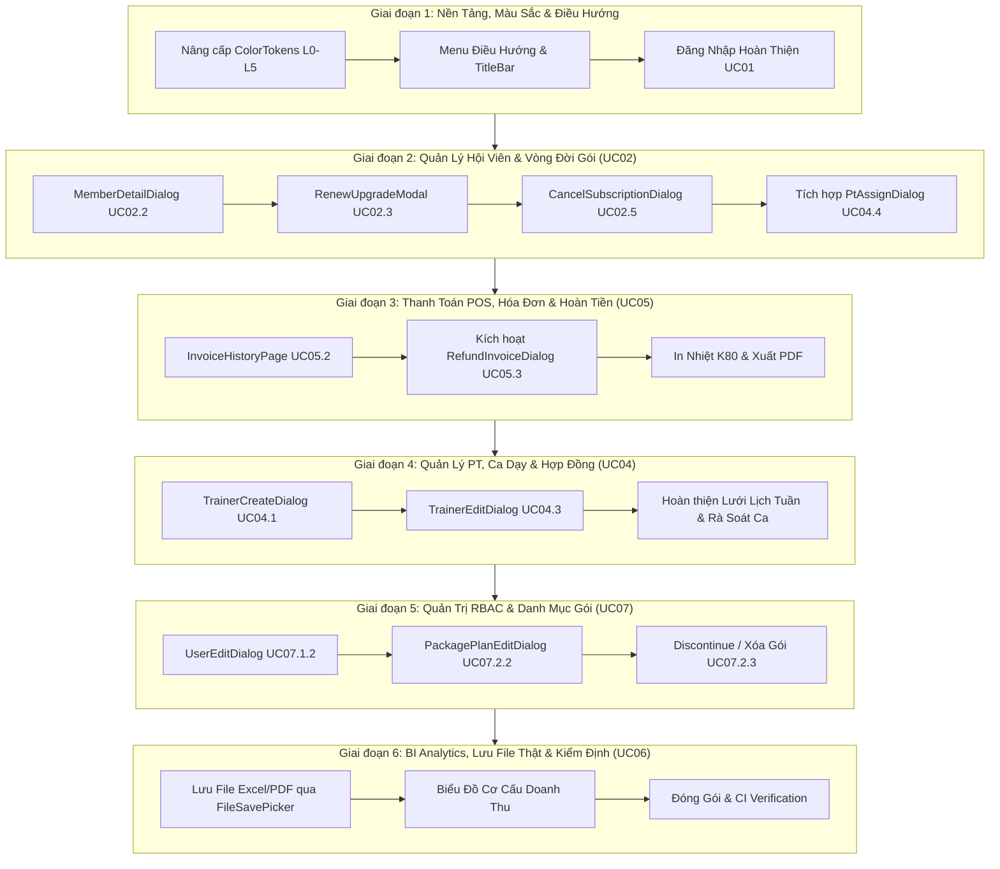

# KẾ HOẠCH HOÀN THIỆN TOÀN DIỆN ỨNG DỤNG WINUI 3 DESKTOP
## HỆ THỐNG QUẢN LÝ PHÒNG TẬP THỂ THAO (GYM MANAGEMENT SYSTEM)

> [!IMPORTANT]
> **Văn bản pháp quy tuân thủ bắt buộc:**
> * [`Document/PRD.md`](PRD.md) & [`Document/task.md`](task.md) (Task 4.1).
> * [`Document/ui_rules.md`](ui_rules.md) (Quy chuẩn giao diện WinUI 3, 6 tầng màu Dark Mode L0-L5, WCAG 2.2 AA).
> * [`Document/ux_rules.md`](ux_rules.md) (Idempotency button lock, never block paste, micro-typography, phím tắt F2-F5, không âm thanh, không mã UC).
> * [`Document/dev_rule.md`](dev_rule.md) (Cấm toán tử 3 ngôi `? :`, cấm expression-bodied `=>` trên phương thức nghiệp vụ, ranh giới 3 lớp, 100% English code identifiers, 100% Vietnamese UI text).

---

## 1. TỔNG QUAN PHẠM VI & MỤC TIÊU THỰC THI

Kế hoạch này vạch ra lộ trình kỹ thuật chi tiết theo 6 giai đoạn tuần tự để biến ứng dụng **`GymManagement.Desktop`** thành một hệ thống điều hành quầy lễ tân & quản trị phòng gym hoàn chỉnh, không còn bất kỳ màn hình khuyết thiếu nào so với tài liệu thiết kế.



---

## 2. MA TRẬN ÁNH XẠ KỸ THUẬT CÁC HẠNG MỤC CẦN BỔ SUNG

| STT | Phân hệ nghiệp vụ | File giao diện (XAML / CS) | ViewModel & Service | Quy chuẩn UX/UI & Dev Rule áp dụng |
| :---: | :--- | :--- | :--- | :--- |
| **1** | Nền tảng ColorTokens | `Styles/ColorTokens.xaml` | Toàn bộ Controls WinUI 3 | Bảng 6 tầng màu Dark Mode (L0-L5) WCAG AA, `FocusVisualPrimaryBrush` 2px. |
| **2** | Đăng nhập quản trị (UC01) | `Views/LoginPage.xaml` | `LoginViewModel.cs` | Checkbox Ghi nhớ tài khoản; `ProgressRing` lồng trong nút; Enter kích hoạt; tự xóa mật khẩu khi lỗi; Never block paste. |
| **3** | Sửa hồ sơ hội viên (UC 02.2) | `Dialogs/MemberDetailDialog.xaml(.cs)` | `MembersViewModel.cs` + `IApiClient.UpdateMemberProfileAsync` | Khóa Mã hội viên/CCCD; Cho phép sửa SĐT, Email, Địa chỉ; Nút Lưu có Idempotency lock. |
| **4** | Gia hạn / Nâng cấp gói (UC 02.3) | `Dialogs/RenewUpgradeModal.xaml(.cs)` | `MembersViewModel.cs` + `IApiClient.Renew/UpgradeSubscriptionAsync` | Tự động tính chênh lệch tiền; Niêm yết cố định (0 chiết khấu); Chọn thanh toán (Tiền mặt / VietQR). |
| **5** | Hủy đăng ký gói (UC 02.5) | `Dialogs/CancelSubscriptionDialog.xaml(.cs)` | `MembersViewModel.cs` + `IApiClient.CancelSubscriptionAsync` | Hộp thoại cảnh báo viền đỏ `status-danger`; Bắt buộc nhập lý do hủy; 2 nút: "Giữ Lại Gói" & "Xác Nhận Hủy". |
| **6** | Phân công PT (UC 04.4) | `Dialogs/PtAssignDialog.xaml(.cs)` | `MembersViewModel.cs` + `PtScheduleViewModel.cs` | Kết nối mở từ nút trên bảng hội viên; Hiển thị định mức học viên hiện tại của PT. |
| **7** | Lịch sử & In hóa đơn (UC 05.2) | `Views/InvoiceHistoryPage.xaml(.cs)` | `ViewModels/InvoiceHistoryViewModel.cs` | Tra cứu theo Mã HĐ / SĐT; Bảng DataGrid phân trang cuộn ảo; Nút In phiếu thu K80; Nút Xuất PDF. |
| **8** | Hoàn tiền hóa đơn (UC 05.3) | `Dialogs/RefundInvoiceDialog.xaml(.cs)` | `InvoiceHistoryViewModel.cs` + `IApiClient.RefundInvoiceAsync` | Kích hoạt từ nút "Hoàn tiền" trên từng hóa đơn; Tiền hoàn $\le$ tiền gốc; Ghi nhận dòng tiền âm. |
| **9** | Thêm mới PT (UC 04.1) | `Dialogs/TrainerCreateDialog.xaml(.cs)` | `PtScheduleViewModel.cs` + `IApiClient.CreateTrainerAsync` | Nhập chuyên môn (`Specialization`), mức lương, kinh nghiệm; Kiểm tra trùng SĐT/Email tức thì. |
| **10**| Sửa hồ sơ PT (UC 04.3) | `Dialogs/TrainerEditDialog.xaml(.cs)` | `PtScheduleViewModel.cs` + `IApiClient.UpdateTrainerAsync` | Cập nhật chuyên môn, kinh nghiệm, chuyển cờ Đang hoạt động / Tạm nghỉ. |
| **11**| Sửa nhân sự & RBAC (UC 07.1.2) | `Dialogs/UserEditDialog.xaml(.cs)` | `SettingsViewModel.cs` | Hàng rào bảo mật: Super Admin không thể tự đổi vai trò của chính mình (`dev_rule.md`). |
| **12**| Sửa gói tập (UC 07.2.2) | `Dialogs/PackagePlanEditDialog.xaml(.cs)` | `PackagePlansViewModel.cs` | Cập nhật đơn giá, thời hạn, số buổi; Áp dụng cho lần mua tiếp theo, bảo lưu quyền lợi gói cũ. |
| **13**| Ngừng kinh doanh gói (UC 07.2.3) | Nút hành động trên `PackagePlansPage` | `PackagePlansViewModel.cs` + `IApiClient.DeletePackagePlanAsync` | Kiểm tra: nếu đã phát sinh hóa đơn $\rightarrow$ Chặn xóa vật lý, chuyển trạng thái sang `DISCONTINUED`. |
| **14**| Lưu file báo cáo thật (UC 06.2) | `Views/DashboardPage.xaml.cs` | `DashboardViewModel.cs` | Dùng `FileSavePicker` gán HWND qua `InitializeWithWindow` để lưu file .xlsx và .pdf thật xuống đĩa cứng. |

---

## 3. LỘ TRÌNH TRIỂN KHAI CHI TIẾT THEO 6 GIAI ĐOẠN

### GIAI ĐOẠN 1: NỀN TẢNG THIẾT KẾ, TOKENS MÀU & CHUẨN HÓA ĐIỀU HƯỚNG
*Mục tiêu: Đảm bảo toàn bộ khung làm việc tuân thủ 100% Dark Mode WCAG 2.2 AA và giao diện Đăng nhập đạt chuẩn UX.*

* **Bước 1.1: Đồng bộ Bảng 6 Tầng Màu Dark Mode trong `ColorTokens.xaml`**
  * Bổ sung đầy đủ các token: L0 Surfaces (`AppBackgroundColor`, `LayerFillColorDefault`, `CardBackgroundColor`, `ElevatedSurfaceColor`), L1 Borders (`SubtleBorderColor`, `FocusVisualPrimaryColor`), L2 Typography (`TextFillColorPrimary`, `TextFillColorSecondary`), L3 Brand Accent (`AccentFillColorDefault`), L4 Semantic Status (`StatusSuccessColor`, `StatusWarningColor`, `StatusDangerColor`, `StatusPtColor`), L5 Data Visualization.
  * Giữ nguyên các alias tương thích cũ (`BgCanvasBrush`, `BgSurfaceBrush`, `BgCardBrush`, `BorderSubtleBrush`).
* **Bước 1.2: Chuẩn hóa Thanh Tiêu Đề & Menu Điều Hướng trong `MainPage.xaml`**
  * Bổ sung mục menu: `"Lịch Sử & In Hóa Đơn (F6)"` với Icon `&#xE8A1;` (Tag: `Invoices`).
  * Gắn nhãn phím tắt trực quan: `F2` (POS), `F3` (Hội viên), `F5` (Lịch PT), `F6` (Hóa đơn).
  * Xóa bỏ hoàn toàn mọi tiền tố "UCxx" (nếu còn) khỏi menu và thanh trạng thái.
* **Bước 1.3: Hoàn thiện Màn Hình Đăng Nhập Quản Trị `LoginPage.xaml` (UC01)**
  * Thêm `CheckBox` *"Ghi nhớ tên đăng nhập"* (lưu vào local settings).
  * Lồng `ProgressRing` vào nút Đăng nhập: Khi `IsLoading == true`, tự động khóa nút và xoay spinner.
  * Trong `LoginViewModel.cs`: Khi bắt `catch (Exception ex)`, tự động reset trường `Password = string.Empty` và giữ nguyên `Username`.
  * Đảm bảo ô `TxtUsername` và `TxtPassword` không chặn dán (`Never block paste`).

---

### GIAI ĐOẠN 2: HOÀN THIỆN PHÂN HỆ QUẢN LÝ HỘI VIÊN & GÓI TẬP (UC02)
*Mục tiêu: Hiện thực đầy đủ 5 Use Cases nghiệp vụ hội viên, biến `MembersPage` thành trung tâm điều phối trọn vòng đời khách hàng.*

* **Bước 2.1: Xây dựng Hộp Thoại Sửa Hồ Sơ Hội Viên `MemberDetailDialog.xaml(.cs)` (UC 02.2)**
  * `ContentDialog` kích thước chuẩn: $640\text{px} \times 480\text{px}$.
  * Hiển thị cố định dạng đọc (Read-only / IsReadOnly=true): Mã hội viên (`UserName`), CCCD (`IdCard`), Ngày tham gia.
  * Cho phép chỉnh sửa: Họ và tên, Số điện thoại (`inputmode="numeric"`), Email, Địa chỉ liên lạc.
  * Xử lý lỗi trùng lặp SĐT/Email phản hồi từ backend.
* **Bước 2.2: Xây dựng Hộp Thoại Gia Hạn / Nâng Cấp Gói `RenewUpgradeModal.xaml(.cs)` (UC 02.3)**
  * Hiển thị thông tin gói tập hiện tại (Tên gói, Hạn dùng, Số buổi còn lại).
  * Lựa chọn 2 chế độ (Segmented Tabs):
    1. *Gia hạn thêm thời gian:* Chọn số tháng (+1 tháng, +3 tháng, +6 tháng, +12 tháng), đơn giá niêm yết cố định.
    2. *Nâng cấp gói:* Danh sách các gói tập cao cấp hơn, tự động tính chênh lệch: $\text{Số tiền phải thu} = \text{Giá gói mới} - \text{Giá trị gói cũ còn lại}$.
  * Bộ nút chọn phương thức thanh toán: `[Tiền mặt]` và `[Chuyển khoản VietQR]`.
* **Bước 2.3: Xây dựng Hộp Thoại Hủy Gói Tập `CancelSubscriptionDialog.xaml(.cs)` (UC 02.5)**
  * Thiết kế hộp thoại cảnh báo viền đỏ `status-danger`.
  * Văn bản giải thích minh bạch: *"Hành động này sẽ chấm dứt hiệu lực gói tập hiện tại của hội viên. Tài khoản đăng nhập của hội viên vẫn được bảo lưu."*
  * `TextBox` bắt buộc nhập lý do hủy (tối thiểu 10 ký tự, nút Xác nhận chỉ bật khi đã nhập lý do).
  * 2 Nút hành động: Nút chính `"Giữ Lại Gói"` (nền trung tính) và Nút phụ `"Xác Nhận Hủy Gói"` (nền đỏ `StatusDangerBrush`).
* **Bước 2.4: Nâng Cấp Bảng `MembersPage.xaml`**
  * Bổ sung nút bấm trong cột Thao tác:
    * `[Xem/Sửa]` $\rightarrow$ Mở `MemberDetailDialog`.
    * `[Gia Hạn/Nâng Cấp]` $\rightarrow$ Mở `RenewUpgradeModal`.
    * `[Phân Công PT]` $\rightarrow$ Mở `PtAssignDialog.xaml` (chỉ hiển thị khi hội viên có gói PT).
    * Menu phụ `[...]` $\rightarrow$ Chứa tùy chọn `[Bảo Lưu]` và `[Hủy Gói Tập]`.
  * Bổ sung trạng thái Rỗng (Empty State) và Vòng xoay tải dữ liệu (Loading State) chuẩn `ui_rules.md 1.4`.

---

### GIAI ĐOẠN 3: BÁN HÀNG POS, LỊCH SỬ HÓA ĐƠN & HOÀN TIỀN (UC05)
*Mục tiêu: Đóng gói khép kín quy trình tài chính từ lập hóa đơn, thu tiền, in phiếu thu nhiệt K80 đến xử lý hoàn tiền.*

* **Bước 3.1: Mở rộng Hợp đồng API Client `IApiClient.cs`**
  * Thêm phương thức:
    ```csharp
    Task<IReadOnlyList<InvoiceDto>> GetInvoicesAsync(string? searchQuery = null, DateTime? fromDate = null, DateTime? toDate = null);
    Task<byte[]> GenerateInvoicePdfAsync(string invoiceCode);
    ```
  * Cài đặt đồng bộ trong `HttpApiClient.cs` và `MockApiClient.cs`.
* **Bước 3.2: Xây dựng Trang Lịch Sử Hóa Đơn `Views/InvoiceHistoryPage.xaml(.cs)` (UC 05.2)**
  * **Bộ lọc tra cứu:**
    * `AutoSuggestBox` tìm kiếm nhanh theo Mã hóa đơn (`INV-...`) hoặc Số điện thoại hội viên.
    * `CalendarDatePicker` chọn khoảng thời gian (Từ ngày - Đến ngày).
    * `ComboBox` lọc theo trạng thái: `Tất cả`, `Đã thanh toán (PAID)`, `Đã hủy/Hoàn tiền (REFUNDED)`.
  * **Bảng danh sách hóa đơn (DataGrid ảo hóa):**
    * Cột dữ liệu: Mã HĐ, Ngày lập (`tabular-nums`), Tên hội viên & SĐT, Gói dịch vụ, Tổng tiền (`tabular-nums text-emerald-400 font-bold`), Phương thức (Tiền mặt / VietQR), Trạng thái (Chip xanh/đỏ tĩnh).
    * Cột thao tác nhanh:
      * Nút `[In Phiếu Thu]` $\rightarrow$ Mở hộp thoại xem trước hóa đơn nhiệt K80.
      * Nút `[Xuất PDF]` $\rightarrow$ Tải file PDF hóa đơn.
      * Nút `[Hoàn Tiền]` (chỉ hiện khi hóa đơn `PAID`) $\rightarrow$ Mở `RefundInvoiceDialog.xaml`.
* **Bước 3.3: Kích Hoạt & Hoàn Thiện Hộp Thoại Hoàn Tiền `RefundInvoiceDialog.xaml(.cs)` (UC 05.3)**
  * Kết nối sự kiện bấm nút `[Hoàn Tiền]` từ `InvoiceHistoryPage`.
  * Validate: Số tiền hoàn không được vượt quá số tiền gốc đã thanh toán; Bắt buộc chọn hình thức hoàn (Tiền mặt / Chuyển khoản) và nhập lý do hoàn tiền.
  * Gọi API `_apiClient.RefundInvoiceAsync(...)`, hiển thị thông báo thành công và chuyển trạng thái hóa đơn sang `REFUNDED`.

---

### GIAI ĐOẠN 4: QUẢN LÝ HUẤN LUYỆN VIÊN PT, PHÂN CÔNG & LỊCH BIỂU (UC04)
*Mục tiêu: Đảm bảo Admin quản lý trọn vẹn danh mục PT, phân công PT cho học viên và giám sát xung đột lịch.*

* **Bước 4.1: Xây dựng Hộp Thoại Thêm Mới PT `Dialogs/TrainerCreateDialog.xaml(.cs)` (UC 04.1)**
  * Form nhập liệu: Họ tên, Ngày sinh, Giới tính, Số điện thoại, Email, Chuyên môn chính (`Specialization`: Giảm mỡ, Tăng cơ, Yoga, Boxing, Phục hồi chức năng), Định mức học viên tối đa.
  * Gọi `_apiClient.CreateTrainerAsync(...)` để ghi nhận vào hệ thống.
* **Bước 4.2: Xây dựng Hộp Thoại Cập Nhật Hồ Sơ PT `Dialogs/TrainerEditDialog.xaml(.cs)` (UC 04.3)**
  * Cho phép chỉnh sửa chuyên môn, số lượng học viên định mức, trạng thái hoạt động (`ACTIVE` / `INACTIVE`).
* **Bước 4.3: Tích hợp Hộp Thoại Phân Công PT `PtAssignDialog.xaml(.cs)` (UC 04.4)**
  * Cho phép mở từ 2 nơi:
    1. Nút `[Phân Công PT]` trên danh sách hội viên `MembersPage`.
    2. Nút shortcut trên thanh điều khiển của `PtSchedulePage`.
  * Hiển thị danh sách PT kèm số lượng học viên đang phụ trách hiện tại; Cảnh báo nếu PT đã đầy tải.
* **Bước 4.4: Kiểm định Hàng Rào Chặn Xung Đột Trùng Lịch Trên `PtSchedulePage` (UC 04.6)**
  * Đảm bảo khi chọn trùng khung giờ với ca dạy đã có, khối giao diện đổi sang viền đỏ rực `#F87171` kèm tooltip cảnh báo chi tiết và nút Đặt lịch tự động khóa (`CanBookSlot == false`).

---

### GIAI ĐOẠN 5: QUẢN TRỊ NHÂN SỰ RBAC & DANH MỤC GÓI TẬP (UC07)
*Mục tiêu: Hiện thực các quyền hạn quản trị nâng cao của Super Admin với đầy đủ hàng rào an toàn.*

* **Bước 5.1: Xây dựng Hộp Thoại Chỉnh Sửa Nhân Sự `Dialogs/UserEditDialog.xaml(.cs)` (UC 7.1.2)**
  * Cho phép cập nhật Họ tên, Email, SĐT và thay đổi vai trò (`Role`: Admin, PT, Member).
  * **Hàng rào an toàn (Guardrail):** Nếu tài khoản được sửa chính là tài khoản Admin đang đăng nhập, dropdown vai trò bị khóa cứng (disable) kèm dòng thông báo: *"Không thể tự thay đổi quyền quản trị của chính tài khoản đang đăng nhập"*.
* **Bước 5.2: Xây dựng Hộp Thoại Sửa Gói Tập `Dialogs/PackagePlanEditDialog.xaml(.cs)` (UC 7.2.2)**
  * Cho phép sửa Đơn giá niêm yết, Thời hạn ngày, Số buổi gym, Số buổi PT, Mô tả quyền lợi.
  * Khi lưu, gọi API cập nhật gói; hiển thị ghi chú: *"Thông tin mới áp dụng cho các lượt đăng ký sau, quyền lợi của hội viên hiện tại được giữ nguyên"*.
* **Bước 5.3: Hoàn thiện Thao tác Xóa / Ngừng Kinh Doanh Gói Tập Trên `PackagePlansPage` (UC 7.2.3)**
  * Thêm nút `[Xóa / Ngừng bán]` trên từng thẻ gói tập:
    * Nếu gói tập chưa phát sinh hóa đơn nào $\rightarrow$ Hiển thị hộp thoại xác nhận xóa vật lý khỏi hệ thống.
    * Nếu gói tập đã có hội viên đăng ký hoặc có hóa đơn $\rightarrow$ Chặn xóa vật lý, hiển thị hộp thoại chuyển trạng thái sang `DISCONTINUED` (Ngừng kinh doanh) để bảo toàn quyền lợi của hội viên cũ.

---

### GIAI ĐOẠN 6: BI ANALYTICS, LƯU FILE BÁO CÁO THẬT & KIỂM ĐỊNH TỔNG THỂ (UC06)
*Mục tiêu: Hoàn thiện chức năng lưu file báo cáo xuống máy tính, bổ sung biểu đồ cơ cấu doanh thu và kiểm tra toàn diện chất lượng code.*

* **Bước 6.1: Tích hợp Hộp Thoại Lưu File Thật Cho Báo Cáo Trong `DashboardPage.xaml.cs` (UC 06.2)**
  * Triển khai `FileSavePicker` trong WinUI 3 (Packaged/Unpackaged) sử dụng `WinRT.Interop.InitializeWithWindow`.
* **Bước 6.2: Bổ sung Biểu Đồ Cơ Cấu Doanh Thu Theo Gói Tập (UC 06.1)**
  * Thêm biểu đồ phân bố doanh thu theo nhóm gói (Gói Tháng, Gói Quý, Gói Năm, Gói PT) với số liệu trực quan theo `ui_rules.md 3.8`.
* **Bước 6.3: Kiểm định Toàn Diện Chất Lượng Code (Quality Gate)**
  1. **Biên dịch:** `dotnet build src/Client/GymManagement.Desktop -p:Platform=x64` $\rightarrow$ 0 Warning, 0 Error.
  2. **Quy chuẩn C# (`dev_rule.md`):** Kiểm tra không có bất kỳ toán tử 3 ngôi `? :` nào, không có phương thức biểu thức `=>` trên logic nghiệp vụ, 100% tiếng Anh cho định danh code.
  3. **Quy chuẩn UI/UX (`ui_rules.md`, `ux_rules.md`):** Kiểm tra 100% Dark Mode, không có mã UC trên giao diện, không âm thanh, hỗ trợ phím tắt, Idempotency lock trên mọi nút bấm.

---

## 4. MA TRẬN PHÂN CHIA NHIỆM VỤ & TRUY VẾT TASK (TASK TRACEABILITY)

| Phân đoạn | Danh sách Task con chi tiết | Mã Use Case liên quan | Độ ưu tiên |
| :--- | :--- | :---: | :---: |
| **Giai đoạn 1** | Cập nhật `ColorTokens.xaml`, Polish `LoginPage`, Polish Menu điều hướng | UC01, System | `P0 - Must Have` |
| **Giai đoạn 2** | Tạo `MemberDetailDialog`, `RenewUpgradeModal`, `CancelSubscriptionDialog`, kết nối `PtAssignDialog` | UC02 (2.1 - 2.5), UC04.4 | `P0 - Must Have` |
| **Giai đoạn 3** | Tạo `InvoiceHistoryPage`, kích hoạt `RefundInvoiceDialog`, in phiếu K80 | UC05 (5.1 - 5.3) | `P0 - Must Have` |
| **Giai đoạn 4** | Tạo `TrainerCreateDialog`, `TrainerEditDialog`, hoàn thiện lịch tuần PT | UC04 (4.1 - 4.6) | `P1 - High` |
| **Giai đoạn 5** | Tạo `UserEditDialog`, `PackagePlanEditDialog`, nút Discontinue gói | UC07 (7.1 - 7.2) | `P1 - High` |
| **Giai đoạn 6** | `FileSavePicker` cho xuất Excel/PDF, biểu đồ doanh thu, kiểm định CI | UC06 (6.1 - 6.2) | `P1 - High` |

