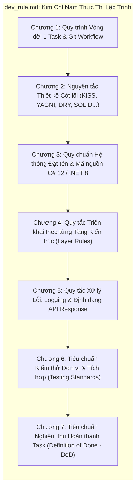

# QUY CHUẨN THỰC THI LẬP TRÌNH & NGUYÊN TẮC PHÁT TRIỂN HỆ THỐNG
# HỆ THỐNG QUẢN LÝ PHÒNG TẬP THỂ THAO (GYM MANAGEMENT SYSTEM)
**Tài liệu tham chiếu:** [`PRD.md`](PRD.md) | [`predevrule.md`](predevrule.md) | [`task.md`](task.md) | [`dev_mapping.md`](dev_mapping.md)

---

## MỤC TIÊU & PHẠM VI ÁP DỤNG

Tài liệu này là **Quy chuẩn Kỹ thuật Thực thi Bắt buộc (Mandatory Engineering Standard)** của dự án Hệ thống Quản lý Phòng tập Thể thao. 

Mọi lập trình viên và AI Agent khi bắt tay vào thực hiện bất kỳ nhiệm vụ nào trong [`task.md`](task.md) (từ Giai đoạn 0 đến Giai đoạn 5) **BẮT BUỘC PHẢI TUÂN THỦ 100%** toàn bộ các nguyên tắc, quy chuẩn đặt tên, bố cục file, ranh giới kiến trúc và tiêu chuẩn nghiệm thu (Definition of Done) được quy định dưới đây.



---

## CHƯƠNG 1: QUY TRÌNH VÒNG ĐỜI TASK & CHIẾN LƯỢC QUẢN LÝ GIT

### 1.1. Quy trình 8 bước Thực thi 1 Task (Task Lifecycle)

Mọi task khi được thực hiện đều phải tuân thủ nghiêm ngặt quy trình 8 bước sau:

```text
[1. Nhận diện Task trong task.md] 
       ↓ 
[2. Tạo nhánh Git chuẩn tiếng Anh: feature/task-X.Y-name] 
       ↓ 
[3. Đối soát PRD (UC/AC) & predevrule.md (Ranh giới kiến trúc)] 
       ↓ 
[4. Lập trình C# 12 & .NET 8 (Tên tiếng Anh, Comment nghiệp vụ tiếng Việt)] 
       ↓ 
[5. Viết Unit / Integration Tests (AAA Pattern)] 
       ↓ 
[6. Kiểm tra Cục bộ: dotnet build + dotnet format + dotnet test] 
       ↓ 
[7. Commit chuẩn Conventional Commits tiếng Anh] 
       ↓ 
[8. Tích [x] task.md, Cập nhật dev_mapping.md & Push CI Quality Gate]
```

#### Chi tiết 8 bước thực thi:
1. **Bước 1: Nhận diện Task:** Đọc rõ `Task ID`, `[Type: ...]`, `[Module: ...]`. Chỉ tập trung giải quyết đúng phạm vi của task đó, không sửa lan man sang các module khác.
2. **Bước 2: Tạo nhánh Git mới:** Tạo nhánh riêng từ `main` theo đúng quy chuẩn đặt tên tiếng Anh (mục 1.2). Tuyệt đối không commit trực tiếp lên nhánh `main`.
3. **Bước 3: Đối chiếu Nghiệp vụ:** Tra cứu mã Use Case tương ứng trong Phần II của [`PRD.md`](PRD.md) và bảng Ma trận truy vết (RTM) để hiểu rõ Tiêu chí chấp nhận (Acceptance Criteria - AC).
4. **Bước 4: Lập trình:** Viết mã nguồn tuân thủ ranh giới 3 lớp và Dependency Rule (Presentation $\rightarrow$ Core Contracts $\rightarrow$ Data Access).
5. **Bước 5: Kiểm thử song hành (Test-Alongside):** Viết test ngay trong thư mục `tests/` tương ứng (`UnitTests`, `DataTests`, hoặc `ApiTests`).
6. **Bước 6: Thẩm định chất lượng cục bộ:**
   * `dotnet build GymManagement.sln -c Release` (0 Errors).
   * `dotnet format GymManagement.sln --verify-no-changes` (Đạt chuẩn formatting).
   * `dotnet test --no-build` (100% test cases pass).
7. **Bước 7: Commit theo chuẩn:** Commit code với thông điệp Conventional Commits bằng **Tiếng Anh 100%** (mục 1.3).
8. **Bước 8: Đóng Task & Ghi Sổ Ánh Xạ Kỹ Thuật:**
   * Đổi `[ ]` thành `[x]` trong cả `../task.md` và `task.md`.
   * Ghi nhận thông tin chi tiết vào [`dev_mapping.md`](dev_mapping.md).
   * Đẩy nhánh lên GitHub, mở Pull Request và xác nhận `CI Quality Gate` báo Xanh.

---

### 1.2. Quy chuẩn Đặt tên Nhánh Git (Git Branch Naming Conventions)

Để bảo đảm tích hợp CI/CD mượt mà, truy vết chính xác đến từng User Story (trong PRD) / Task (trong roadmap) và **triệt tiêu rủi ro lỗi giới hạn đường dẫn 260 ký tự trên hệ điều hành Windows**, toàn bộ lập trình viên và AI Agent **BẮT BUỘC PHẢI TUÂN THỦ 100%** chuẩn đặt tên nhánh sau:

$$\text{Cú pháp chuẩn:} \quad \mathbf{\langle type\rangle/\langle story-id\rangle-\langle short-description\rangle} \quad \text{hoặc} \quad \mathbf{\langle type\rangle/\langle task-id\rangle-\langle short-description\rangle}$$

* **Danh mục Loại Nhánh Hợp Lệ (`<type>`):**
  * `feat/`: Phát triển tính năng mới (ví dụ: `feat/us-02.1-member-registration`, `feat/us-04.1-qr-turnstile-checkin`).
  * `fix/`: Vá lỗi phát hiện trong quá trình kiểm thử hoặc vận hành (ví dụ: `fix/us-05.2-pt-slot-collision`, `fix/login-lockout-timer`).
  * `test/`: Thêm mới hoặc bổ sung test suite mà không làm thay đổi code nghiệp vụ (ví dụ: `test/us-07.1-vietqr-payment-mock`).
  * `refactor/`: Tái cấu trúc mã nguồn nhưng giữ nguyên hành vi nghiệp vụ (ví dụ: `refactor/unit-of-work-cleanup`).
  * `chore/`: Cập nhật cấu hình build, dependencies NuGet, CI/CD hoặc bảo trì repository (ví dụ: `chore/ci-workflow-dotnet8`).
  * `docs/`: Cập nhật tài liệu kỹ thuật, quy chuẩn kiến trúc (ví dụ: `docs/dev-rules-naming-conventions`).
* **Định danh User Story / Task (`<story-id>`):**
  * Bắt buộc tham chiếu chính xác mã Agile User Story trong [`PRD.md`](PRD.md) (ví dụ: `us-01.1` đến `us-10.4`) hoặc Task ID trong [`task.md`](task.md) (ví dụ: `task-2.2`).
* **Mô tả ngắn gọn (`<short-description>`):**
  * Gồm 2 đến 4 từ tiếng Anh viết thường, phân tách bằng dấu gạch ngang (`kebab-case`), mô tả đúng phạm vi cốt lõi của nhánh (ví dụ: `member-registration`, `turnstile-checkin`, `pt-schedule-collision`).
* ❌ **CẤM TUYỆT ĐỐI (STRICTLY BANNED):**
  * **Cấm sử dụng đường dẫn file làm tên nhánh** (ví dụ: `feat/src/GymManagement.Core/Services/CheckInService.cs`). Đường dẫn dài sẽ vượt giới hạn 260 ký tự của Windows, làm hỏng terminal Git và mất tính ngữ cảnh của User Story.
  * **Cấm đặt tên nhánh chung chung, tối nghĩa** (ví dụ: `update`, `patch`, `test1`, `my-branch`, `fix-bug`, `dev-new`).

> [!CAUTION]
> **Quy tắc An toàn Nhánh Chính:** Nhánh `main` là nhánh sản phẩm ổn định. Mọi thay đổi đều phải thông qua Pull Request (PR) từ nhánh `feat/*` hoặc `fix/*` và phải vượt qua bài kiểm tra `CI Quality Gate` trước khi merge.

---

### 1.3. Quy chuẩn Thông điệp Commit Git (Conventional Commits Standard)

Mọi commit message **BẮT BUỘC VIẾT BẰNG TIẾNG ANH (100% ENGLISH)** theo chuẩn **Conventional Commits**:

$$\text{Cú pháp:} \quad \mathbf{\langle type\rangle(\langle scope\rangle): \langle action\ verb\ in\ present\ tense\rangle\ \langle short\ description\rangle}$$

* **Danh mục `type` hợp lệ:**
  * `feat`: Thêm tính năng mới hoặc hoàn tất một chức năng task nghiệp vụ.
  * `fix`: Sửa lỗi (bug fix).
  * `test`: Thêm hoặc chỉnh sửa unit test / integration test.
  * `refactor`: Tái cấu trúc code (không đổi hành vi, không thêm tính năng, không sửa bug).
  * `perf`: Cải thiện hiệu năng xử lý (query, bộ nhớ, UI rendering).
  * `docs`: Thay đổi hoặc thêm mới tài liệu kỹ thuật.
  * `build`: Thay đổi hệ thống build, cập nhật gói NuGet, cấu hình .NET SDK.
  * `ci`: Chỉnh sửa cấu hình workflow GitHub Actions (`.github/workflows/*.yml`).
  * `chore`: Các tác vụ bảo trì phụ trợ (dọn dẹp repo, cập nhật `.gitignore`).
  * `style`: Định dạng khoảng trắng, thụt dòng, không ảnh hưởng logic thực thi.
* **Danh mục `scope` khuyến nghị:**
  * Theo mã User Story / Task: `us-01.1`, `us-02.1`, `us-04.2`, `task-2.2`...
  * Hoặc theo phân hệ kỹ thuật: `server/api`, `server/core`, `server/data`, `client/desktop`, `client/web`, `db`, `ci`, `docs`, `standards`.
* **Quy tắc ngữ pháp & định dạng bắt buộc:**
  * Luôn sử dụng thể mệnh lệnh ở thì hiện tại (**Imperative, Present Tense**): dùng `add`, `implement`, `fix`, `refactor`, `prevent`, `configure`; **KHÔNG DÙNG** `added`, `implementing`, `fixed`.
  * Mô tả ngắn gọn (**ngắn hơn 72 ký tự**).
  * Viết thường chữ cái đầu tiên sau dấu hai chấm.
  * **Không để dấu chấm (`.`) ở cuối dòng tiêu đề**.
* **Ví dụ Commit Messages Chuẩn Mẫu:**
  * `feat(us-04.1): implement CheckInService logic and QR validation`
  * `feat(server/data): configure EF Core 9 physical tables and configurations`
  * `fix(us-05.2): prevent double-booking for the same trainer time slot`
  * `test(us-02.3): add unit tests for subscription renewal and penalty calculation`
  * `docs(standards): add system-wide naming conventions to dev_rule.md`
  * `ci(workflow): enable windows-latest runner for WinUI 3 desktop build`

---

### 1.4. Chính sách Phân định Ngôn ngữ Toàn Dự án (Bilingual Language Policy)

Để đảm bảo tính quốc tế hóa cao của mã nguồn kỹ thuật nhưng vẫn giữ trọn vẹn ngữ nghĩa nghiệp vụ thực tế tại phòng gym Việt Nam:

```
┌─────────────────────────────────────────────────────────────────────────────────┐
│                      MA TRẬN PHÂN ĐỊNH NGÔN NGỮ HỆ THỐNG                        │
├────────────────────────────────────────┬────────────────────────────────────────┤
│     100% TIẾNG ANH (STRICTLY ENGLISH)  │      TIẾNG VIỆT (VIETNAMESE DOMAIN)    │
├────────────────────────────────────────┼────────────────────────────────────────┤
│ 1. Tên File & Thư mục                  │ 1. Tài liệu Nghiệp vụ                  │
│    (CheckInService.cs, src/Server/...) │    (PRD.md, predevrule.md, task.md...) │
│ 2. Định danh Mã nguồn C#               │ 2. Sổ Ánh Xạ & Kế hoạch Thực thi       │
│    (Class, Interface, Method, Variable)│    (dev_mapping.md, dev_rule.md)       │
│ 3. Tên Nhánh Git (Branch Names)        │ 3. Chú thích Code Nghiệp vụ phức tạp   │
│    (feature/task-2.2-checkin-service)  │    (Giải thích phạt hủy ca < 2 tiếng)  │
│ 4. Thông điệp Commit Git               │ 4. Chuỗi Hiển thị Giao diện Người dùng │
│    (feat(server/core): implement...)   │    (Nhãn form POS, nút bấm, menu)      │
│ 5. Tiêu đề Pull Request & Code Review  │ 5. Thông báo Lỗi Người dùng Cuối       │
│    (PR #12: feat(server): Add Auth)    │    ("Gói tập đã hết hạn sử dụng")      │
└────────────────────────────────────────┴────────────────────────────────────────┘
```

---

## CHƯƠNG 2: NGUYÊN TẮC THIẾT KẾ & TRIẾT LÝ LẬP TRÌNH CỐT LÕI

Mọi đoạn mã trong hệ thống Gym Management đều phải thấm nhuần 8 nguyên tắc sau:

```mermaid
flowchart LR
    KISS["1. KISS<br>(Keep It Simple)"]
    YAGNI["2. YAGNI<br>(You Aren't Gonna Need It)"]
    DRY["3. DRY<br>(Don't Repeat Yourself)"]
    SOLID["4. SOLID<br>(Đặc biệt SRP & DIP)"]
    FailFast["5. Fail-Fast<br>(& Guard Clauses)"]
    Defensive["6. Immutability<br>(& Defensive Coding)"]
    BoyScout["7. Boy Scout Rule<br>(Luôn dọn dẹp code)"]
    NoSecret["8. Zero Secrets<br>(Không hardcode khóa)"]
    
    KISS --- YAGNI --- DRY --- SOLID --- FailFast --- Defensive --- BoyScout --- NoSecret
```



### 1. KISS (Keep It Simple, Stupid) — Đơn giản là thượng sách
* **Tính dễ đọc là ưu tiên số 1:** Viết code tường minh, trực diện. Tránh viết những câu lệnh một dòng (one-liners) phức tạp, lắt léo khó debug.
* **Chống Over-Engineering:** Không tự ý tạo thêm các tầng trung gian trừu tượng không cần thiết. Không dùng Mediator/CQRS hay Abstract Factory khi chỉ cần Service Interface + Dependency Injection đơn giản là đủ đáp ứng.
* **Hàm ngắn gọn, đơn mục đích:** Mỗi hàm lý tưởng chỉ nên dài từ 20 đến 40 dòng, giải quyết trọn vẹn đúng 1 mục tiêu duy nhất.

### 2. YAGNI (You Aren't Gonna Need It) — Chỉ làm đúng những gì cần
* Tuyệt đối **không lập trình đón đầu tương lai**: Chỉ hiện thực đúng các trường dữ liệu, phương thức và endpoint được quy định trong 37 Use Cases của [`PRD.md`](PRD.md) và đúng 9 bảng CSDL trong [`GymManagement_Physical_Model.sql`](GymManagement_Physical_Model.sql).
* Không tự ý thêm cột "dự phòng", không thêm bảng mở rộng, không thêm các API "tiện ích" chưa nằm trong Acceptance Criteria (AC).

### 3. DRY (Don't Repeat Yourself) — Không nhân bản logic
* Tập trung toàn bộ quy tắc nghiệp vụ (tính ngày hết hạn, kiểm tra xung đột ca dạy PT, tính phạt hủy ca $< 2\text{h}$) vào duy nhất tầng `Server.Core`. Cấm tuyệt đối việc sao chép (duplicate) logic nghiệp vụ sang Desktop Client hay Web Client.
* DTOs và Contracts dùng chung qua `GymManagement.Server.Core.Contracts` và `DTOs`.
* **Ranh giới hợp lý (Rule of Three):** Không gượng ép DRY giữa các tầng kiến trúc khác nhau (ví dụ: không dùng chung Database Entity cho tầng UI chỉ để "tiết kiệm tạo class DTO").

### 4. SOLID Principles (Đặc biệt chú trọng SRP và DIP)
* **Single Responsibility Principle (SRP):** Mỗi Service chỉ đảm nhiệm đúng miền nghiệp vụ của mình (`CheckInService` chỉ quản lý điểm danh, `BillingService` chỉ quản lý hóa đơn/tiền). Nếu một thao tác cần chạm đến miền khác, hãy gọi Service phụ trách qua Interface thay vì tự ý can thiệp dữ liệu bảng khác.
* **Dependency Inversion Principle (DIP):** Các tầng Presentation và Business Logic chỉ phụ thuộc vào Abstractions (Interfaces như `IUnitOfWork`, `IMemberService`, `INotificationAdapter`), không bao giờ phụ thuộc trực tiếp vào Concrete Implementations hay EF Core DbContext.

### 5. Fail-Fast & Guard Clauses (Báo lỗi sớm, dứt khoát)
* **Kiểm tra hợp lệ ngay đầu hàm (Guard Clauses):** Bắt lỗi tham số null, lỗi logic hoặc vi phạm quyền hạn ngay khi vừa bước vào hàm:
  ```csharp
  ArgumentNullException.ThrowIfNull(request);
  if (request.DurationDays <= 0) 
      throw new ValidationException("Thời lượng gói tập phải lớn hơn 0.");
  ```
* **Tránh "Kim tự tháp lồng nhau" (Arrow Anti-Pattern):** Dùng `return` hoặc `throw` sớm để giữ mã nguồn thẳng hàng (Flat code structure), tuyệt đối không lồng ghép `if/else` quá 3 cấp độ.

### 6. Defensive Coding & Immutability (Lập trình phòng vệ & Bất biến)
* Dữ liệu truyền nhận giữa các tầng (DTOs) luôn dùng `record` hoặc `readonly` / `init-only`.
* Luôn bật `<Nullable>enable</Nullable>` và kiểm tra null cẩn trọng, không cho phép null rò rỉ âm thầm gây `NullReferenceException`.
* Mọi tác vụ I/O (Database query, HTTP request, File read) **bắt buộc** phải nhận `CancellationToken`.

### 7. Boy Scout Rule (Quy tắc Hướng đạo sinh)
* *"Luôn để khu đất cắm trại sạch hơn lúc bạn đến"*: Khi mở bất kỳ file nào ra để làm task, nếu thấy `using` thừa, biến chưa dùng, định dạng lộn xộn hoặc comment lỗi thời, hãy dọn dẹp sạch sẽ trước khi commit.

### 8. Zero Hardcoded Secrets (Không lưu mã bí mật trong code)
* Tuyệt đối không hardcode Chuỗi kết nối CSDL (Connection Strings), Khóa bí mật JWT (Secret Keys), Mật khẩu mặc định, hoặc API Key VietQR/Email vào mã nguồn C#. Toàn bộ phải được cấu hình an toàn qua `appsettings.json` và nạp qua `IConfiguration`.

---

## CHƯƠNG 3: QUY CHUẨN ĐẶT TÊN TOÀN HỆ THỐNG & MÃ NGUỒN C# 12 / .NET 8 (SYSTEM-WIDE NAMING CONVENTIONS & CODING STANDARDS)

Để bảo đảm toàn bộ hệ thống Gym Management đạt **tính tự giải thích cao (self-explanatory), dễ đọc, dễ bảo trì và rõ ràng về ngữ cảnh nghiệp vụ ngay từ cái nhìn đầu tiên**, toàn bộ mã nguồn phải tuân thủ nghiêm ngặt hệ thống quy chuẩn đặt tên dưới đây:

### 3.1. Quy chuẩn Đặt tên Thư mục & Bố cục Cây Dự án (Directory & Folder Naming)

1. **Cấu trúc Thư mục Cấp Giải pháp (Solution Root Structure):**
   * Sử dụng tên thư mục viết thường ngắn gọn theo quy chuẩn quốc tế:
     * `src/`: Chứa toàn bộ mã nguồn sản phẩm (Production Projects).
     * `tests/`: Chứa toàn bộ mã nguồn kiểm thử tự động (Unit / Data / Integration Tests).
     * `docs/`: Chứa tài liệu thiết kế hệ thống, PRD, predevrule, sơ đồ kiến trúc.

2. **Quy chuẩn Đặt tên Thư mục Dự án con (Project Directories):**
   * Sử dụng **`PascalCase`**, tên thư mục dự án **phải trùng khớp 100% với tên Assembly & Root Namespace**:
     * `src/GymManagement.Api`: Tầng giao tiếp HTTP API (ASP.NET Core Web API).
     * `src/GymManagement.Core`: Tầng miền nghiệp vụ độc lập (Domain Entities, Contracts, DTOs, Services, Exceptions).
     * `src/GymManagement.Infrastructure`: Tầng dữ liệu & tích hợp ngoại vi (EF Core 8, Configurations, Repositories, Adapters).
     * `src/GymManagement.Desktop`: Tầng giao diện quản trị WinUI 3 MVVM (Dành cho Admin, Lễ tân, Thu ngân).
     * `src/GymManagement.Web`: Tầng cổng thông tin hội viên Blazor Server (Dành cho Hội viên & PT).
     * `tests/GymManagement.Server.UnitTests`: Kiểm thử đơn vị các nghiệp vụ tại `Core`.
     * `tests/GymManagement.Server.DataTests`: Kiểm thử truy xuất dữ liệu EF Core tại `Infrastructure`.
     * `tests/GymManagement.Server.ApiTests`: Kiểm thử tích hợp Endpoints qua `WebApplicationFactory`.

3. **Quy chuẩn Đặt tên Thư mục Bên trong từng Project:**
   * Sử dụng **`PascalCase`**, danh từ số nhiều phản ánh đúng vai trò kỹ thuật hoặc nhóm chức năng:
     * `Controllers/`: Chứa các bộ điều hướng HTTP API.
     * `Services/`: Chứa các lớp cài đặt nghiệp vụ (Implementations).
     * `Contracts/`: Chứa các giao diện dịch vụ (Service Interfaces).
     * `DTOs/`: Chứa các đối tượng truyền nhận dữ liệu (`Requests/`, `Responses/`, `Common/`).
     * `Entities/`: Chứa 9 lớp thực thể ánh xạ 9 bảng CSDL vật lý.
     * `Configurations/`: Chứa các lớp Fluent API EntityTypeConfiguration cho EF Core.
     * `Repositories/`: Chứa các lớp truy xuất kho dữ liệu.
     * `Adapters/`: Chứa các lớp chuyển đổi tích hợp bên thứ ba (VietQR, Email, Máy quét barcode).
     * `ViewModels/`: Chứa các ViewModel cho WinUI 3 Desktop MVVM.
     * `Views/`: Chứa các XAML Page / UserControl / Dialog cho WinUI 3 Desktop.
     * `Pages/`: Chứa các trang Blazor có định tuyến (Routable Razor Pages).
     * `Components/`: Chứa các Blazor Component tái sử dụng (`Cards/`, `Modals/`, `Charts/`).

4. **Phân tách Ngữ cảnh Miền Nghiệp vụ (Contextual Domain Separation):**
   * Bên trong các thư mục lớn (`DTOs/`, `ViewModels/`, `Views/`, `Components/`), bắt buộc phân nhóm theo miền chức năng hoặc tác nhân:
     * Ví dụ trong DTOs: `DTOs/Identity/`, `DTOs/Members/`, `DTOs/CheckIn/`, `DTOs/PTSchedules/`, `DTOs/Billing/`, `DTOs/Reports/`.
     * Ví dụ trong ViewModels: `ViewModels/Admin/`, `ViewModels/Receptionist/`, `ViewModels/Cashier/`.

---

### 3.2. Ma trận Quy chuẩn Đặt tên File & Module Toàn Hệ thống (File & Module Naming Matrix)

| Tầng / Nền tảng | Thành phần / Module | Quy chuẩn Đặt tên | Cú pháp Pattern | Ví dụ Chuẩn trong GymManagement |
| :--- | :--- | :--- | :--- | :--- |
| **Server API** | ASP.NET Core Controller | `PascalCase.cs` | `<DomainPlural>Controller.cs` | `MembersController.cs`, `CheckInController.cs`, `InvoicesController.cs`, `PtSessionsController.cs` |
| **Server Core** | Service Contract (Giao diện) | `IPascalCase.cs` | `I<Domain>Service.cs` | `IMemberService.cs`, `ICheckInService.cs`, `IBillingService.cs`, `IPtService.cs` |
| **Server Core** | Service Implementation | `PascalCase.cs` | `<Domain>Service.cs` | `MemberService.cs`, `CheckInService.cs`, `BillingService.cs`, `PtService.cs` |
| **Server Core** | Incoming Request Payload | `PascalCase.cs` | `<Action><Domain>Request.cs` | `RegisterMemberRequest.cs`, `CheckInRequest.cs`, `CreateInvoiceRequest.cs`, `BookPtSessionRequest.cs` |
| **Server Core** | Outgoing Response Payload | `PascalCase.cs` | `<Domain><Action>Response.cs` | `MemberProfileResponse.cs`, `CheckInResultResponse.cs`, `RevenueReportResponse.cs`, `LoginResponse.cs` |
| **Server Core** | Internal Data Transfer Object | `PascalCase.cs` | `<Domain>Dto.cs` | `MemberDto.cs`, `InvoiceDto.cs`, `SubscriptionDto.cs`, `PtSessionDto.cs` |
| **Server Core** | Domain Entity (9 Bảng CSDL) | `PascalCase.cs` | `<EntityName>.cs` | `User.cs`, `Role.cs`, `PackagePlan.cs`, `MemberSubscription.cs`, `CheckInLog.cs`, `Invoice.cs`, `MemberBodyMetric.cs`, `PTAvailability.cs`, `PTTrainingSession.cs` |
| **Server Core** | Domain Exception | `PascalCase.cs` | `<Condition>Exception.cs` | `SubscriptionExpiredException.cs`, `PtScheduleCollisionException.cs`, `ValidationException.cs`, `NotFoundException.cs` |
| **Server Infra** | EF Core DbContext | `PascalCase.cs` | `<ContextName>DbContext.cs` | `GymManagementDbContext.cs` |
| **Server Infra** | Entity Type Configuration | `PascalCase.cs` | `<Entity>Configuration.cs` | `UserConfiguration.cs`, `MemberSubscriptionConfiguration.cs`, `InvoiceConfiguration.cs` |
| **Server Infra** | Repository Interface / Class | `IPascalCase.cs` / `PascalCase.cs` | `I<Domain>Repository.cs`, `<Domain>Repository.cs` | `IInvoiceRepository.cs`, `InvoiceRepository.cs`, `IGenericRepository.cs` |
| **Server Infra** | Third-party Adapter | `PascalCase.cs` | `<Service>Adapter.cs` | `VietQrPaymentAdapter.cs`, `EmailNotificationAdapter.cs`, `BarcodeScannerAdapter.cs` |
| **Desktop (WinUI 3)**| MVVM ViewModel | `PascalCase.cs` | `<Feature>ViewModel.cs` | `MembersViewModel.cs`, `CheckInCounterViewModel.cs`, `PosBillingViewModel.cs`, `PtScheduleViewModel.cs` |
| **Desktop (WinUI 3)**| XAML Page / View | `PascalCase.xaml` + `.cs` | `<Feature>Page.xaml` | `MembersPage.xaml`, `CheckInCounterPage.xaml`, `PosBillingPage.xaml` |
| **Desktop (WinUI 3)**| XAML Dialog / Modal | `PascalCase.xaml` + `.cs` | `<Action><Domain>Dialog.xaml` | `RenewSubscriptionDialog.xaml`, `CreateMemberDialog.xaml`, `ConfirmPaymentDialog.xaml` |
| **Web (Blazor)** | Routable Razor Page | `PascalCase.razor` | `<Feature>Page.razor` | `MemberPortalPage.razor`, `PtSessionBookingPage.razor`, `HealthMetricPage.razor` |
| **Web (Blazor)** | Reusable UI Component | `PascalCase.razor` | `<ComponentName>.razor` | `DigitalMembershipCard.razor`, `PtCalendarView.razor`, `BodyMetricChart.razor`, `QrScannerModal.razor` |
| **Testing** | Unit Test File | `PascalCase.cs` | `<TargetClass>Tests.cs` | `MemberServiceTests.cs`, `CheckInServiceTests.cs`, `BillingServiceTests.cs` |
| **Testing** | Data / EF Core Test File | `PascalCase.cs` | `<Entity>DataTests.cs` | `MemberSubscriptionDataTests.cs`, `InvoiceDataTests.cs` |
| **Testing** | API Integration Test File | `PascalCase.cs` | `<Domain>ApiTests.cs` | `CheckInApiTests.cs`, `BillingApiTests.cs`, `MembersApiTests.cs` |
| **Database** | SQL Schema & Migrations | `snake_case.sql` / `PascalCase.sql` | `V<Version>__<description>.sql` | `GymManagement_Physical_Model.sql`, `V1__init_schema.sql`, `V2__seed_demo_data.sql` |

---

### 3.3. Quy chuẩn Đặt tên Lớp, Giao diện, Kiểu Dữ liệu & DTOs (Class, Interface, Type & DTO Naming)

1. **Lớp (Class), Bản ghi (Record), Cấu trúc (Struct):**
   * Sử dụng **`PascalCase`**, danh từ số ít phản ánh đúng bản chất thực thể hoặc trách nhiệm:
     * Entity CSDL: `User`, `Role`, `PackagePlan`, `MemberSubscription`, `CheckInLog`, `Invoice`.
     * Service: `MemberService`, `BillingService`, `CheckInService`.
     * Validator: `RegisterMemberValidator`, `CreateInvoiceValidator`.

2. **Giao diện (Interface):**
   * Bắt buộc có tiền tố **`I`** đi liền với **`PascalCase`**:
     * Hợp đồng nghiệp vụ: `IMemberService`, `ICheckInService`, `IBillingService`, `IAuthService`.
     * Kho dữ liệu & Mẫu thiết kế: `IUnitOfWork`, `IGenericRepository<T>`, `IInvoiceRepository`.
     * Cổng tích hợp: `IVietQrAdapter`, `INotificationAdapter`.

3. **Mô hình DTOs (Data Transfer Objects & Schemas):**
   * Bắt buộc có hậu tố định hướng rõ ràng:
     * **Chiều dữ liệu nhận vào (Incoming Client Request):** Dùng hậu tố **`*Request`** (ví dụ: `RegisterMemberRequest`, `CheckInRequest`, `RenewSubscriptionRequest`, `CreateInvoiceRequest`).
     * **Chiều dữ liệu trả về (Outgoing Backend Response):** Dùng hậu tố **`*Response`** (ví dụ: `CheckInResponse`, `LoginResponse`, `MemberProfileResponse`, `DailyRevenueResponse`).
     * **Đối tượng dữ liệu nội bộ / chia sẻ (Internal DTO):** Dùng hậu tố **`*Dto`** (ví dụ: `MemberDto`, `SubscriptionDto`, `InvoiceDto`, `TrainerSlotDto`).

4. **Lớp ViewModel (WinUI 3 MVVM):**
   * Bắt buộc có hậu tố **`*ViewModel`** (ví dụ: `MembersViewModel`, `CheckInCounterViewModel`, `PosBillingViewModel`).

5. **Kiểu Liệt kê (Enum) & Giá trị Liệt kê (Enum Values):**
   * Tên kiểu Enum dùng **`PascalCase`**, danh từ số ít (ví dụ: `SubscriptionStatus`, `PaymentStatus`, `CheckInResult`, `UserRoleType`).
   * Giá trị bên trong Enum: Dùng **`PascalCase`** hoặc **`UPPER_SNAKE_CASE`** cố định (ví dụ: `SubscriptionStatus.Active`, `SubscriptionStatus.Expired`, `SubscriptionStatus.Frozen`, `SubscriptionStatus.Cancelled`).

6. **Lớp Ngoại lệ Miền (Domain Exceptions):**
   * Bắt buộc có hậu tố **`*Exception`** (ví dụ: `SubscriptionExpiredException`, `PtScheduleCollisionException`, `ValidationException`, `NotFoundException`).

---

### 3.4. Quy chuẩn Đặt tên Hàm, Phương thức, Command & Sự kiện (Function, Method & Event Naming)

1. **Phương thức Nghiệp vụ & Hàm (Methods & Functions):**
   * Cú pháp **`PascalCase`**, luôn bắt đầu bằng **Động từ thể hiện hành động rõ ràng (`Verb + Noun`)**:
     * **Truy vấn (Queries):** `GetByIdAsync`, `ListActiveMembersAsync`, `FindTrainerAvailabilityAsync`, `CalculateRemainingDays`.
     * **Biến đổi trạng thái (Mutations):** `RegisterMemberAsync`, `RenewSubscriptionAsync`, `CheckInAsync`, `ProcessPaymentAsync`, `CancelSessionAsync`.
     * **Tính toán nghiệp vụ (Calculations):** `CalculateLateCancellationPenalty`, `ComputeBmiMetric`, `CalculateTotalAmount`.
     * **Xác thực / Ràng buộc (Validation & Guard):** `ValidateCheckInEligibilityAsync`, `VerifyPasswordHash`, `EnsureScheduleNoConflictAsync`.
   * **Cấm kỵ:** Tuyệt đối không đặt tên hàm chung chung hoặc mơ hồ: `DoWork()`, `Process()`, `Handle()`, `ExecuteData()`.

2. **Phương thức Bất đồng bộ (Asynchronous Methods):**
   * Mọi hàm `async` bắt buộc có hậu tố **`Async`** và luôn nhận `CancellationToken cancellationToken = default` ở tham số cuối cùng.

3. **Phương thức / Thuộc tính Kiểm tra Điều kiện (Boolean Methods & Properties):**
   * Bắt buộc bắt đầu bằng các trợ động từ trạng thái nghi vấn: **`Is...`**, **`Has...`**, **`Can...`**, **`Should...`**:
     * Ví dụ: `IsSubscriptionActive()`, `HasRemainingSessions()`, `CanCancelWithoutPenalty()`, `IsSlotOverlapping()`, `ShouldChargeCancellationFee()`.

4. **Lệnh trong MVVM (RelayCommands cho WinUI 3 Desktop):**
   * Đặt tên theo hành động kèm hậu tố **`*Command`**:
     * Khi dùng thuộc tính `[RelayCommand]` của CommunityToolkit.Mvvm trên hàm `CheckInAsync()`, hệ thống tự sinh ra thuộc tính `CheckInCommand`.
     * Khi khai báo thuộc tính thủ công: `SearchMembersCommand`, `SubmitPaymentCommand`, `ExportReportCommand`, `RefreshDataCommand`.

5. **Bộ xử lý Sự kiện & Callbacks (Event Handlers):**
   * Bắt đầu bằng tiền tố **`On`** + `<TênSựKiện>` hoặc **`Handle`** + `<TênSựKiện>`:
     * Ví dụ trong Service / Core: `OnQrCodeScanned`, `OnPaymentStatusChanged`, `OnSessionCancelled`.
     * Ví dụ trong UI Code-behind / Component: `HandleMemberSelected`, `HandlePaymentCompleted`, `BtnCheckIn_Click`, `Page_Loaded`.

---

### 3.5. Quy chuẩn Đặt tên Biến, Thuộc tính, Trường dữ liệu & Hằng số (Variables, Properties, Fields & Constants)

1. **Thuộc tính Công khai (Public Properties):**
   * Sử dụng **`PascalCase`** (ví dụ: `RemainingSessions`, `FullName`, `ExpireDate`, `PhoneNumber`, `IsActive`).

2. **Biến Cục bộ & Tham số Hàm (Local Variables & Method Parameters):**
   * Sử dụng **`camelCase`** (ví dụ: `memberId`, `subscriptionPlan`, `checkInTime`, `cancellationToken`).
   * Tên biến phải có ý nghĩa biểu đạt ngữ cảnh; **cấm đặt tên biến 1 chữ cái** (ví dụ: `x`, `y`, `d`, `temp`), ngoại trừ biến đếm vòng lặp ngắn (`i`, `j`, `k`).

3. **Biến Boolean (Boolean Variables):**
   * Bắt buộc có tiền tố trạng thái rõ nghĩa:
     * Ví dụ: `isActive`, `hasPaid`, `isExpired`, `canCheckIn`, `isRefunded`, `isLoaded`.

4. **Trường Dữ liệu Riêng của Lớp (Private Instance Fields):**
   * Bắt buộc có tiền tố gạch dưới **`_`** kèm **`camelCase`** (ví dụ: `_unitOfWork`, `_logger`, `_dateTimeProvider`, `_notificationAdapter`).

5. **Hằng số Cố định (Constants):**
   * Sử dụng **`UPPER_SNAKE_CASE`** hoặc **`PascalCase`** có nghĩa cố định rõ ràng:
     * Ví dụ: `public const int CANCELLATION_GRACE_PERIOD_HOURS = 2;`, `public const int DEFAULT_PAGE_SIZE = 20;`, `public const decimal VAT_RATE = 0.08m;`.

6. **Biến Tĩnh Chỉ Đọc (Static Readonly Fields):**
   * Dùng tiền tố **`s_`** kèm `camelCase` hoặc `_camelCase` (ví dụ: `private static readonly TimeSpan s_defaultTimeout = TimeSpan.FromSeconds(30);`).

---

### 3.6. Quy tắc Vị trí Khai báo Thành viên trong File (File Member Layout & Declaration Order)
> [!IMPORTANT]
> **QUY TẮC BẤT DI BẤT DỊCH VỀ VỊ TRÍ BIẾN TOÀN CỤC / CLASS FIELDS:**
> * Toàn bộ các biến cấp độ lớp (Constants, Static fields, Private readonly fields, Injected Dependencies, Properties) **BẮT BUỘC PHẢI KHAI BÁO TẬP TRUNG TẠI ĐẦU CLASS / ĐẦU FILE**.
> * **TUYỆT ĐỐI CẤM (STRICTLY FORBIDDEN):** Không khai báo biến toàn cục/fields rải rác ở giữa các phương thức hoặc đặt ở cuối file. Mọi lập trình viên mở file ra phải nhìn thấy toàn bộ dependencies và state ngay dòng đầu tiên.

**Bố cục chuẩn trong một file C# từ trên xuống dưới:**
```csharp
namespace GymManagement.Server.Core.Services;

public class MemberService : IMemberService
{
    // ====================================================================
    // 1. CONSTANTS & STATIC FIELDS (Khai báo đầu tiên)
    // ====================================================================
    public const int DEFAULT_EXPIRY_DAYS = 30;
    private static readonly TimeSpan s_defaultLockoutTime = TimeSpan.FromMinutes(15);

    // ====================================================================
    // 2. INJECTED DEPENDENCIES & PRIVATE FIELDS (Ngay sau constants)
    // ====================================================================
    private readonly IUnitOfWork _unitOfWork;
    private readonly ILogger<MemberService> _logger;
    private readonly INotificationAdapter _notificationAdapter;

    // ====================================================================
    // 3. CONSTRUCTOR (Khởi tạo và inject dependencies)
    // ====================================================================
    public MemberService(
        IUnitOfWork unitOfWork, 
        ILogger<MemberService> logger,
        INotificationAdapter notificationAdapter)
    {
        _unitOfWork = unitOfWork;
        _logger = logger;
        _notificationAdapter = notificationAdapter;
    }

    // ====================================================================
    // 4. PUBLIC PROPERTIES (Nếu có)
    // ====================================================================
    public string ServiceName => nameof(MemberService);

    // ====================================================================
    // 5. PUBLIC METHODS / INTERFACE IMPLEMENTATIONS (Nghiệp vụ chính)
    // ====================================================================
    public async Task<MemberDto> RegisterMemberAsync(RegisterMemberRequest request, CancellationToken cancellationToken = default)
    {
        // Thực thi nghiệp vụ...
    }

    public async Task<SubscriptionDto> RenewSubscriptionAsync(RenewSubscriptionRequest request, CancellationToken cancellationToken = default)
    {
        // Thực thi nghiệp vụ...
    }

    // ====================================================================
    // 6. PRIVATE HELPER METHODS (Luôn đặt ở cuối cùng của file)
    // ====================================================================
    private static string GenerateQrCodeString(Guid userId)
    {
        return $"GYM-{userId:N}-{DateTime.UtcNow.Ticks}";
    }
}
```

---

### 3.7. Chuẩn Tính năng Hiện đại của C# 12 & .NET 8
* Sử dụng **File-scoped namespace** (`namespace GymManagement.Server.Core.Services;`).
* Bật **Nullable Reference Types** (`<Nullable>enable</Nullable>`) trên toàn solution. Tuyệt đối không dùng toán tử `!` (null-forgiving) trừ khi đã kiểm tra null chặt chẽ.
* Dùng **Primary Constructors** cho DI khi không cần gán logic phức tạp trong Constructor.
* Dùng `record` cho toàn bộ DTOs để bảo đảm tính bất biến (Immutability):
  ```csharp
  public record MemberDto(Guid UserId, string FullName, string Phone, string Email, string Status);
  ```
* Dùng **Collection Expressions** (`[...]`) thay thế cho `new List<T>()` hoặc `new[] { ... }`.
* Ưu tiên dùng `required` keyword hoặc `init-only properties` cho các model khởi tạo tường minh.

---

## CHƯƠNG 4: QUY TẮC TRIỂN KHAI THEO TỪNG THÀNH PHẦN (LAYER RULES)

### 4.1. Thành phần `GymManagement.Server.Core` (7 Service Components)
* **Nguyên tắc độc lập:** Không tham chiếu đến bất kỳ project Web, UI hay EF Core nào.
* **Giao tiếp qua Contracts:** Mọi service triển khai từ Interface tại `GymManagement.Server.Core.Contracts` (`IAuthService`, `IMemberService`, `ICheckInService`, `IPtService`, `IBillingService`, `IReportService`, `ISystemSettingService`).
* **Không làm việc với Entity CSDL:** Service chỉ nhận Request DTO và trả về Response DTO / Domain Model, không bao giờ trả Database Entity ra ngoài Presentation.
* **Xử lý giao dịch đa bảng (ACID):** Khi thực hiện các luồng nghiệp vụ phức tạp (ví dụ: Tạo hóa đơn + Kích hoạt gói tập), bắt buộc dùng `IUnitOfWork.ExecuteTransactionAsync` để tự động Rollback nếu có lỗi.

### 4.2. Thành phần `GymManagement.Server.Data` (Database API & Adapters)
* **Chuẩn hóa 9 bảng SQL Server:** Chỉ tạo đúng 9 Entity tương ứng với DDL trong `GymManagement_Physical_Model.sql` (`Role`, `[User]`, `PackagePlan`, `PTAvailability`, `PTTrainingSession`, `MemberSubscription`, `CheckInLog`, `Invoice`, `MemberBodyMetric`).
* **Fluent API Configuration:** Tách riêng từng cấu hình bảng vào thư mục `Configurations/` bằng cách triển khai `IEntityTypeConfiguration<T>`. Không viết dồn toàn bộ vào `OnModelCreating`.
* **Repository Pattern:** `IGenericRepository<T>` hỗ trợ các thao tác cơ bản; các truy vấn đặc thù (Aggregate, Report) đặt trong Repository chuyên biệt.
* **External Adapters:** `VietQrAdapter` (cổng Payment API), `NotificationAdapter` (cổng SMS/Email), `CameraScannerAdapter` phải được cấu hình linh hoạt (hỗ trợ Mock khi chạy môi trường Dev/Test).

### 4.3. Thành phần `GymManagement.Server.Api` (GymManagement API & Authenticated)
* **Chuẩn RESTful:** URL dạng danh từ số nhiều: `/api/v1/members`, `/api/v1/check-in`, `/api/v1/pt-sessions`.
* **Phân quyền RBAC qua Claims:** Mọi Endpoint (ngoại trừ Auth) bắt buộc gắn `[Authorize]` hoặc `[Authorize(Roles = "Admin,PT,Member")]`.
* **Không xử lý nghiệp vụ trong Controller:** Controller chỉ đóng vai trò tiếp nhận HTTP, trích xuất Claims người dùng, chuyển tiếp vào Core Service và trả về HTTP Status phù hợp.

### 4.4. Thành phần `GymManagement.Desktop` (Admin App - WinUI 3)
* **Mô hình MVVM:** Bắt buộc sử dụng `CommunityToolkit.Mvvm` (`[ObservableProperty]`, `[RelayCommand]`).
* **Ranh giới công nghệ:** Desktop App chỉ gọi `GymManagement API` qua HTTP Client, tuyệt đối không kết nối trực tiếp CSDL.
* **Trải nghiệm người dùng:** Các thao tác gọi API phải bất đồng bộ (`async/await`), hiển thị `ProgressRing` khi đang tải và có thông báo lỗi dạng `InfoBar` hoặc `ContentDialog`.

### 4.5. Thành phần `GymManagement.Web` (Member/PT Portal - Blazor Server)
* **Responsive UI:** Thiết kế tương thích máy tính, máy tính bảng và điện thoại di động.
* **Phiên làm việc:** Quản lý bối cảnh đăng nhập qua `CustomAuthenticationStateProvider`.

---

## CHƯƠNG 5: QUY TẮC XỬ LÝ LỖI, LOGGING & ĐỊNH DẠNG API RESPONSE CHUẨN

### 5.1. Cấu trúc ApiResponse Thống Nhất
Mọi API Endpoint trả về một cấu trúc phản hồi bất biến đồng nhất:
```csharp
public record ApiResponse<T>(
    bool Success, 
    T? Data, 
    string? ErrorCode = null, 
    string? Message = null
);
```

### 5.2. Hệ thống Ngoại lệ Miền (Domain Exceptions)
Không bắt lỗi chung chung bằng `Exception`. Hãy sử dụng các Custom Exceptions chuẩn nghĩa:
* `ValidationException`: Dữ liệu đầu vào sai định dạng (HTTP 400 Bad Request).
* `NotFoundException`: Không tìm thấy tài nguyên yêu cầu (HTTP 404 Not Found).
* `BusinessRuleException`: Vi phạm quy tắc phòng gym (ví dụ: thẻ hết hạn, hủy ca $<2\text{h}$, trùng lịch PT) (HTTP 422 Unprocessable Entity hoặc HTTP 409 Conflict).
* `UnauthorizedAccessException`: Sai mật khẩu hoặc không có quyền truy cập (HTTP 401 Unauthorized / HTTP 403 Forbidden).

### 5.3. Global Exception Handling Middleware
* Tự động bắt mọi ngoại lệ chưa được xử lý, ghi log chi tiết mã lỗi (Error StackTrace) vào `ILogger` và trả về `ApiResponse` chuẩn cho Client, không làm lộ thông tin nhạy cảm của server.

---

## CHƯƠNG 6: QUY CHUẨN KIỂM THỬ ĐƠN VỊ & TÍCH HỢP (TESTING STANDARDS)

### 6.1. Quy chuẩn Vị trí Thư mục & Đặt tên File Test (Unit Test Placement & Naming Standard)

Để bảo đảm bộ test dễ dàng định vị, tự động hóa trong CI và **ánh xạ chính xác 1-to-1 với mã nguồn sản phẩm (Production Code)**:

1. **Cấu trúc Thư mục Tests Phản chiếu Cấu trúc Mã nguồn (1-to-1 Mirroring):**
   * Mọi thư mục bên trong project kiểm thử phải phản chiếu cấu trúc cây thư mục của project sản phẩm mục tiêu:
     * `src/GymManagement.Core/Services/CheckInService.cs` $\rightarrow$ `tests/GymManagement.Server.UnitTests/Services/CheckInServiceTests.cs`
     * `src/GymManagement.Core/Services/MemberService.cs` $\rightarrow$ `tests/GymManagement.Server.UnitTests/Services/MemberServiceTests.cs`
     * `src/GymManagement.Infrastructure/Configurations/InvoiceConfiguration.cs` $\rightarrow$ `tests/GymManagement.Server.DataTests/Configurations/InvoiceConfigurationTests.cs`
     * `src/GymManagement.Api/Controllers/CheckInController.cs` $\rightarrow$ `tests/GymManagement.Server.ApiTests/Controllers/CheckInControllerTests.cs`

2. **Quy chuẩn Đặt tên File Test:**
   * Bắt buộc sử dụng tên class mục tiêu kèm hậu tố **`Tests.cs`**:
     * Unit Test lớp nghiệp vụ: `<ClassName>Tests.cs` (ví dụ: `CheckInServiceTests.cs`, `BillingServiceTests.cs`, `PtServiceTests.cs`).
     * Data Test truy xuất CSDL: `<EntityName>DataTests.cs` (ví dụ: `MemberSubscriptionDataTests.cs`, `InvoiceDataTests.cs`).
     * Integration Test Controller/Endpoint: `<Domain>ApiTests.cs` hoặc `<ControllerName>Tests.cs` (ví dụ: `CheckInApiTests.cs`, `MembersApiTests.cs`).

---

### 6.2. Quy tắc Đặt tên Ca Kiểm thử (Test Method Naming Pattern)

Mọi phương thức test bắt buộc tuân theo quy tắc 3 phần phân tách bằng dấu gạch dưới (`_`):

$$\text{Cú pháp chuẩn:} \quad \mathbf{[MethodUnderTest]\_[StateUnderTest]\_[ExpectedBehavior]}$$

* **Thành phần 1 (`[MethodUnderTest]`):** Tên của phương thức hoặc hành vi đang được kiểm thử.
* **Thành phần 2 (`[StateUnderTest]`):** Bối cảnh hoặc điều kiện đầu vào của ca kiểm thử (`When...`, `Given...`, hoặc trạng thái cụ thể).
* **Thành phần 3 (`[ExpectedBehavior]`):** Kết quả kỳ vọng (`Should...`, `Returns...`, `Throws...`).

#### Bảng Ví dụ Ca Kiểm thử Chuẩn theo Nghiệp vụ Phòng Gym:
| Phân hệ Nghiệp vụ | Tên Test Method Chuẩn Mẫu | Ý Nghĩa Kiểm Thử |
| :--- | :--- | :--- |
| **Check-in (UC04)** | `CheckInAsync_WhenSubscriptionIsExpired_ThrowsBusinessRuleException` | Quét thẻ đã hết hạn $\rightarrow$ Báo lỗi BusinessRuleException |
| **Check-in (UC04)** | `CheckInAsync_WhenValidQrCodeAndHasSessions_DeductsRemainingSessionAndReturnsSuccess` | Quét thẻ hợp lệ $\rightarrow$ Trừ 1 lượt tập và trả về thành công |
| **PT Booking (UC05)** | `BookSessionAsync_WhenSlotAlreadyBooked_ThrowsScheduleConflictException` | Đặt trùng khung giờ PT $\rightarrow$ Báo lỗi xung đột lịch |
| **PT Booking (UC05)** | `CancelSessionAsync_WhenLessThanTwoHoursBeforeStart_ChargesCancellationPenalty` | Hủy ca tập $< 2\text{h}$ $\rightarrow$ Tính phí phạt hủy muộn |
| **Billing & POS (UC07)** | `CreateInvoiceAsync_WhenCashPaymentCompleted_ActivatesSubscriptionInstantly` | Thanh toán tiền mặt $\rightarrow$ Kích hoạt thẻ tập ngay lập tức |
| **Billing & POS (UC07)** | `ProcessVietQrCallbackAsync_WhenChecksumInvalid_ReturnsUnauthorized` | Callback VietQR sai mã checksum $\rightarrow$ Từ chối xử lý |
| **InBody Metrics (UC06)** | `CalculateBmi_WhenHeightAndWeightValid_ReturnsAccurateBmiScore` | Tính toán chỉ số BMI chính xác từ chiều cao, cân nặng |

### 6.3. Mô hình Arrange - Act - Assert (AAA)
Mọi test case phải phân tách rõ ràng 3 khối:
```csharp
[Fact]
public async Task CheckInAsync_WhenValidQrCode_ShouldReturnSuccessAndDeductSession()
{
    // Arrange: Thiết lập dữ liệu giả lập và Mock behavior
    var request = new CheckInRequest("VALID-QR-STRING");
    // ... setup mocks ...

    // Act: Thực thi phương thức cần kiểm thử
    var result = await _checkInService.CheckInAsync(request, CancellationToken.None);

    // Assert: Xác minh kết quả trả về và các lệnh gọi mock
    Assert.True(result.Success);
    _unitOfWorkMock.Verify(u => u.CommitAsync(It.IsAny<CancellationToken>()), Times.Once);
}
```

### 6.4. Mục tiêu Độ Phủ Code (Code Coverage)
Tối thiểu **$\ge 80\%$** cho toàn bộ logic nghiệp vụ trong `GymManagement.Server.Core`.

---

## CHƯƠNG 7: TIÊU CHUẨN NGHIỆM THU HOÀN THÀNH TASK (DEFINITION OF DONE - DoD)

Một task trong `task.md` chỉ được phép chuyển trạng thái sang `[x]` khi thỏa mãn **toàn bộ 10 tiêu chí DoD**:

- [ ] **DoD 1 (Ranh giới Kiến trúc):** Không vi phạm quy tắc phụ thuộc 1 chiều (Presentation không tham chiếu Data/EF Core; Core không tham chiếu Presentation/Data).
- [ ] **DoD 2 (Nghiệp vụ PRD):** Thỏa mãn đầy đủ Tiêu chí Chấp nhận (AC) của Use Case tương ứng.
- [ ] **DoD 3 (Async & Cancellation):** Mọi hàm I/O đều là `async/await` và có `CancellationToken`.
- [ ] **DoD 4 (CSDL Chuẩn):** Thao tác dữ liệu đúng 9 bảng, không tự tạo bảng mới ngoài DDL.
- [ ] **DoD 5 (Kiểm thử):** Có ít nhất 1 Unit/Integration Test tương ứng, test chạy Pass 100%.
- [ ] **DoD 6 (Bố cục & Quy chuẩn Đặt tên Toàn Hệ thống):** Đặt tên thư mục, file, class, interface (`I*`), DTOs (`*Request`, `*Response`, `*Dto`), hàm (`Verb + Noun`), biến và ca test tuân thủ 100% Ma trận Chương 3 & Chương 6. Toàn bộ hằng số/biến toàn cục/fields **BẮT BUỘC nằm ở đầu file, không khai báo rải rác**.
- [ ] **DoD 7 (Code Cleanliness):** Chạy `dotnet format` không còn lỗi format hay warning nghiêm trọng.
- [ ] **DoD 8 (Biên dịch Không Lỗi):** `dotnet build` đạt 0 Errors.
- [ ] **DoD 9 (Git Branch & Commit Tiếng Anh):** Tên nhánh chuẩn kebab-case tiếng Anh (`<type>/<story-id>-<short-description>`), thông điệp commit chuẩn Conventional Commits tiếng Anh (`<type>(<scope>): <action>`). Pipeline CI trên GitHub Actions báo trạng thái Xanh (Pass).
- [ ] **DoD 10 (Sổ Ánh Xạ Kỹ Thuật):** Đã ghi lại nhật ký ánh xạ kỹ thuật chi tiết của task vào [`dev_mapping.md`](dev_mapping.md) (mã nguồn, kiểm thử, bảng CSDL, commit hash).

