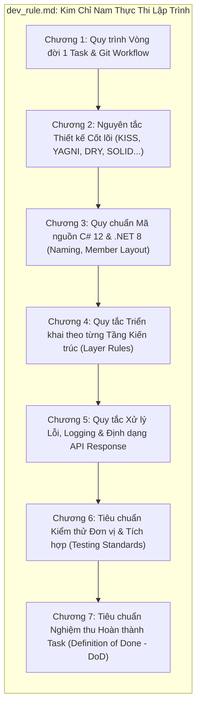

# QUY CHUẨN THỰC THI LẬP TRÌNH & NGUYÊN TẮC PHÁT TRIỂN HỆ THỐNG
# HỆ THỐNG QUẢN LÝ PHÒNG TẬP THỂ THAO (GYM MANAGEMENT SYSTEM)
**Tài liệu tham chiếu:** [`PRD.md`](file:///c:/Users/nguye/Desktop/Gym-management/Document/PRD.md) | [`predevrule.md`](file:///c:/Users/nguye/Desktop/Gym-management/Document/predevrule.md) | [`task.md`](file:///c:/Users/nguye/Desktop/Gym-management/Document/task.md) | [`dev_mapping.md`](file:///c:/Users/nguye/Desktop/Gym-management/Document/dev_mapping.md)

---

## MỤC TIÊU & PHẠM VI ÁP DỤNG

Tài liệu này là **Quy chuẩn Kỹ thuật Thực thi Bắt buộc (Mandatory Engineering Standard)** của dự án Hệ thống Quản lý Phòng tập Thể thao. 

Mọi lập trình viên và AI Agent khi bắt tay vào thực hiện bất kỳ nhiệm vụ nào trong [`task.md`](file:///c:/Users/nguye/Desktop/Gym-management/Document/task.md) (từ Giai đoạn 0 đến Giai đoạn 5) **BẮT BUỘC PHẢI TUÂN THỦ 100%** toàn bộ các nguyên tắc, quy chuẩn đặt tên, bố cục file, ranh giới kiến trúc và tiêu chuẩn nghiệm thu (Definition of Done) được quy định dưới đây.



---

## CHƯƠNG 1: QUY TRÌNH VÒNG ĐỜI THỰC HIỆN 1 TASK (TASK LIFECYCLE)

Mọi task khi được thực hiện đều phải tuân thủ nghiêm ngặt quy trình 8 bước sau:

```text
[1. Nhận diện Task trong task.md] 
       ↓ 
[2. Đối soát PRD (UC/AC) & predevrule.md (Ranh giới kiến trúc)] 
       ↓ 
[3. Viết Mã Nguồn theo Chuẩn C# 12 & .NET 8] 
       ↓ 
[4. Viết Unit / Integration Tests (Mô hình AAA)] 
       ↓ 
[5. Chạy Kiểm tra Cục bộ: dotnet build + dotnet format + dotnet test] 
       ↓ 
[6. Commit theo Chuẩn Conventional Commits] 
       ↓ 
[7. Đánh dấu [x] trong task.md & Ghi nhận vào Document/dev_mapping.md]
       ↓ 
[8. Đẩy lên GitHub xác thực qua CI Quality Gate]
```

### Chi tiết 8 bước thực thi:
1. **Bước 1: Nhận diện Task:** Đọc rõ `Task ID`, `[Type: ...]`, `[Module: ...]`. Chỉ tập trung giải quyết đúng phạm vi của task đó, không sửa lan man sang các module khác.
2. **Bước 2: Đối chiếu Nghiệp vụ:** Tra cứu mã Use Case tương ứng trong Phần II của [`PRD.md`](file:///c:/Users/nguye/Desktop/Gym-management/Document/PRD.md) và bảng Ma trận truy vết (RTM) để hiểu rõ Tiêu chí chấp nhận (Acceptance Criteria - AC).
3. **Bước 3: Lập trình:** Viết code tuân thủ ranh giới 3 lớp và Dependency Rule (Presentation $\rightarrow$ Core Contracts $\rightarrow$ Data Access).
4. **Bước 4: Kiểm thử song hành (Test-Alongside):** Viết test ngay trong thư mục `tests/` tương ứng (`UnitTests`, `DataTests`, hoặc `ApiTests`).
5. **Bước 5: Thẩm định chất lượng cục bộ:**
   * `dotnet build GymManagement.sln -c Release` (0 Errors).
   * `dotnet format GymManagement.sln --verify-no-changes` (Đạt chuẩn formatting).
   * `dotnet test --no-build` (100% test cases pass).
6. **Bước 6: Quy ước Git Commit:**
   * Cú pháp chuẩn Conventional Commits: `<type>(<scope>): <mô tả ngắn ngọn>`
   * Các type hợp lệ: `feat:`, `fix:`, `test:`, `refactor:`, `chore:`, `ci:`, `docs:`.
   * Ví dụ: `feat(server/member): implement QR code generation and subscription renewal (Task 2.3)`
7. **Bước 7: Đóng Task & Ghi Sổ Ánh Xạ Kỹ Thuật (`dev_mapping.md`):**
   * Đổi `[ ]` thành `[x]` trong cả `task.md` và `Document/task.md`.
   * **Bắt buộc:** Ghi nhận thông tin chi tiết của task vừa hoàn thành vào [`Document/dev_mapping.md`](file:///c:/Users/nguye/Desktop/Gym-management/Document/dev_mapping.md) (mã nguồn, kiểm thử, bảng CSDL liên quan, commit hash).
8. **Bước 8: Xác thực qua CI:** Đẩy commit lên branch trên GitHub và đảm bảo `CI Quality Gate` báo trạng thái Xanh (Pass).

---

## CHƯƠNG 2: NGUYÊN TẮC THIẾT KẾ & TRIẾT LÝ LẬP TRÌNH CỐT LÕI

Mọi đoạn mã trong hệ thống Gym Management đều phải thấm nhuần 8 nguyên tắc sau:

```mermaid
flowchart LR
    KISS["1. KISS<br>(Keep It Simple)"]
    YAGNI["2. YAGNI<br>(You Aren't Gonna Need It)"]
    DRY["3. DRY<br>(Don't Repeat Yourself)"]
    SOLID["4. SOLID<br>(Đặc biệt SRP & DIP)"]
    FailFast["5. Fail-Fast<br>(& Guard Clauses)"]
    Defensive["6. Immutability<br>(& Defensive Coding)"]
    BoyScout["7. Boy Scout Rule<br>(Luôn dọn dẹp code)"]
    NoSecret["8. Zero Secrets<br>(Không hardcode khóa)"]
    
    KISS --- YAGNI --- DRY --- SOLID --- FailFast --- Defensive --- BoyScout --- NoSecret
```



### 1. KISS (Keep It Simple, Stupid) — Đơn giản là thượng sách
* **Tính dễ đọc là ưu tiên số 1:** Viết code tường minh, trực diện. Tránh viết những câu lệnh một dòng (one-liners) phức tạp, lắt léo khó debug.
* **Chống Over-Engineering:** Không tự ý tạo thêm các tầng trung gian trừu tượng không cần thiết. Không dùng Mediator/CQRS hay Abstract Factory khi chỉ cần Service Interface + Dependency Injection đơn giản là đủ đáp ứng.
* **Hàm ngắn gọn, đơn mục đích:** Mỗi hàm lý tưởng chỉ nên dài từ 20 đến 40 dòng, giải quyết trọn vẹn đúng 1 mục tiêu duy nhất.

### 2. YAGNI (You Aren't Gonna Need It) — Chỉ làm đúng những gì cần
* Tuyệt đối **không lập trình đón đầu tương lai**: Chỉ hiện thực đúng các trường dữ liệu, phương thức và endpoint được quy định trong 37 Use Cases của [`PRD.md`](file:///c:/Users/nguye/Desktop/Gym-management/Document/PRD.md) và đúng 9 bảng CSDL trong [`GymManagement_Physical_Model.sql`](file:///c:/Users/nguye/Desktop/Gym-management/Document/GymManagement_Physical_Model.sql).
* Không tự ý thêm cột "dự phòng", không thêm bảng mở rộng, không thêm các API "tiện ích" chưa nằm trong Acceptance Criteria (AC).

### 3. DRY (Don't Repeat Yourself) — Không nhân bản logic
* Tập trung toàn bộ quy tắc nghiệp vụ (tính ngày hết hạn, kiểm tra xung đột ca dạy PT, tính phạt hủy ca $< 2\text{h}$) vào duy nhất tầng `Server.Core`. Cấm tuyệt đối việc sao chép (duplicate) logic nghiệp vụ sang Desktop Client hay Web Client.
* DTOs và Contracts dùng chung qua `GymManagement.Server.Core.Contracts` và `DTOs`.
* **Ranh giới hợp lý (Rule of Three):** Không gượng ép DRY giữa các tầng kiến trúc khác nhau (ví dụ: không dùng chung Database Entity cho tầng UI chỉ để "tiết kiệm tạo class DTO").

### 4. SOLID Principles (Đặc biệt chú trọng SRP và DIP)
* **Single Responsibility Principle (SRP):** Mỗi Service chỉ đảm nhiệm đúng miền nghiệp vụ của mình (`CheckInService` chỉ quản lý điểm danh, `BillingService` chỉ quản lý hóa đơn/tiền). Nếu một thao tác cần chạm đến miền khác, hãy gọi Service phụ trách qua Interface thay vì tự ý can thiệp dữ liệu bảng khác.
* **Dependency Inversion Principle (DIP):** Các tầng Presentation và Business Logic chỉ phụ thuộc vào Abstractions (Interfaces như `IUnitOfWork`, `IMemberService`, `INotificationAdapter`), không bao giờ phụ thuộc trực tiếp vào Concrete Implementations hay EF Core DbContext.

### 5. Fail-Fast & Guard Clauses (Báo lỗi sớm, dứt khoát)
* **Kiểm tra hợp lệ ngay đầu hàm (Guard Clauses):** Bắt lỗi tham số null, lỗi logic hoặc vi phạm quyền hạn ngay khi vừa bước vào hàm:
  ```csharp
  ArgumentNullException.ThrowIfNull(request);
  if (request.DurationDays <= 0) 
      throw new ValidationException("Thời lượng gói tập phải lớn hơn 0.");
  ```
* **Tránh "Kim tự tháp lồng nhau" (Arrow Anti-Pattern):** Dùng `return` hoặc `throw` sớm để giữ mã nguồn thẳng hàng (Flat code structure), tuyệt đối không lồng ghép `if/else` quá 3 cấp độ.

### 6. Defensive Coding & Immutability (Lập trình phòng vệ & Bất biến)
* Dữ liệu truyền nhận giữa các tầng (DTOs) luôn dùng `record` hoặc `readonly` / `init-only`.
* Luôn bật `<Nullable>enable</Nullable>` và kiểm tra null cẩn trọng, không cho phép null rò rỉ âm thầm gây `NullReferenceException`.
* Mọi tác vụ I/O (Database query, HTTP request, File read) **bắt buộc** phải nhận `CancellationToken`.

### 7. Boy Scout Rule (Quy tắc Hướng đạo sinh)
* *"Luôn để khu đất cắm trại sạch hơn lúc bạn đến"*: Khi mở bất kỳ file nào ra để làm task, nếu thấy `using` thừa, biến chưa dùng, định dạng lộn xộn hoặc comment lỗi thời, hãy dọn dẹp sạch sẽ trước khi commit.

### 8. Zero Hardcoded Secrets (Không lưu mã bí mật trong code)
* Tuyệt đối không hardcode Chuỗi kết nối CSDL (Connection Strings), Khóa bí mật JWT (Secret Keys), Mật khẩu mặc định, hoặc API Key VietQR/Email vào mã nguồn C#. Toàn bộ phải được cấu hình an toàn qua `appsettings.json` và nạp qua `IConfiguration`.

---

## CHƯƠNG 3: QUY CHUẨN MÃ NGUỒN C# 12 & .NET 8 (CODING STANDARDS)

### 3.1. Quy tắc Đặt tên Hàm / Phương thức (Function & Method Naming)
* **Cú pháp chung:** Sử dụng **`PascalCase`**, luôn bắt đầu bằng **Động từ thể hiện hành động rõ ràng (`Verb + Noun`)**:
  * Truy vấn dữ liệu: `GetByIdAsync`, `GetActiveSubscriptionsByMemberIdAsync`, `FindTrainerAvailabilityAsync`.
  * Thao tác nghiệp vụ: `RegisterMemberAsync`, `RenewSubscriptionAsync`, `CheckInAsync`, `CancelSessionAsync`, `CalculateLateCancellationPenalty`.
  * Xác thực / Kiểm tra: `ValidateCheckInEligibilityAsync`, `VerifyPasswordHash`, `EnsureScheduleNoConflictAsync`.
* **Hàm trả về kiểu Boolean:** Bắt buộc bắt đầu bằng các trợ động từ nghi vấn: **`Is...`**, **`Has...`**, **`Can...`**, **`Should...`**:
  * Ví dụ: `IsSubscriptionActive()`, `HasRemainingSessions()`, `CanCancelWithoutPenalty()`, `IsSlotOverlapping()`.
* **Hậu tố Asynchronous:** Mọi hàm `async` bắt buộc có hậu tố **`Async`** và luôn nhận tham số `CancellationToken cancellationToken = default` ở vị trí cuối cùng.
* **Cấm kỵ:** Tuyệt đối không đặt tên hàm mơ hồ hoặc tối nghĩa như: `DoWork()`, `Process()`, `Handle()`, `ExecuteData()`.

### 3.2. Quy tắc Đặt tên Biến & Hằng số (Variable & Constant Naming)
* **Biến cục bộ & Tham số hàm (Local Variables & Parameters):**
  * Sử dụng **`camelCase`** (ví dụ: `memberId`, `subscriptionPlan`, `checkInTime`, `cancellationToken`).
  * Tên biến phải có ý nghĩa biểu đạt ngữ cảnh; **cấm đặt tên biến 1 chữ cái** (ví dụ: `x`, `y`, `d`, `temp`), ngoại trừ biến đếm vòng lặp ngắn (`i`, `j`, `k`).
* **Biến Boolean:** Bắt buộc có tiền tố trạng thái rõ nghĩa:
  * Ví dụ: `isActive`, `hasPaid`, `isExpired`, `canCheckIn`, `isRefunded`.
* **Biến thành viên của lớp (Private Instance Fields):**
  * Bắt buộc có tiền tố gạch dưới **`_`** kèm **`camelCase`** (ví dụ: `_unitOfWork`, `_logger`, `_dateTimeProvider`, `_notificationAdapter`).
* **Hằng số (Constants):**
  * Sử dụng **`UPPER_SNAKE_CASE`** hoặc **`PascalCase`** có nghĩa cố định rõ ràng.
  * Ví dụ: `public const int CANCELLATION_GRACE_PERIOD_HOURS = 2;`, `public const int DEFAULT_PAGE_SIZE = 20;`.
* **Biến Static Readonly:**
  * Dùng tiền tố **`s_`** kèm `camelCase` hoặc `_camelCase` (ví dụ: `private static readonly TimeSpan s_defaultTimeout = TimeSpan.FromSeconds(30);`).

### 3.3. Quy tắc Vị trí Khai báo Thành viên trong File (File Member Layout & Declaration Order)
> [!IMPORTANT]
> **QUY TẮC BẤT DI BẤT DỊCH VỀ VỊ TRÍ BIẾN TOÀN CỤC / CLASS FIELDS:**
> * Toàn bộ các biến cấp độ lớp (Constants, Static fields, Private readonly fields, Injected Dependencies, Properties) **BẮT BUỘC PHẢI KHAI BÁO TẬP TRUNG TẠI ĐẦU CLASS / ĐẦU FILE**.
> * **TUYỆT ĐỐI CẤM (STRICTLY FORBIDDEN):** Không khai báo biến toàn cục/fields rải rác ở giữa các phương thức hoặc đặt ở cuối file. Mọi lập trình viên mở file ra phải nhìn thấy toàn bộ dependencies và state ngay dòng đầu tiên.

**Bố cục chuẩn trong một file C# từ trên xuống dưới:**
```csharp
namespace GymManagement.Server.Core.Services;

public class MemberService : IMemberService
{
    // ====================================================================
    // 1. CONSTANTS & STATIC FIELDS (Khai báo đầu tiên)
    // ====================================================================
    public const int DEFAULT_EXPIRY_DAYS = 30;
    private static readonly TimeSpan s_defaultLockoutTime = TimeSpan.FromMinutes(15);

    // ====================================================================
    // 2. INJECTED DEPENDENCIES & PRIVATE FIELDS (Ngay sau constants)
    // ====================================================================
    private readonly IUnitOfWork _unitOfWork;
    private readonly ILogger<MemberService> _logger;
    private readonly INotificationAdapter _notificationAdapter;

    // ====================================================================
    // 3. CONSTRUCTOR (Khởi tạo và inject dependencies)
    // ====================================================================
    public MemberService(
        IUnitOfWork unitOfWork, 
        ILogger<MemberService> logger,
        INotificationAdapter notificationAdapter)
    {
        _unitOfWork = unitOfWork;
        _logger = logger;
        _notificationAdapter = notificationAdapter;
    }

    // ====================================================================
    // 4. PUBLIC PROPERTIES (Nếu có)
    // ====================================================================
    public string ServiceName => nameof(MemberService);

    // ====================================================================
    // 5. PUBLIC METHODS / INTERFACE IMPLEMENTATIONS (Nghiệp vụ chính)
    // ====================================================================
    public async Task<MemberDto> RegisterMemberAsync(RegisterMemberRequest request, CancellationToken cancellationToken = default)
    {
        // Thực thi nghiệp vụ...
    }

    public async Task<SubscriptionDto> RenewSubscriptionAsync(RenewSubscriptionRequest request, CancellationToken cancellationToken = default)
    {
        // Thực thi nghiệp vụ...
    }

    // ====================================================================
    // 6. PRIVATE HELPER METHODS (Luôn đặt ở cuối cùng của file)
    // ====================================================================
    private static string GenerateQrCodeString(Guid userId)
    {
        return $"GYM-{userId:N}-{DateTime.UtcNow.Ticks}";
    }
}
```

### 3.4. Tính năng Hiện đại của C# 12 & .NET 8
* Sử dụng **File-scoped namespace** (`namespace GymManagement.Server.Core.Services;`).
* Bật **Nullable Reference Types** (`<Nullable>enable</Nullable>`) trên toàn solution. Tuyệt đối không dùng toán tử `!` (null-forgiving) trừ khi đã kiểm tra null chặt chẽ.
* Dùng **Primary Constructors** cho DI khi không cần gán logic phức tạp trong Constructor.
* Dùng `record` cho toàn bộ DTOs để bảo đảm tính bất biến (Immutability):
  ```csharp
  public record MemberDto(Guid UserId, string FullName, string Phone, string Email, string Status);
  ```

---

## CHƯƠNG 4: QUY TẮC TRIỂN KHAI THEO TỪNG THÀNH PHẦN (LAYER RULES)

### 4.1. Thành phần `GymManagement.Server.Core` (7 Service Components)
* **Nguyên tắc độc lập:** Không tham chiếu đến bất kỳ project Web, UI hay EF Core nào.
* **Giao tiếp qua Contracts:** Mọi service triển khai từ Interface tại `GymManagement.Server.Core.Contracts` (`IAuthService`, `IMemberService`, `ICheckInService`, `IPtService`, `IBillingService`, `IReportService`, `ISystemSettingService`).
* **Không làm việc với Entity CSDL:** Service chỉ nhận Request DTO và trả về Response DTO / Domain Model, không bao giờ trả Database Entity ra ngoài Presentation.
* **Xử lý giao dịch đa bảng (ACID):** Khi thực hiện các luồng nghiệp vụ phức tạp (ví dụ: Tạo hóa đơn + Kích hoạt gói tập), bắt buộc dùng `IUnitOfWork.ExecuteTransactionAsync` để tự động Rollback nếu có lỗi.

### 4.2. Thành phần `GymManagement.Server.Data` (Database API & Adapters)
* **Chuẩn hóa 9 bảng SQL Server:** Chỉ tạo đúng 9 Entity tương ứng với DDL trong `GymManagement_Physical_Model.sql` (`Role`, `[User]`, `PackagePlan`, `PTAvailability`, `PTTrainingSession`, `MemberSubscription`, `CheckInLog`, `Invoice`, `MemberBodyMetric`).
* **Fluent API Configuration:** Tách riêng từng cấu hình bảng vào thư mục `Configurations/` bằng cách triển khai `IEntityTypeConfiguration<T>`. Không viết dồn toàn bộ vào `OnModelCreating`.
* **Repository Pattern:** `IGenericRepository<T>` hỗ trợ các thao tác cơ bản; các truy vấn đặc thù (Aggregate, Report) đặt trong Repository chuyên biệt.
* **External Adapters:** `VietQrAdapter` (cổng Payment API), `NotificationAdapter` (cổng SMS/Email), `CameraScannerAdapter` phải được cấu hình linh hoạt (hỗ trợ Mock khi chạy môi trường Dev/Test).

### 4.3. Thành phần `GymManagement.Server.Api` (GymManagement API & Authenticated)
* **Chuẩn RESTful:** URL dạng danh từ số nhiều: `/api/v1/members`, `/api/v1/check-in`, `/api/v1/pt-sessions`.
* **Phân quyền RBAC qua Claims:** Mọi Endpoint (ngoại trừ Auth) bắt buộc gắn `[Authorize]` hoặc `[Authorize(Roles = "Admin,PT,Member")]`.
* **Không xử lý nghiệp vụ trong Controller:** Controller chỉ đóng vai trò tiếp nhận HTTP, trích xuất Claims người dùng, chuyển tiếp vào Core Service và trả về HTTP Status phù hợp.

### 4.4. Thành phần `GymManagement.Desktop` (Admin App - WinUI 3)
* **Mô hình MVVM:** Bắt buộc sử dụng `CommunityToolkit.Mvvm` (`[ObservableProperty]`, `[RelayCommand]`).
* **Ranh giới công nghệ:** Desktop App chỉ gọi `GymManagement API` qua HTTP Client, tuyệt đối không kết nối trực tiếp CSDL.
* **Trải nghiệm người dùng:** Các thao tác gọi API phải bất đồng bộ (`async/await`), hiển thị `ProgressRing` khi đang tải và có thông báo lỗi dạng `InfoBar` hoặc `ContentDialog`.

### 4.5. Thành phần `GymManagement.Web` (Member/PT Portal - Blazor Server)
* **Responsive UI:** Thiết kế tương thích máy tính, máy tính bảng và điện thoại di động.
* **Phiên làm việc:** Quản lý bối cảnh đăng nhập qua `CustomAuthenticationStateProvider`.

---

## CHƯƠNG 5: QUY TẮC XỬ LÝ LỖI, LOGGING & ĐỊNH DẠNG API RESPONSE CHUẨN

### 5.1. Cấu trúc ApiResponse Thống Nhất
Mọi API Endpoint trả về một cấu trúc phản hồi bất biến đồng nhất:
```csharp
public record ApiResponse<T>(
    bool Success, 
    T? Data, 
    string? ErrorCode = null, 
    string? Message = null
);
```

### 5.2. Hệ thống Ngoại lệ Miền (Domain Exceptions)
Không bắt lỗi chung chung bằng `Exception`. Hãy sử dụng các Custom Exceptions chuẩn nghĩa:
* `ValidationException`: Dữ liệu đầu vào sai định dạng (HTTP 400 Bad Request).
* `NotFoundException`: Không tìm thấy tài nguyên yêu cầu (HTTP 404 Not Found).
* `BusinessRuleException`: Vi phạm quy tắc phòng gym (ví dụ: thẻ hết hạn, hủy ca $<2\text{h}$, trùng lịch PT) (HTTP 422 Unprocessable Entity hoặc HTTP 409 Conflict).
* `UnauthorizedAccessException`: Sai mật khẩu hoặc không có quyền truy cập (HTTP 401 Unauthorized / HTTP 403 Forbidden).

### 5.3. Global Exception Handling Middleware
* Tự động bắt mọi ngoại lệ chưa được xử lý, ghi log chi tiết mã lỗi (Error StackTrace) vào `ILogger` và trả về `ApiResponse` chuẩn cho Client, không làm lộ thông tin nhạy cảm của server.

---

## CHƯƠNG 6: QUY CHUẨN KIỂM THỬ ĐƠN VỊ & TÍCH HỢP (TESTING STANDARDS)

### 6.1. Cấu trúc Thư mục Tests
* `tests/GymManagement.Server.UnitTests`: Kiểm thử 7 Core Services (Mock toàn bộ Repositories qua `Moq`).
* `tests/GymManagement.Server.DataTests`: Kiểm thử EF Core, DbContext và ràng buộc 9 bảng CSDL.
* `tests/GymManagement.Server.ApiTests`: Kiểm thử tích hợp Endpoints qua `WebApplicationFactory`.

### 6.2. Quy tắc Đặt tên Test Method
Cú pháp chuẩn: `[TênPhươngThức]_[ĐiềuKiệnĐầuVào]_[KếtQuảKỳVọng]`
* Ví dụ: `CheckInAsync_WhenSubscriptionIsExpired_ThrowsBusinessRuleException`
* Ví dụ: `BookSessionAsync_WhenSlotAlreadyBooked_ThrowsScheduleConflictException`

### 6.3. Mô hình Arrange - Act - Assert (AAA)
Mọi test case phải phân tách rõ ràng 3 khối:
```csharp
[Fact]
public async Task CheckInAsync_WhenValidQrCode_ShouldReturnSuccessAndDeductSession()
{
    // Arrange: Thiết lập dữ liệu giả lập và Mock behavior
    var request = new CheckInRequest("VALID-QR-STRING");
    // ... setup mocks ...

    // Act: Thực thi phương thức cần kiểm thử
    var result = await _checkInService.CheckInAsync(request, CancellationToken.None);

    // Assert: Xác minh kết quả trả về và các lệnh gọi mock
    Assert.True(result.Success);
    _unitOfWorkMock.Verify(u => u.CommitAsync(It.IsAny<CancellationToken>()), Times.Once);
}
```

### 6.4. Mục tiêu Độ Phủ Code (Code Coverage)
Tối thiểu **$\ge 80\%$** cho toàn bộ logic nghiệp vụ trong `GymManagement.Server.Core`.

---

## CHƯƠNG 7: TIÊU CHUẨN NGHIỆM THU HOÀN THÀNH TASK (DEFINITION OF DONE - DoD)

Một task trong `task.md` chỉ được phép chuyển trạng thái sang `[x]` khi thỏa mãn **toàn bộ 10 tiêu chí DoD**:

- [ ] **DoD 1 (Ranh giới Kiến trúc):** Không vi phạm quy tắc phụ thuộc 1 chiều (Presentation không tham chiếu Data/EF Core; Core không tham chiếu Presentation/Data).
- [ ] **DoD 2 (Nghiệp vụ PRD):** Thỏa mãn đầy đủ Tiêu chí Chấp nhận (AC) của Use Case tương ứng.
- [ ] **DoD 3 (Async & Cancellation):** Mọi hàm I/O đều là `async/await` và có `CancellationToken`.
- [ ] **DoD 4 (CSDL Chuẩn):** Thao tác dữ liệu đúng 9 bảng, không tự tạo bảng mới ngoài DDL.
- [ ] **DoD 5 (Kiểm thử):** Có ít nhất 1 Unit/Integration Test tương ứng, test chạy Pass 100%.
- [ ] **DoD 6 (Bố cục & Đặt tên):** Tên hàm bắt đầu bằng động từ (`Verb + Noun`), biến có ý nghĩa ngữ cảnh, và **toàn bộ hằng số/biến toàn cục/fields BẮT BUỘC nằm ở đầu file, không khai báo rải rác**.
- [ ] **DoD 7 (Code Cleanliness):** Chạy `dotnet format` không còn lỗi format hay warning nghiêm trọng.
- [ ] **DoD 8 (Biên dịch Không Lỗi):** `dotnet build` đạt 0 Errors.
- [ ] **DoD 9 (CI Green):** Đẩy lên Git và Pipeline CI trên GitHub Actions báo trạng thái Xanh (Pass).
- [ ] **DoD 10 (Sổ Ánh Xạ Kỹ Thuật):** Đã ghi lại nhật ký ánh xạ kỹ thuật chi tiết của task vào [`Document/dev_mapping.md`](file:///c:/Users/nguye/Desktop/Gym-management/Document/dev_mapping.md) (mã nguồn, kiểm thử, bảng CSDL, commit).
