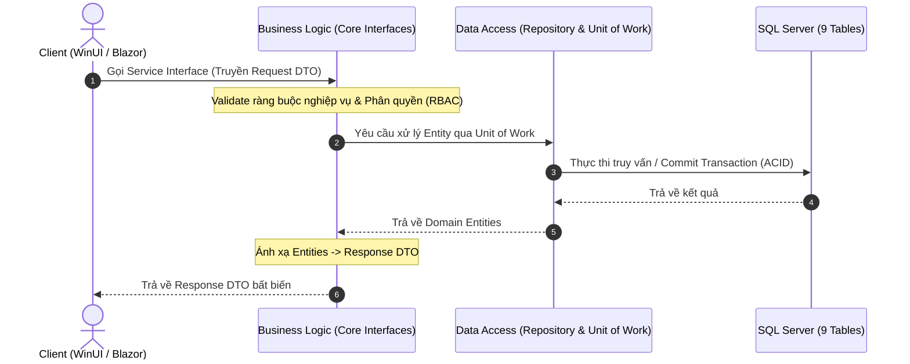
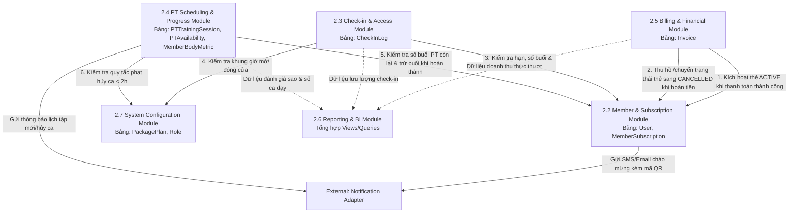

# QUY TẮC PHÁT TRIỂN & TÀI LIỆU KIẾN TRÚC 3 LỚP (PRE-DEV RULES)
# HỆ THỐNG QUẢN LÝ PHÒNG TẬP THỂ THAO (GYM MANAGEMENT SYSTEM)

---

## 1. TỔNG QUAN KIẾN TRÚC HỆ THỐNG (3-TIER ARCHITECTURE)

Hệ thống được thiết kế theo chuẩn **Kiến trúc 3 Lớp (3-Tier Architecture)** nhằm đảm bảo tính phân tách trách nhiệm (Separation of Concerns), dễ bảo trì, mở rộng và kiểm thử độc lập:

```
┌─────────────────────────────────────────────────────────────────────────────────┐
│ TẦNG 1: PRESENTATION LAYER (Giao diện & Cổng Điều hướng)                        │
│  ├── 1.1 Desktop Admin Client (WinUI 3): Lễ tân, Thu ngân, Admin                │
│  ├── 1.2 Member & PT Portal (Blazor Server): Cổng Hội viên & Huấn luyện viên     │
│  └── 1.3 API Gateway / Controller: Tiếp nhận HTTP/JSON, phân quyền JWT Claims   │
└────────────────────────────────────────┬────────────────────────────────────────┘
                                         │ Giao tiếp qua Contracts (Interfaces) & DTOs
┌────────────────────────────────────────▼────────────────────────────────────────┐
│ TẦNG 2: BUSINESS LOGIC LAYER (BLL / GymManagement.Core - Nghiệp Vụ Cốt Lõi)     │
│  ├── 2.1 Authentication & RBAC Module (UC01)                                    │
│  ├── 2.2 Member & Subscription Lifecycle Module (UC02, UC09)                    │
│  ├── 2.3 Check-in & Access Control Module (UC03)                                │
│  ├── 2.4 PT Scheduling & Progress Module (UC04, UC08, UC10)                      │
│  ├── 2.5 Billing & Financial Module (UC05)                                      │
│  ├── 2.6 Reporting & BI Analytics Module (UC06)                                 │
│  └── 2.7 System Configuration & Catalog Module (UC07)                           │
└────────────────────────────────────────┬────────────────────────────────────────┘
                                         │ Thực thi qua Repository Interfaces & Unit of Work
┌────────────────────────────────────────▼────────────────────────────────────────┐
│ TẦNG 3: DATA ACCESS LAYER (DAL / GymManagement.Infrastructure - Dữ Liệu)        │
│  ├── 3.1 Entity Repositories & Unit of Work (Quản lý giao dịch ACID)            │
│  ├── 3.2 Database Persistence (Chuẩn hóa đúng 9 bảng trong SQL Server)          │
│  └── 3.3 External Adapters (VietQR NAPAS, Camera Barcode/QR, Email/SMS)         │
└─────────────────────────────────────────────────────────────────────────────────┘
```

---

## 2. PHÂN BỐ MODULE THEO TỪNG TẦNG KIẾN TRÚC

### 2.1. Tầng 1: Presentation Layer (Giao diện người dùng)
* **1.1 Desktop Admin Client (`GymManagement.Desktop` - WinUI 3):**
  * Dành riêng cho nhân sự vận hành tại quầy: Admin, Lễ tân, Thu ngân.
  * Đảm nhiệm các tác vụ nặng: Quản lý hồ sơ hội viên, quét webcam QR check-in tốc độ cao, lập hóa đơn thu ngân POS, xếp lịch trực quan cho PT, xem Dashboard báo cáo quản trị.
* **1.2 Member & PT Portal (`GymManagement.Web` - Blazor Server):**
  * Cổng tác nghiệp trực tuyến chuẩn Responsive dành cho Hội viên và Huấn luyện viên.
  * Phía Hội viên: Thẻ tập số (mã QR check-in cá nhân), đặt/đổi/hủy lịch tập PT, theo dõi chỉ số thể hình InBody, đánh giá chất lượng ca dạy (1–5 sao).
  * Phía Huấn luyện viên (PT): Đăng ký khung giờ làm việc rảnh theo tuần, xem thời khóa biểu, theo dõi danh sách học viên phụ trách, nhập số đo InBody và bấm xác nhận hoàn tất ca dạy trực tiếp.
* **1.3 API Gateway / Controllers:**
  * Tiếp nhận yêu cầu HTTP/JSON từ các client, kiểm tra xác thực JWT Token, phân quyền người dùng thông qua Role Claims (`Admin`, `PT`, `Member`) trước khi chuyển tiếp vào tầng Business Logic.

### 2.2. Tầng 2: Business Logic Layer (BLL / `GymManagement.Core`)
Tầng xử lý toàn bộ quy tắc nghiệp vụ, tính toán thời hạn, kiểm tra điều kiện và ràng buộc logic:
* **2.1 Auth & RBAC Module (`IAuthService`):**
  * Xác thực thông tin đăng nhập, đối soát mật khẩu băm (BCrypt), kiểm tra trạng thái khóa tài khoản (`LOCKED`), sinh JWT Token chứa claims vai trò (UC01).
* **2.2 Member & Subscription Lifecycle Module (`IMemberService`):**
  * Tiếp nhận đăng ký mới, tính toán ngày hết hạn, sinh chuỗi định danh QR, gia hạn/nâng cấp gói, bảo lưu thời hạn (`FROZEN`), hủy đăng ký gói (`CANCELLED`), cập nhật hồ sơ cá nhân (UC02, UC09).
* **2.3 Check-in & Access Control Module (`ICheckInService`):**
  * Chốt chặn kiểm soát vào phòng: Kiểm tra trạng thái thẻ (`ACTIVE`), kiểm tra hạn dùng, số buổi còn lại và khung giờ hợp lệ; tự động trừ buổi tập đối với gói tính theo lượt, ghi nhận lịch sử ra/vào (UC03).
* **2.4 PT Scheduling & Progress Module (`IPtService`):**
  * Quản trị hồ sơ PT, phân công PT cố định cho học viên, thuật toán kiểm tra chống xung đột lịch dạy (Overlapping Check), hội viên đặt/đổi/hủy ca (áp dụng quy tắc phạt không hoàn buổi nếu hủy $< 2\text{h}$), cập nhật số đo InBody định kỳ, xác nhận hoàn thành ca tập, ghi nhận đánh giá sao (UC04, UC08, UC10).
* **2.5 Billing & Financial Module (`IBillingService`):**
  * Lập hóa đơn POS đa dịch vụ, tích hợp sinh mã VietQR động chuẩn NAPAS, xử lý hủy hóa đơn và hoàn tiền theo chính sách, trích xuất báo cáo doanh thu tài chính (UC05).
* **2.6 Reporting & BI Analytics Module (`IReportService`):**
  * Tổng hợp số liệu đa chiều: Doanh thu thực thu, biến động hội viên mới/tái tục, lưu lượng check-in theo khung giờ, hiệu suất giảng dạy và điểm đánh giá của PT; xuất dữ liệu ra file Excel (.xlsx) và PDF (UC06).
* **2.7 System Configuration & Catalog Module (`ISystemSettingService`):**
  * Quản trị tài khoản nhân viên và phân quyền (RBAC), quản lý danh mục gói tập (thêm mới, chỉnh sửa, chuyển trạng thái ngừng kinh doanh `DISCONTINUED`), cài đặt tham số vận hành chung (UC07).

### 2.3. Tầng 3: Data Access Layer (DAL / `GymManagement.Infrastructure`)
* **3.1 Repositories & Unit of Work:**
  * Quản trị phiên kết nối ORM (EF Core) tới SQL Server. Áp dụng mẫu thiết kế Unit of Work để đảm bảo tính toàn vẹn giao dịch (ACID Transaction) khi một nghiệp vụ tác động lên nhiều bảng đồng thời.
* **3.2 Database Persistence (Chuẩn hóa 9 bảng SQL Server):**
  * Toàn bộ dữ liệu được lưu trữ cố định trên 9 bảng theo đúng DDL trong `GymManagement_Physical_Model.sql`:
    1. `Role`: Danh mục vai trò hệ thống.
    2. `[User]`: Tài khoản người dùng dùng chung (Admin, PT, Member).
    3. `PackagePlan`: Danh mục gói tập.
    4. `PTAvailability`: Khung giờ rảnh theo tuần của PT.
    5. `PTTrainingSession`: Ca tập luyện giữa PT và học viên (gộp cả đánh giá, sao, nhận xét).
    6. `MemberSubscription`: Thẻ tập hội viên (gộp cả thông tin bảo lưu và PT phụ trách).
    7. `CheckInLog`: Nhật ký điểm danh ra/vào cơ sở.
    8. `Invoice`: Hóa đơn tài chính (gộp cả thông tin hoàn tiền).
    9. `MemberBodyMetric`: Chỉ số phát triển thể hình InBody.
* **3.3 External Adapters & Drivers:**
  * `Camera Scanner Adapter`: Kết nối webcam giải mã chuỗi QR điểm danh.
  * `VietQR Adapter`: Tích hợp chuẩn NAPAS sinh chuỗi thanh toán ngân hàng tự động.
  * `Notification Adapter`: Cổng gửi SMS/Email chào mừng, hóa đơn và nhắc lịch tập.

---

## 3. CƠ CHẾ GIAO TIẾP GIỮA CÁC MODULE

### 3.1. Giao tiếp Dọc (Vertical Flow)



* **Quy tắc Presentation $\leftrightarrow$ Business Logic:**
  * Presentation Layer chỉ phụ thuộc vào **Interface** (Contracts) tại `GymManagement.Core.Contracts` (như `IMemberService`, `ICheckInService`, `IBillingService`, `IPtService`).
  * Toàn bộ dữ liệu truyền vào và trả ra bắt buộc phải là **DTO (Data Transfer Objects)** thuần túy tại `GymManagement.Core.DTOs`. Presentation tuyệt đối không được tham chiếu hay thao tác trực tiếp trên Database Entity.
* **Quy tắc Business Logic $\leftrightarrow$ Data Access:**
  * BLL tương tác với DAL qua các Repository Interface và `IUnitOfWork`. DAL phụ trách việc chuyển đổi dữ liệu và thực thi an toàn xuống cơ sở dữ liệu.

---

### 3.2. Giao tiếp Ngang giữa các Module Nghiệp vụ (Inter-Module / Cross-Cutting Flow)

Các quy trình nghiệp vụ phức tạp phối hợp giữa các module nghiệp vụ ở tầng BLL theo luồng sau:



1. **Luồng Thanh toán & Kích hoạt Thẻ tập (UC02 + UC05):**
   * Thu ngân xác nhận thu tiền $\rightarrow$ `BillingModule` tạo hóa đơn trạng thái `PAID` trong bảng `Invoice` $\rightarrow$ gọi `MemberModule` tạo thẻ tập `ACTIVE` trong bảng `MemberSubscription` và sinh chuỗi `QrCode` $\rightarrow$ kích hoạt `NotificationAdapter` gửi Email hóa đơn và thông tin thẻ cho khách hàng.
2. **Luồng Điểm danh Check-in Vào phòng (UC03):**
   * Quét QR hoặc nhập SĐT $\rightarrow$ `CheckInModule` tiếp nhận $\rightarrow$ gọi `MemberModule` tra cứu bảng `MemberSubscription` để kiểm tra điều kiện (thẻ `ACTIVE`, không bị `FROZEN` hay `LOCKED`, còn hạn và số buổi) $\rightarrow$ gọi `ConfigModule` đối soát khung giờ mở cửa $\rightarrow$ nếu hợp lệ, tự động trừ 1 buổi tập (với gói theo lượt) và ghi bản ghi vào bảng `CheckInLog`.
3. **Luồng Đặt, Đổi, Hủy & Hoàn tất Ca dạy PT (UC04 + UC08 + UC10):**
   * **Đặt/Đổi lịch:** `PtModule` gọi `MemberModule` kiểm tra `RemainingPtSessions > 0` trong `MemberSubscription` $\rightarrow$ kiểm tra chống trùng lịch trong `PTAvailability` $\rightarrow$ ghi nhận ca hẹn vào `PTTrainingSession`.
   * **Hủy ca:** `PtModule` gọi `ConfigModule` kiểm tra quy định thời gian hủy tối thiểu: nếu hủy trước $\ge 2\text{h}$ thì hoàn lại 1 buổi tập vào `MemberSubscription`; nếu sát giờ tập $< 2\text{h}$ thì áp dụng quy tắc phạt không hoàn lại buổi.
   * **Hoàn tất ca tập:** PT bấm "Xác nhận hoàn thành" $\rightarrow$ `PtModule` gọi `MemberModule` tự động trừ 1 buổi tập PT trong `MemberSubscription` và ghi nhận công dạy cho PT.
4. **Luồng Hủy / Hoàn tiền Hóa đơn (UC05.3):**
   * Admin duyệt yêu cầu hoàn tiền $\rightarrow$ `BillingModule` cập nhật `RefundAmount` và `RefundReason` vào bảng `Invoice` $\rightarrow$ gọi `MemberModule` chuyển trạng thái thẻ tập tương ứng sang `CANCELLED`.
5. **Luồng Báo cáo Quản trị Đa chiều (UC06):**
   * `ReportModule` đóng vai trò module tổng hợp dữ liệu:
     * Trích xuất doanh thu thực thu từ `BillingModule` (bảng `Invoice`).
     * Trích xuất lưu lượng mật độ khách từ `CheckInModule` (bảng `CheckInLog`).
     * Trích xuất biến động hội viên mới/tái gia hạn từ `MemberModule` (bảng `MemberSubscription`).
     * Trích xuất điểm đánh giá và hiệu suất giảng dạy từ `PtModule` (bảng `PTTrainingSession`).

---

## 4. QUY TẮC PHÁT TRIỂN BẮT BUỘC (PRE-DEVELOPMENT RULES)

Trước khi tiến hành viết code, toàn bộ lập trình viên phải tuân thủ nghiêm ngặt 5 nguyên tắc kỹ thuật sau:

### Quy tắc 1: Nguyên tắc Phụ thuộc Một chiều (Dependency Rule)
* **Presentation** chỉ được phép phụ thuộc vào **Business Logic Layer (Core)** thông qua Interfaces và DTOs.
* Tuyệt đối **không** tham chiếu thư viện Data Access hoặc EF Core DbContext từ các project Presentation (`GymManagement.Desktop`, `GymManagement.Web`).
* Mọi hành vi truy xuất cơ sở dữ liệu bắt buộc phải đi qua Service ở tầng Core.

### Quy tắc 2: Bất biến Dữ liệu & Đóng gói DTO (DTO Immutability)
* Dữ liệu truyền giữa các tầng phải sử dụng `record` hoặc `class` có thuộc tính `init-only` (ví dụ: `MemberDto`, `InvoiceDto`).
* Không sử dụng các Entity nội bộ của CSDL (`[User]`, `MemberSubscription`, `Invoice`) để hiển thị trực tiếp lên DataGrid hoặc ViewModels nhằm tránh rò rỉ cấu trúc dữ liệu và lỗi Lazy Loading/Tracking.

### Quy tắc 3: Toàn vẹn Giao dịch (Transactional Integrity)
* Mọi luồng xử lý có tác động đến từ 2 bảng trở lên (ví dụ: Tạo hóa đơn + Kích hoạt thẻ, hoặc Điểm danh + Trừ buổi tập) bắt buộc phải được bao bọc trong một **Database Transaction** duy nhất (sử dụng Unit of Work hoặc `IDbContextTransaction`).
* Nếu bất kỳ bước nào trong quy trình thất bại, toàn bộ giao dịch phải được Rollback về trạng thái ban đầu và trả về mã lỗi rõ ràng cho tầng Presentation.

### Quy tắc 4: Phân quyền & Kiểm tra Bảo mật Chặt chẽ (RBAC Enforcement)
* Mỗi API Endpoint hoặc Service Method phải kiểm tra vai trò người gọi dựa trên JWT Claims:
  * `Admin / Super Admin`: Có toàn quyền quản trị cấu hình, phân công PT, xử lý hóa đơn và hoàn tiền.
  * `PT`: Chỉ có quyền thao tác trên lịch dạy của chính mình, học viên do mình phụ trách và nhập chỉ số InBody.
  * `Member`: Chỉ có quyền xem thông tin cá nhân của bản thân, xem thẻ tập cá nhân và đặt lịch với PT đã được phân công cố định.

### Quy tắc 5: Quy chuẩn Đặt tên & Cấu trúc Mô hình CSDL Chuẩn 9 Bảng
* Toàn bộ mã nguồn Data Access phải tuân thủ chuẩn xác 9 bảng vật lý trong `GymManagement_Physical_Model.sql`. Tuyệt đối không tự ý thêm các bảng độc lập nằm ngoài thiết kế nếu chưa được cập nhật chính thức vào mô hình DDL.

