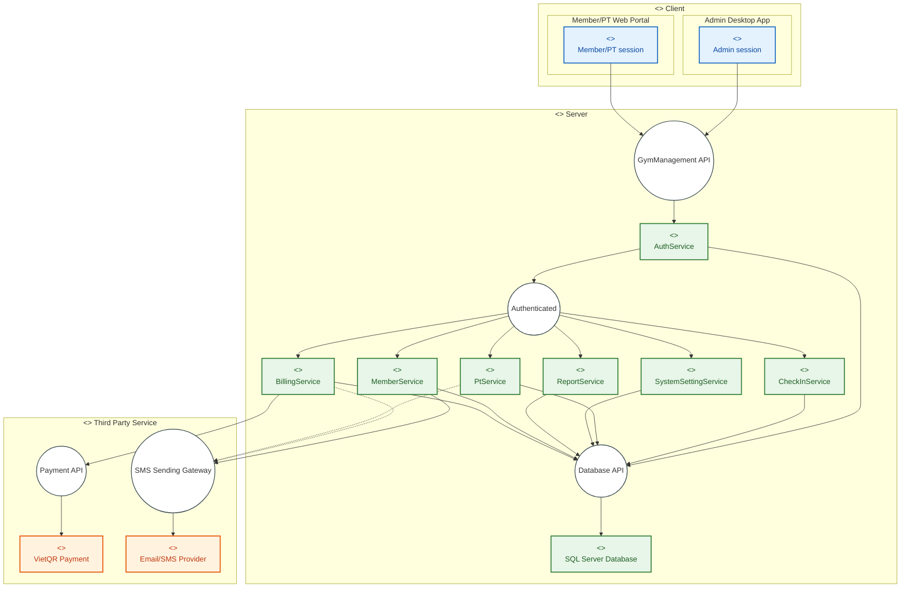

# KẾ HOẠCH & DANH MỤC NHIỆM VỤ PHÁT TRIỂN (PROJECT TASKS ROADMAP)
## HỆ THỐNG QUẢN LÝ PHÒNG TẬP THỂ THAO (GYM MANAGEMENT SYSTEM)
**Kiến trúc:** Chuẩn hóa 100% theo Sơ đồ Thành phần (Component Diagram - Phần 4 PRD)  
**Mô hình:** Client – Server Architecture & Modular Backend Services  
**Phạm vi:** Tạo mới toàn bộ mã nguồn trong thư mục `src` theo đúng ranh giới thành phần (Component Boundaries) và 37 Use Cases.

---

## 1. KHỚP NỐI VỚI SƠ ĐỒ THÀNH PHẦN (COMPONENT DIAGRAM - PRD PHẦN 4)

Dựa trên sơ đồ thành phần kiến trúc chính thức trong [`PRD.md`](PRD.md), hệ thống bao gồm **3 Khối Thành phần Cấp cao (High-Level Components)**:



### Các Ranh Giới Giao Tiếp Chính:
1. **`Client` $\leftrightarrow$ `Server` qua Interface `GymManagement API`:** Giao thức HTTPS / RESTful API (JSON + JWT Token). Cả hai client đều quản lý phiên làm việc riêng (`Admin session` và `Member/PT session`).
2. **Nội bộ `Server` qua Interface `Authenticated`:** Cổng kiểm soát bảo mật trung tâm. Sau khi `AuthService` xác thực danh tính, các service nghiệp vụ (`MemberService`, `BillingService`, `CheckInService`, `PtService`, `ReportService`, `SystemSettingService`) đều yêu cầu bối cảnh xác thực `Authenticated` (JWT Claims).
3. **Nội bộ `Server` qua Interface `Database API`:** Giao diện truy xuất dữ liệu thống nhất (Repository & Unit of Work) kết nối trực tiếp với thực thể `SQL Server Database` (9 bảng vật lý).
4. **`Server` $\rightarrow$ `Third Party Service`:**
   * `Payment API`: Kết nối từ `BillingService` tới `VietQR Payment`.
   * `SMS Sending Gateway`: Kết nối từ `MemberService` / `BillingService` / `PtService` tới `Email/SMS Provider`.

---

## 2. CẤU TRÚC CÂY THƯ MỤC CHUẨN HÓA MỚI (`Tree Structure`)

Để khớp 100% với Sơ đồ Thành phần trên, mã nguồn trong thư mục `src/` và `tests/` được tái cấu trúc thành 2 khối lớn: **`Client/`** và **`Server/`**:

```text
GymManagement.sln
│
├── .github/
│   └── workflows/
│       └── ci.yml                          # CI Pipeline kiểm thử tự động Server Component
│
├── Document/                               # PRD, predevrule, SQL DDL, task.md
│
├── src/
│   ├── Client/                             # <<component>> Client
│   │   ├── GymManagement.Desktop/          # <<component>> Admin Desktop App (WinUI 3)
│   │   │   ├── Sessions/                   # <<component>> Admin session (Quản lý phiên Admin)
│   │   │   ├── Views/ & ViewModels/        # Màn hình POS, Check-in, Hội viên, Lịch PT, Báo cáo
│   │   │   └── Services/                   # Client HTTP gọi tới "GymManagement API"
│   │   │
│   │   └── GymManagement.Web/              # <<component>> Member/PT Web Portal (Blazor Server)
│   │       ├── Sessions/                   # <<component>> Member/PT session (AuthStateProvider)
│   │       ├── Pages/                      # Mã QR gói tập, Đặt lịch PT, InBody, Lịch dạy
│   │       └── Services/                   # Client HTTP gọi tới "GymManagement API"
│   │
│   └── Server/                             # <<component>> Server
│       ├── GymManagement.Server.Api/       # Cung cấp Interface "GymManagement API" (Controllers)
│       │   ├── Controllers/                # Auth, Members, CheckIn, Pt, Billing, Reports, Settings
│       │   ├── Middlewares/                # Hiện thực Interface "Authenticated" (JWT Validator)
│       │   └── Program.cs
│       │
│       ├── GymManagement.Server.Core/      # Chứa toàn bộ 7 Service Components nội bộ Server
│       │   ├── Contracts/                  # C# Service Interfaces
│       │   ├── DTOs/ & Enums/              # DTOs truyền nhận dữ liệu
│       │   └── Services/
│       │       ├── AuthService.cs          # <<component>> AuthService (Cổng Authenticated)
│       │       ├── MemberService.cs        # <<component>> MemberService
│       │       ├── CheckInService.cs       # <<component>> CheckInService
│       │       ├── PtService.cs            # <<component>> PtService
│       │       ├── BillingService.cs       # <<component>> BillingService
│       │       ├── ReportService.cs        # <<component>> ReportService
│       │       └── SystemSettingService.cs # <<component>> SystemSettingService
│       │
│       └── GymManagement.Server.Data/      # Cung cấp Interface "Database API" & "External Adapters"
│           ├── Persistence/                # EF Core DbContext kết nối "SQL Server Database" (9 bảng)
│           ├── Repositories/               # Unit of Work quản lý giao dịch ACID
│           └── Adapters/                   # Hiện thực các cổng ra Third Party
│               ├── VietQrAdapter.cs        # Kết nối Interface "Payment API" (VietQR)
│               ├── NotificationAdapter.cs  # Kết nối Interface "SMS Sending Gateway" (Email/SMS)
│               └── CameraScannerAdapter.cs # Giải mã chuỗi QR check-in
│
└── tests/                                  # HỆ THỐNG KIỂM THỬ SERVER COMPONENT TRONG CI
    ├── GymManagement.Server.UnitTests/     # Kiểm thử đơn vị 7 Service Components
    ├── GymManagement.Server.DataTests/     # Kiểm thử Database API & Ràng buộc 9 bảng CSDL
    └── GymManagement.Server.ApiTests/      # Kiểm thử GymManagement API & Authenticated Interface
```

---

## 3. CHECKLIST NHIỆM VỤ CHI TIẾT THEO CÁC THÀNH PHẦN

### GIAI ĐOẠN 0: KHỞI TẠO NỀN TẢNG THEO RÀNH GIỚI COMPONENT
- [x] **Task 0.0:** `[Type: Scaffolding]` `[Module: Infrastructure]` Thiết lập pipeline CI GitHub Actions (`.github/workflows/ci.yml`) tự động Build & Test cho Solution.
- [x] **Task 0.0b:** `[Type: Standards]` `[Module: Documentation]` Ban hành bộ quy chuẩn thực thi lập trình [`dev_rule.md`](dev_rule.md) (KISS, YAGNI, SOLID, quy tắc đặt tên, biến toàn cục ở đầu file, 10 tiêu chí DoD) và Sổ ánh xạ kỹ thuật [`dev_mapping.md`](dev_mapping.md).
- [x] **Task 0.1:** `[Type: Scaffolding]` `[Module: Infrastructure]` Tạo mới file Solution `GymManagement.sln`.
- [x] **Task 0.2:** `[Type: Scaffolding]` `[Module: Server]` Tạo các dự án thành phần của `Server`:
  - `src/Server/GymManagement.Server.Core` (Class Library .NET 8).
  - `src/Server/GymManagement.Server.Data` (Class Library .NET 8, tham chiếu Core).
  - `src/Server/GymManagement.Server.Api` (ASP.NET Core Web API, tham chiếu Core & Data).
- [x] **Task 0.3:** `[Type: Scaffolding]` `[Module: Client]` Tạo các dự án thành phần của `Client`:
  - `src/Client/GymManagement.Desktop` (WinUI 3 .NET 8).
  - `src/Client/GymManagement.Web` (Blazor Server .NET 8).
- [x] **Task 0.4:** `[Type: Scaffolding]` `[Module: Testing]` Tạo 3 project kiểm thử trong thư mục `tests/`:
  - `tests/GymManagement.Server.UnitTests`.
  - `tests/GymManagement.Server.DataTests`.
  - `tests/GymManagement.Server.ApiTests`.

---

### GIAI ĐOẠN 1: HIỆN THỰC `SQL SERVER DATABASE` & `DATABASE API` (SERVER DATA)
*Mục tiêu: Đóng gói tầng dữ liệu của Server Component và kết nối các External Adapters.*

#### 1.1. Thực thể CSDL & Cấu hình 9 bảng (SQL Server Database)
- [x] **Task 1.1.1:** `[Type: Database]` `[Module: Server / Data]` Định nghĩa Entity `Role` và `[User]` theo đúng DDL.
- [x] **Task 1.1.2:** `[Type: Database]` `[Module: Server / Data]` Định nghĩa Entity `PackagePlan` và `MemberSubscription`.
- [x] **Task 1.1.3:** `[Type: Database]` `[Module: Server / Data]` Định nghĩa Entity `PTAvailability` và `PTTrainingSession`.
- [x] **Task 1.1.4:** `[Type: Database]` `[Module: Server / Data]` Định nghĩa Entity `CheckInLog`, `Invoice` và `MemberBodyMetric`.
- [x] **Task 1.1.5:** `[Type: Database]` `[Module: Server / Data]` Cấu hình `GymDbContext` thiết lập toàn bộ khóa ngoại (FKs) và Unique Constraints (`QrCode`, `InvoiceCode`, `Phone`).

#### 1.2. Hiện thực Interface "Database API" (Unit of Work & Repositories)
- [x] **Task 1.2.1:** `[Type: DAL / Repository]` `[Module: Server / Data]` Triển khai `GenericRepository<T>` hỗ trợ CRUD an toàn.
- [x] **Task 1.2.2:** `[Type: DAL / Repository]` `[Module: Server / Data]` Xây dựng `IUnitOfWork` và `UnitOfWork` điều phối transaction ACID cho các nghiệp vụ đa bảng.

#### 1.3. Cổng giao tiếp Third Party Service
- [x] **Task 1.3.1:** `[Type: Adapter]` `[Module: Server / Data]` Hiện thực cổng **`Payment API`**: Xây dựng `VietQrAdapter` gọi tới `VietQR Payment`.
- [x] **Task 1.3.2:** `[Type: Adapter]` `[Module: Server / Data]` Hiện thực cổng **`SMS Sending Gateway`**: Xây dựng `NotificationAdapter` gửi Email hóa đơn/SMS tới `Email/SMS Provider`.
- [x] **Task 1.3.3:** `[Type: Adapter]` `[Module: Server / Data]` Xây dựng `CameraScannerAdapter` giải mã QR điểm danh.

---

### GIAI ĐOẠN 2: HIỆN THỰC 7 SERVICE COMPONENTS TRONG `SERVER` (SERVER CORE)
*Mục tiêu: Xây dựng toàn bộ các Service Components bên trong Server kết nối qua cổng "Authenticated" và "Database API".*

- [x] **Task 2.1: `AuthService Component` (Cửa ngõ xác thực & Cấp phát Authenticated):**
  - Xác thực tên đăng nhập/mật khẩu qua BCrypt.
  - Kiểm tra trạng thái tài khoản `Status == ACTIVE`.
  - Sinh JWT Token đóng vai trò chìa khóa mở cổng `Authenticated` cho toàn bộ các service khác.
- [x] **Task 2.2: `CheckInService Component` (Kết nối Authenticated + Database API):**
  - Tiếp nhận mã quét QR từ quầy.
  - Kiểm tra điều kiện: gói tập `ACTIVE`, còn hạn, còn buổi, đúng giờ.
  - Trừ 1 lượt tập và ghi vết vào `CheckInLog`.
- [x] **Task 2.3: `MemberService Component` (Kết nối Authenticated + Database API + SMS Gateway):**
  - Đăng ký mới, gia hạn, nâng cấp gói tập, sinh chuỗi mã `QrCode`.
  - Bảo lưu gói tập (`FROZEN`), tính toán kéo dài ngày hết hạn.
  - Gửi thông báo chào mừng qua `SMS Sending Gateway`.
- [x] **Task 2.4: `BillingService Component` (Kết nối Authenticated + Database API + Payment API):**
  - Lập hóa đơn POS, gọi `Payment API` (VietQR) sinh mã QR động.
  - Xác nhận nhận tiền: Đổi hóa đơn sang `PAID` và kích hoạt gói tập `ACTIVE` trong 1 Transaction.
  - Xử lý hoàn tiền hóa đơn (`REFUNDED`) và thu hồi gói tập (`CANCELLED`).
  - Gửi email hóa đơn điện tử qua `SMS Sending Gateway`.
- [x] **Task 2.5: `PtService Component` (Kết nối Authenticated + Database API + SMS Gateway):**
  - Quản lý lịch rảnh PT (`PTAvailability`), phân công PT phụ trách.
  - Hội viên đặt lịch tập: Thuật toán kiểm tra chống trùng lịch (Overlapping Check).
  - Hủy ca tập: Nếu $< 2\text{h}$ phạt trừ buổi, nếu $\ge 2\text{h}$ bảo lưu buổi; gửi thông báo qua `SMS Sending Gateway`.
  - PT ghi nhận chỉ số InBody và xác nhận hoàn tất ca tập.
  - Hội viên đánh giá chấm điểm sao (1–5 sao).
- [x] **Task 2.6: `SystemSettingService Component` (Kết nối Authenticated + Database API):**
  - Quản trị tài khoản người dùng và phân quyền (chặn Admin tự khóa tài khoản).
  - Quản lý danh mục gói tập (kiểm tra ràng buộc trước khi chuyển sang `DISCONTINUED`).
- [x] **Task 2.7: `ReportService Component` (Kết nối Authenticated + Database API):**
  - Tổng hợp số liệu đa chiều: Doanh thu thực thu, biến động hội viên, lưu lượng check-in, hiệu suất PT.
  - Xuất dữ liệu báo cáo ra file Excel (.xlsx) và PDF.

---

### GIAI ĐOẠN 3: HIỆN THỰC CỔNG GIAO TIẾP `GYMMANAGEMENT API` (SERVER API)
*Mục tiêu: Đóng gói API Gateway cung cấp giao diện RESTful chính thức cho Client Component.*

- [x] **Task 3.2:** Cấu hình xác thực JWT và bảo vệ `Authenticated` với fallback yêu cầu đăng nhập cùng role policy `Admin`, `PT`, `Member`; cho phép truy cập ẩn danh `/health`.
  - Cấu hình bắt buộc: `Jwt:Issuer`, `Jwt:Audience`, `Jwt:SigningKey` (tối thiểu 32 byte UTF-8); cung cấp bằng secret store hoặc environment variables (`Jwt__...`), không commit signing key.
- [x] **Task 3.1:** Cấu hình Middleware xử lý lỗi toàn cục (`ApiResponse<T>`, `ApiErrorResponse`), chuẩn hóa lỗi validation, not found, business rule và lỗi không dự kiến.
- [x] **Task 3.3:** Xây dựng các API Controllers công khai giao tiếp `GymManagement API`:
  - `AuthController` (`/api/v1/auth/*`)
  - `MembersController` (`/api/v1/members/*`)
  - `CheckInController` (`/api/v1/checkin/*`)
  - `PtController` (`/api/v1/pt/*`)
  - `InvoicesController` (`/api/v1/invoices/*`)
  - `ReportsController` (`/api/v1/reports/*`)
  - `SettingsController` (`/api/v1/admin/*`)

---

### GIAI ĐOẠN 4: HIỆN THỰC `CLIENT COMPONENT`
*Mục tiêu: Xây dựng hai ứng dụng khách độc lập kết nối vào cổng "GymManagement API".*

#### 4.1. `Admin Desktop App` (WinUI 3)
- [x] **Task 4.1.1: Quản lý phiên làm việc (`Admin session`):** Quản lý trạng thái đăng nhập của Admin, lưu trữ Token an toàn, tự động đính kèm Bearer Token vào header request.
- [x] **Task 4.1.2: Màn hình vận hành & quầy tiếp đón:**
  - Quầy điểm danh Check-in (kết nối webcam quét QR thời gian thực).
  - Bán gói & Thanh toán POS (hiển thị mã VietQR động từ Payment API, in phiếu thu K80).
  - Quản lý hội viên, gia hạn, bảo lưu gói tập.
- [x] **Task 4.1.3: Màn hình quản trị cơ sở:**
  - Dashboard tổng quan kinh doanh.
  - Điều phối lịch huấn luyện viên PT (Calendar View).
  - Danh mục gói tập, quản lý tài khoản người dùng và báo cáo BI đa chiều.

#### 4.2. `Member/PT Web Portal` (Blazor Server)
- [ ] **Task 4.2.1: Quản lý phiên làm việc (`Member/PT session`):** Quản lý phiên qua `AuthenticationStateProvider` trên trình duyệt.
- [ ] **Task 4.2.2: Phân hệ Cổng Hội viên:** Mã QR gói tập cá nhân (QR code), Đặt/Hủy ca PT, Biểu đồ InBody, Lịch sử tập, Đánh giá sao PT.
- [ ] **Task 4.2.3: Phân hệ Cổng Huấn luyện viên (PT):** Thời khóa biểu tuần, Đăng ký slot rảnh, Danh sách học viên, Ghi nhận InBody, Xác nhận hoàn tất ca dạy.

---

### GIAI ĐOẠN 5: KẾ HOẠCH CI TOÀN DIỆN CHO `SERVER COMPONENT` & `CLIENT` TRÊN GITHUB ACTIONS
- [x] **Task 5.0:** `[Type: Scaffolding]` `[Module: Infrastructure]` Cấu hình workflow `.github/workflows/ci.yml` trên GitHub Actions theo kiến trúc Enterprise (Path filtering, Gitleaks, 3-Tier Architecture check, Server Core tests, Data tests, Api tests, Client build & CI Quality Gate).

Pipeline CI được thiết kế chuyên biệt và khớp 100% với yêu cầu dự án:
1. **`detect-changes`:** Tách biệt phạm vi ảnh hưởng giữa `src/Server/**` và `src/Client/**`.
2. **`security-scan`:** Quét rò rỉ mã bí mật, API key và Connection string bằng Gitleaks.
3. **`server-compile-and-lint`:** Biên dịch .NET 8, kiểm tra định dạng code và kiểm tra vi phạm ranh giới 3 lớp (Pre-dev Rule 1).
4. **`server-test`:** Kiểm tra cú pháp 9 bảng CSDL (`GymManagement_Physical_Model.sql`), kiểm thử 7 Service Components nội bộ (`UnitTests`), kiểm thử cổng Database API (`DataTests`) và cổng GymManagement API (`ApiTests`).
5. **`client-compile-and-build`:** Biên dịch Desktop WinUI 3 (trên runner `windows-latest`) và Blazor Web Portal.
6. **`ci-gate`:** Cổng kiểm duyệt chất lượng tổng hợp bắt buộc để Merge Pull Request vào nhánh chính `main`.
